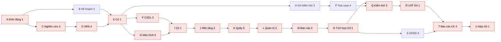
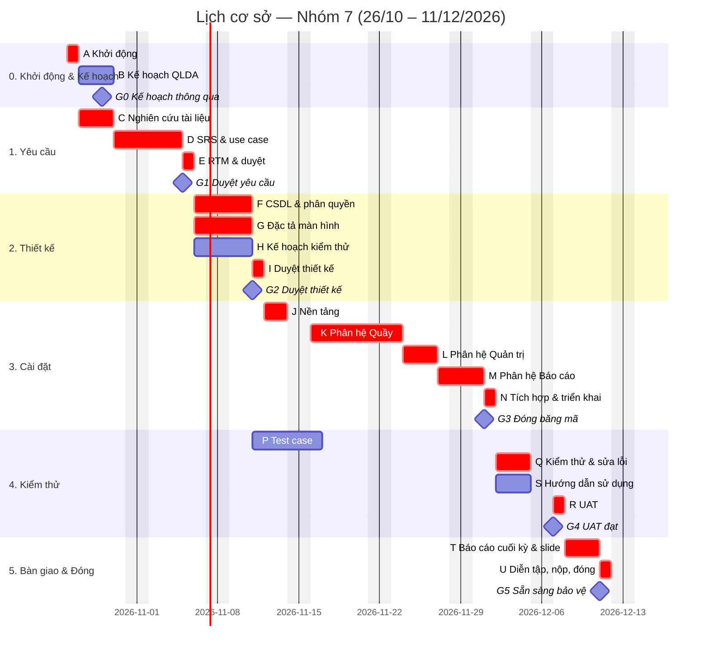

# Kế hoạch quản lý dự án: Hệ thống quản lý quầy nhà hàng bia hơi

> Nhóm 7 — môn Quản trị dự án — ĐH Bách Khoa
> Phiên bản 0.1 (bản nháp, thông qua tại Gate G0) — 2026-10-24
> Người lập: Nguyễn Xuân Tự (Quản lý dự án)
> Tài liệu kèm theo: `srs.md` (đặc tả yêu cầu — SRS)
> Căn cứ: bài giảng Lesson 1–7 (Schwalbe, *Information Technology Project Management*, 9th ed.; PMBOK)

| Phiên bản | Ngày | Người sửa | Nội dung thay đổi |
|---|---|---|---|
| 0.1 | 24/10/2026 | Tự | Bản nháp đầu tiên, trình bày tại buổi kick-off |

---

## Phần I — KHỞI TẠO (Initiating)

### 1. Hiến chương dự án (Project Charter)

| Mục | Nội dung |
|---|---|
| Tên dự án | Hệ thống quản lý quầy nhà hàng bia hơi |
| Mã dự án | QTDA-N7-2026 |
| Ngày bắt đầu – kết thúc | 24/10/2026 (kick-off) – 13/12/2026; lịch công việc 26/10 – 11/12/2026 (7 tuần) |
| Nhà tài trợ / khách hàng | Giảng viên môn Quản trị dự án (giao đề bài, nghiệm thu) |
| Quản lý dự án | Nguyễn Xuân Tự — được giao quyền lập kế hoạch, phân công, phê duyệt thay đổi nhỏ |
| Ngân sách (quy đổi) | 14.510.000 đ (xem mục 12) |

**Mục đích / tình huống kinh doanh.** Nhà hàng bia hơi đông khách quản lý order và tiền bằng giấy, dẫn đến sót món, tính tiền chậm/sai, thất thoát bia hơi và hủy món không kiểm soát. Dự án xây dựng một web app giúp quầy nhập order và tính tiền nhanh, đồng thời cho chủ quán theo dõi doanh thu, hao hụt bia và nhật ký hủy món.

**Mục tiêu (SMART).**
1. Đến 01/12/2026 hoàn thành web app có phân quyền (phân hệ Quầy, Quản trị, Báo cáo), đáp ứng 100% yêu cầu mức **M** trong SRS.
2. Đến 07/12/2026 đạt nghiệm thu UAT: ≥ 95% test case mức M đạt, không còn lỗi nghiêm trọng.
3. Bảo vệ cuối kỳ với bản demo chạy trên đường dẫn công khai và bộ hồ sơ quản lý dự án đầy đủ.
4. Tổng chi phí thực tế (giờ công quy đổi) không vượt cost baseline 13,82 triệu đ quá 10%.

**Yêu cầu mức cao.** Sơ đồ bàn theo khu; gọi món và in phiếu theo khu chế biến; chuyển/gộp bàn; hủy/giảm món có duyệt bằng PIN quản lý ca; in tạm tính; thanh toán tiền mặt + VietQR; theo dõi keg bia và báo cáo hao hụt; quản trị thực đơn, bàn, nhân viên, kho keg; báo cáo cho chủ quán. Mọi chức năng được phân quyền theo 3 vai trò.

**Sản phẩm bàn giao chính.** Web app đã triển khai, mã nguồn trên GitHub, SRS và đặc tả use case, tài liệu thiết kế, kế hoạch & bộ hồ sơ quản lý dự án, kế hoạch & báo cáo kiểm thử, hướng dẫn sử dụng, báo cáo cuối kỳ + slide.

**Tiêu chí thành công.** Giảng viên nghiệm thu sản phẩm và hồ sơ; dự án đóng đúng ngày; mỗi thành viên có đóng góp được ghi nhận rõ ràng.

**Rủi ro chính** (chi tiết mục 15): chỉ một người phụ trách cài đặt, quản lý dự án quá tải, trùng lịch thi, yêu cầu chưa sát thực tế do không khảo sát trực tiếp.

**Ký duyệt**

| Vai trò | Họ tên | Chữ ký | Ngày |
|---|---|---|---|
| Nhà tài trợ | Giảng viên môn học | | |
| Quản lý dự án | Nguyễn Xuân Tự | | |
| Thành viên | Phí Việt Hiếu | | |
| Thành viên | Dương Tất Trung | | |
| Thành viên | Nguyễn Chính Thái | | |

### 2. Lựa chọn dự án & phương pháp

#### 2.1 Phân tích lợi ích (minh họa — số liệu giả định)

Giả định một quán áp dụng hệ thống: chi phí ban đầu C₀ = 14,51 triệu đ (bằng ngân sách dự án); lợi ích ròng nhờ giảm thất thoát bia và sai sót tính tiền ước 8 triệu đ/năm trong 3 năm; lãi suất chiết khấu r = 10%.

| Năm | Lợi ích (triệu đ) | Hệ số chiết khấu 1/(1+r)ᵗ | Lợi ích chiết khấu | Lũy kế |
|---|---|---|---|---|
| 0 | −14,51 | 1,000 | −14,51 | −14,51 |
| 1 | 8,00 | 0,909 | 7,27 | −7,24 |
| 2 | 8,00 | 0,826 | 6,61 | −0,63 |
| 3 | 8,00 | 0,751 | 6,01 | +5,38 |

- **NPV** = Σ Cₜ/(1+r)ᵗ − C₀ = 19,89 − 14,51 = **+5,38 triệu đ** > 0 → đáng đầu tư.
- **ROI** = (19,89 − 14,51) / 14,51 ≈ **37,1%**.
- **Thời gian hoàn vốn** ≈ 2 + 0,63/6,01 ≈ **2,1 năm**.

#### 2.2 Chọn mô hình vòng đời: mô hình chấm điểm có trọng số

| Tiêu chí | Trọng số | Thác nước | Scrum (Agile) | Tăng dần (Incremental) |
|---|---|---|---|---|
| Phù hợp kinh nghiệm của nhóm | 30% | 9 | 3 | 6 |
| Dễ kiểm soát tiến độ, tài liệu, mốc nghiệm thu | 25% | 9 | 6 | 7 |
| Yêu cầu tương đối ổn định (đề bài cố định, 7 tuần) | 20% | 8 | 6 | 7 |
| Phù hợp cách đánh giá của môn học (hồ sơ theo nhóm quy trình) | 15% | 9 | 7 | 7 |
| Khả năng thích ứng thay đổi | 10% | 4 | 9 | 7 |
| **Tổng điểm** | 100% | **8,30** | 5,55 | 6,70 |

**Kết luận:** chọn mô hình **thác nước (predictive)**. Không ai trong nhóm có kinh nghiệm Agile, và thác nước cho các mốc rõ ràng để kiểm soát. Điểm yếu là thích ứng thay đổi kém và lỗi có thể lộ ra muộn. Hai điểm này được giảm thiểu bằng quy trình kiểm soát thay đổi (mục 9), bản mẫu giao diện dùng ngay ở pha Yêu cầu, và việc kiểm thử từng chức năng ngay khi cài đặt xong (mục 13).

### 3. Đăng ký các bên liên quan (Stakeholder Register)

| Họ tên / nhóm | Vị trí | Trong/ngoài | Vai trò dự án | Liên hệ | Ảnh hưởng | Tác động | Chiến lược quản lý |
|---|---|---|---|---|---|---|---|
| Giảng viên môn học | Giảng viên | Ngoài | Nhà tài trợ, khách hàng, người nghiệm thu | Email / lớp học | Cao | Cao | Quản lý chặt: hỏi rõ yêu cầu hồ sơ nộp cuối kỳ ngay tuần 1, báo cáo ở các mốc |
| Nguyễn Xuân Tự | Nhóm trưởng | Trong | Quản lý dự án; phát triển sản phẩm | Zalo nhóm | Cao | Cao | Ra quyết định, chủ trì họp và CCB |
| Phí Việt Hiếu | Thành viên | Trong | Phụ trách yêu cầu & thiết kế (SRS, use case, đặc tả màn hình) | Zalo nhóm | Trung bình | Cao | Giao việc rõ, theo dõi hằng tuần |
| Dương Tất Trung | Thành viên | Trong | Phụ trách đảm bảo chất lượng & kiểm thử | Zalo nhóm | Trung bình | Cao | Giao việc rõ, theo dõi hằng tuần |
| Nguyễn Chính Thái | Thành viên | Trong | Thư ký nhóm; quản lý tài liệu; hướng dẫn sử dụng | Zalo nhóm | Trung bình | Cao | Giao việc rõ, theo dõi hằng tuần |
| Chủ quán bia hơi (người dùng giả định) | Người dùng nghiệp vụ | Ngoài | Đại diện qua tài liệu nghiên cứu | — | Thấp | Trung bình | Đại diện bằng nghiên cứu tài liệu và phần mềm tương tự |
| Nhân viên quầy (người dùng cuối) | Người dùng | Ngoài | Đại diện qua tài liệu nghiên cứu | — | Thấp | Trung bình | Như trên; 2 bạn ngoài nhóm đóng vai khi kiểm thử dễ dùng (NFR-03) |

### 4. Nhật ký giả định & ràng buộc (Assumption Log)

| Mã | Giả định / ràng buộc | Loại | Người nêu | Trạng thái |
|---|---|---|---|---|
| A1 | Tự dành khoảng 8–9 giờ/tuần, mỗi thành viên khác khoảng 6 giờ/tuần cho dự án | Giả định | Tự | Mở — xác nhận tại kick-off |
| A2 | Yêu cầu được thu thập bằng nghiên cứu tài liệu và phần mềm tương tự, không khảo sát trực tiếp tại quán | Ràng buộc | Nhóm | Đã chốt (kick-off 24/10) |
| A3 | Hạn bảo vệ cuối kỳ không sớm hơn 13/12/2026 | Giả định | Tự | Mở — hỏi giảng viên |
| A4 | Hồ sơ nộp cuối kỳ gồm báo cáo (có ảnh chụp giao diện); danh mục tài liệu chi tiết sẽ hỏi lại giảng viên | Giả định | Trung | Mở — hỏi giảng viên |
| A5 | Chỉ dùng công cụ & dịch vụ miễn phí (GitHub, Supabase, Vercel/Netlify, Google Meet, Zalo) | Ràng buộc | Tự | Đã chốt |
| A6 | Phạm vi là một web app có phân quyền; không làm app desktop, app di động, offline, hóa đơn điện tử | Ràng buộc | Nhóm | Đã chốt |

### 5. Điều lệ nhóm (Team Charter)

**Giá trị chung:** đúng hẹn, minh bạch, hỏi sớm khi bị kẹt, tôn trọng ý kiến.

**Quy tắc làm việc**
1. Mọi công việc (cả tài liệu lẫn code) được giao qua GitHub Issues. Mỗi người cập nhật trạng thái ít nhất 2 lần/tuần.
2. Ưu tiên trao đổi bằng văn bản trên nhóm Zalo để mọi người đọc lại và suy nghĩ trước khi phản hồi. Quyết định quan trọng được chép vào nhật ký quyết định.
3. Bị kẹt quá 1 ngày thì báo ngay lên nhóm.
4. Họp tuần 30 phút đúng giờ. Vắng phải báo trước ít nhất 12 giờ và gửi báo cáo bằng văn bản (đã làm / sẽ làm / vướng mắc).
5. Tài liệu viết trong repo (`docs/`), không gửi file rời qua chat. Mọi tài liệu bàn giao được Tự rà soát; mọi thay đổi mã nguồn được Trung kiểm thử trước khi merge.

**Ra quyết định:** thảo luận để đạt đồng thuận. Nếu không đạt (sau 15 phút họp hoặc 24 giờ trên chat), quản lý dự án quyết định và ghi vào nhật ký quyết định.

**Giải quyết xung đột:** (1) hai bên trao đổi trực tiếp → (2) quản lý dự án hòa giải trong buổi họp tuần → (3) nếu ảnh hưởng đến phân công/điểm số, báo giảng viên.

**Ghi nhận đóng góp:** dựa trên issue đã đóng, tài liệu đã viết, PR đã merge/kiểm thử và biên bản họp. Bảng đóng góp cập nhật ở mỗi Gate và đưa vào báo cáo cuối kỳ.

---

## Phần II — LẬP KẾ HOẠCH (Planning)

### 6. Tổng quan kế hoạch quản lý dự án

| Thành phần | Nơi mô tả |
|---|---|
| Mục đích, mục tiêu, phạm vi | Mục 1, 7 |
| Giả định & ràng buộc | Mục 4 |
| Tổ chức, vai trò, trách nhiệm | Mục 8 |
| Quy trình kỹ thuật (vòng đời, phương pháp, công cụ) | Mục 2.2, 6.1, 6.2 |
| Kế hoạch phạm vi, tiến độ, chi phí | Mục 7, 11, 12 |
| Kiểm soát thay đổi, quản lý cấu hình | Mục 9, 10 |
| Chất lượng, truyền thông, rủi ro, mua sắm | Mục 13, 14, 15, 16 |
| Giám sát, báo cáo, đóng dự án | Mục 17, 18 |

#### 6.1 Vòng đời dự án: thác nước, 6 pha, mỗi pha kết thúc bằng một Gate

| Pha | Thời gian | Đầu ra chính | Gate (tiêu chí qua cổng) |
|---|---|---|---|
| 0. Khởi động & Lập kế hoạch | 24/10 – 29/10 | Hiến chương, đăng ký các bên liên quan, điều lệ nhóm, kế hoạch quản lý dự án | G0 (29/10): kế hoạch được cả nhóm thông qua |
| 1. Phân tích yêu cầu | 27/10 – 05/11 | Báo cáo nghiên cứu yêu cầu, SRS, đặc tả use case, RTM, tuyên bố phạm vi | **G1 (05/11)**: SRS được duyệt → *scope baseline* |
| 2. Thiết kế | 06/11 – 11/11 | Thiết kế CSDL & phân quyền, đặc tả màn hình (wireframe), kế hoạch kiểm thử | **G2 (11/11)**: thiết kế được duyệt |
| 3. Cài đặt | 12/11 – 01/12 | Web app 3 phân hệ đã triển khai | **G3 (01/12)**: đóng băng mã, mọi FR mức M đã cài đặt |
| 4. Kiểm thử | 02/12 – 07/12 | Test case, báo cáo kiểm thử, lỗi đã sửa, hướng dẫn sử dụng | **G4 (07/12)**: UAT đạt (≥ 95% TC mức M, 0 lỗi nghiêm trọng) |
| 5. Bàn giao & Đóng dự án | 08/12 – 11/12 | Báo cáo cuối kỳ, slide, bài học kinh nghiệm | **G5 (11/12)**: hồ sơ hoàn tất, sẵn sàng bảo vệ |

Nguyên tắc thác nước: **không bắt đầu pha sau khi pha trước chưa qua Gate.** Riêng các công việc có độ trễ cho phép (ví dụ viết kế hoạch kiểm thử, test case) được chạy song song theo lịch ở mục 11. Muốn sửa sản phẩm của một pha đã qua Gate thì phải đi qua quy trình kiểm soát thay đổi (mục 9).

#### 6.2 Phương pháp, công cụ, hạ tầng

| Hạng mục | Lựa chọn |
|---|---|
| Công nghệ sản phẩm | React + Vite + TypeScript; Supabase (Auth, PostgreSQL, Row Level Security, Realtime); triển khai Vercel/Netlify |
| Quản lý mã nguồn & công việc | GitHub: repo `xuan-tu-ai/bia-hoi-pos`, Issues, Projects (bảng theo pha), Pull Request |
| Giao tiếp | Nhóm Zalo (trao đổi hằng ngày); Google Meet (họp online) |
| Tài liệu | Markdown trong thư mục `docs/` của repo; sơ đồ bằng draw.io / Mermaid |
| Lập lịch | Biểu đồ Gantt (Mermaid trong tài liệu này, có thể chuyển sang Excel/GanttProject) |
| Kiểm thử | Kiểm thử thủ công theo test case trên bản triển khai thử (preview) của từng Pull Request |

### 7. Quản lý phạm vi

#### 7.1 Kế hoạch quản lý phạm vi & yêu cầu

- **Thu thập yêu cầu:** nghiên cứu tài liệu, gồm phân tích các phần mềm quản lý nhà hàng phổ biến (KiotViet, iPOS, Sapo FnB, CukCuk) và tài liệu về vận hành quán bia hơi; bổ sung bản mẫu giao diện để thống nhất cách hiểu. Hiếu phụ trách; Trung và Thái mỗi người phân tích một phần mềm.
- **Ghi nhận yêu cầu:** trong SRS, mỗi yêu cầu có mã `FR-xx`/`NFR-xx`, mức ưu tiên MoSCoW và tiêu chí nghiệm thu.
- **Truy vết:** ma trận truy vết yêu cầu (RTM, mục 8 của SRS) nối yêu cầu với nguồn, gói WBS, người đặc tả, người cài đặt, test case và trạng thái. RTM được cập nhật ở mỗi Gate.
- **Tạo & duyệt WBS:** quản lý dự án lập bản nháp theo hướng từ trên xuống. Cả nhóm rà soát tại kick-off. WBS được duyệt cùng SRS ở G1.
- **Nghiệm thu sản phẩm (Validate Scope):** mỗi sản phẩm bàn giao được kiểm tra theo tiêu chí nghiệm thu và ký vào *Phiếu nghiệm thu* (Phụ lục D) tại Gate tương ứng.
- **Kiểm soát phạm vi:** mọi yêu cầu thêm/bớt chức năng sau G1 phải có *Phiếu yêu cầu thay đổi* (Phụ lục C) và đi qua CCB (mục 9). Khi trễ tiến độ, ưu tiên cắt yêu cầu mức C rồi đến S, không cắt M.

#### 7.2 Tuyên bố phạm vi dự án (Project Scope Statement)

- **Mô tả phạm vi sản phẩm:** một web app có phân quyền theo 3 vai trò (Nhân viên quầy, Quản lý ca, Chủ quán), gồm phân hệ Quầy, Quản trị và Báo cáo. Có 19 yêu cầu chức năng (FR-01..FR-19) và 8 yêu cầu phi chức năng, chi tiết trong SRS.
- **Tiêu chí nghiệm thu của người dùng:** mọi FR mức M đạt tiêu chí nghiệm thu; kịch bản demo trọn vẹn (đăng nhập → mở bàn → gọi món → in phiếu → hủy có duyệt → tạm tính → thanh toán VietQR → xem báo cáo bằng tài khoản chủ quán) chạy không lỗi.
- **Sản phẩm bàn giao:**

| Sản phẩm | Pha | Người chịu trách nhiệm chính |
|---|---|---|
| Hiến chương, đăng ký các bên liên quan, điều lệ nhóm, kế hoạch quản lý dự án | 0 | Tự |
| Báo cáo nghiên cứu yêu cầu | 1 | Hiếu |
| SRS, đặc tả use case, RTM | 1 | Hiếu |
| Thiết kế CSDL & phân quyền | 2 | Tự |
| Đặc tả màn hình (wireframe) | 2 | Hiếu |
| Kế hoạch kiểm thử, bộ test case, báo cáo kiểm thử | 2–4 | Trung |
| Web app đã triển khai + mã nguồn | 3 | Tự |
| Hướng dẫn sử dụng | 4 | Thái |
| Biên bản họp, báo cáo tuần, nhật ký quyết định | Suốt dự án | Thái |
| Sổ rủi ro, nhật ký thay đổi, báo cáo EVM | Suốt dự án | Tự |
| Báo cáo cuối kỳ, slide, bài học kinh nghiệm | 5 | Tự (Thái tổng hợp, biên tập) |

- **Ngoài phạm vi:** ứng dụng desktop riêng, app di động/PWA, chạy offline, máy in nhiệt chuyên dụng, hóa đơn điện tử, tự xác nhận chuyển khoản, nhiều chi nhánh, app phục vụ, khách tự order, màn hình bếp, định lượng nguyên liệu, đặt bàn, combo, tách bill theo người (xem `tam-nhin.md`).
- **Ràng buộc & giả định:** mục 4.

#### 7.3 Cấu trúc phân chia công việc (WBS)

```
1.0 Hệ thống quản lý quầy bia hơi
├── 1.1 Quản lý dự án
│   ├── 1.1.1 Khởi động (kick-off, hiến chương, các bên liên quan, điều lệ nhóm)
│   ├── 1.1.2 Lập kế hoạch quản lý dự án
│   ├── 1.1.3 Họp & báo cáo (họp tuần, họp Gate, biên bản, báo cáo tuần)
│   ├── 1.1.4 Giám sát & kiểm soát thay đổi
│   └── 1.1.5 Đóng dự án (bài học kinh nghiệm, lưu trữ hồ sơ)
├── 1.2 Phân tích yêu cầu
│   ├── 1.2.1 Nghiên cứu tài liệu & phần mềm tương tự
│   ├── 1.2.2 Viết SRS & đặc tả use case
│   └── 1.2.3 Lập RTM & duyệt yêu cầu (G1)
├── 1.3 Thiết kế
│   ├── 1.3.1 Thiết kế CSDL & phân quyền
│   ├── 1.3.2 Đặc tả màn hình (wireframe)
│   └── 1.3.3 Duyệt thiết kế (G2)
├── 1.4 Cài đặt
│   ├── 1.4.1 Nền tảng (dự án, Supabase, đăng nhập & phân quyền, dữ liệu mẫu)
│   ├── 1.4.2 Phân hệ Quầy
│   ├── 1.4.3 Phân hệ Quản trị
│   ├── 1.4.4 Phân hệ Báo cáo
│   └── 1.4.5 Tích hợp, triển khai & đóng băng mã (G3)
├── 1.5 Kiểm thử
│   ├── 1.5.1 Kế hoạch kiểm thử
│   ├── 1.5.2 Viết test case
│   ├── 1.5.3 Kiểm thử hệ thống & sửa lỗi
│   └── 1.5.4 Kiểm thử chấp nhận UAT (G4)
└── 1.6 Bàn giao
    ├── 1.6.1 Hướng dẫn sử dụng
    ├── 1.6.2 Báo cáo cuối kỳ & slide
    └── 1.6.3 Diễn tập demo & nộp (G5)
```

#### 7.4 Từ điển WBS (WBS Dictionary)

Mỗi gói công việc có một mục theo mẫu sau. Dưới đây là các gói chính; các gói còn lại được ghi trong `docs/wbs-dictionary.md` theo cùng mẫu.

| Tên dự án | Hệ thống quản lý quầy bia hơi |
|---|---|
| **Mã WBS** | 1.2.1 |
| **Tên** | Nghiên cứu tài liệu & phần mềm tương tự |
| **Mô tả công việc** | Tìm hiểu tài liệu hướng dẫn, video demo của 4 phần mềm quản lý nhà hàng (KiotViet, iPOS, Sapo FnB, CukCuk) và tài liệu về vận hành quán bia hơi. Lập bảng so sánh chức năng, rút ra danh sách yêu cầu đề xuất kèm nguồn |
| **Người chịu trách nhiệm** | Hiếu (chính; tổng hợp); Trung, Thái mỗi người phân tích 1 phần mềm; Hiếu phân tích 2 phần mềm |
| **Đầu vào / phụ thuộc trước** | 1.1.1 Khởi động |
| **Phụ thuộc sau** | 1.2.2 Viết SRS |
| **Sản phẩm / tiêu chí hoàn thành** | `docs/nghien-cuu-yeu-cau.md`: bảng so sánh ≥ 4 phần mềm, danh sách yêu cầu đề xuất có ghi nguồn; được Tự rà soát |
| **Ước lượng** | 3 ngày làm việc; 14 giờ công |

| Tên dự án | Hệ thống quản lý quầy bia hơi |
|---|---|
| **Mã WBS** | 1.4.2 |
| **Tên** | Phân hệ Quầy |
| **Mô tả công việc** | Cài đặt FR-02..FR-10: sơ đồ bàn realtime, gọi món & in phiếu, chuyển/gộp bàn, hủy/giảm có duyệt PIN, tạm tính, thanh toán VietQR, ca, thay keg; các hàm RPC đảm bảo toàn vẹn dữ liệu |
| **Người chịu trách nhiệm** | Tự; Trung kiểm thử từng Pull Request |
| **Đầu vào / phụ thuộc trước** | 1.3.3 Thiết kế đã duyệt; 1.4.1 Nền tảng |
| **Phụ thuộc sau** | 1.4.3 Phân hệ Quản trị (phụ thuộc nguồn lực: cùng một người cài đặt) |
| **Sản phẩm / tiêu chí hoàn thành** | Mọi tiêu chí nghiệm thu của FR-02..FR-10 đạt khi Trung kiểm thử trên bản preview; PR đã merge vào `develop` |
| **Ước lượng** | 6 ngày làm việc; 12 giờ công |

| Tên dự án | Hệ thống quản lý quầy bia hơi |
|---|---|
| **Mã WBS** | 1.5.2 |
| **Tên** | Viết test case |
| **Mô tả công việc** | Viết test case cho mọi FR và NFR trong SRS theo kế hoạch kiểm thử: mã TC, yêu cầu liên quan, tiền điều kiện, các bước, dữ liệu, kết quả mong đợi |
| **Người chịu trách nhiệm** | Trung; Hiếu rà soát độ phủ so với SRS |
| **Đầu vào / phụ thuộc trước** | 1.5.1 Kế hoạch kiểm thử; SRS đã duyệt |
| **Phụ thuộc sau** | 1.5.3 Kiểm thử hệ thống |
| **Sản phẩm / tiêu chí hoàn thành** | `docs/test-cases.md`: mỗi FR có ≥ 1 TC cho luồng chính và ≥ 1 TC cho luồng lỗi; RTM điền đủ cột Test case |
| **Ước lượng** | 4 ngày làm việc; 10 giờ công |

### 8. Tổ chức dự án & phân công

#### 8.1 Cơ cấu tổ chức

Nhóm tổ chức theo **cơ cấu dự án**: quản lý dự án có toàn quyền phân công. Công việc chia theo mảng chuyên môn, mỗi thành viên sở hữu trọn vẹn một nhóm sản phẩm bàn giao.

| Thành viên | Vai trò | Sản phẩm bàn giao sở hữu |
|---|---|---|
| Nguyễn Xuân Tự | Quản lý dự án; phát triển sản phẩm; chủ tịch CCB | Kế hoạch QLDA, sổ rủi ro, báo cáo EVM, thiết kế CSDL, web app, báo cáo cuối kỳ |
| Phí Việt Hiếu | Phụ trách yêu cầu & thiết kế | Báo cáo nghiên cứu yêu cầu, SRS, đặc tả use case, RTM, đặc tả màn hình |
| Dương Tất Trung | Phụ trách đảm bảo chất lượng & kiểm thử | Kế hoạch kiểm thử, test case, báo cáo kiểm thử; kiểm thử & duyệt mọi Pull Request |
| Nguyễn Chính Thái | Thư ký nhóm; quản lý tài liệu | Biên bản họp, báo cáo tuần, nhật ký quyết định, hướng dẫn sử dụng; tổng hợp, biên tập báo cáo cuối kỳ |

#### 8.2 Ma trận trách nhiệm RACI

R = thực hiện · A = chịu trách nhiệm cuối cùng (mỗi dòng đúng một A) · C = được tham vấn · I = được thông báo

| Mã WBS | Công việc | Tự | Hiếu | Trung | Thái |
|---|---|---|---|---|---|
| 1.1.1 | Khởi động | A/R | C | C | C |
| 1.1.2 | Kế hoạch quản lý dự án | A/R | C | C | C |
| 1.1.3 | Họp & báo cáo | A | R | R | R (biên bản, báo cáo tuần) |
| 1.1.4 | Giám sát & kiểm soát thay đổi | A/R | I | C | I |
| 1.1.5 | Đóng dự án | A/R | R | R | R |
| 1.2.1 | Nghiên cứu tài liệu & phần mềm tương tự | C | A/R | R | R |
| 1.2.2 | SRS & đặc tả use case | C | A/R | C | I |
| 1.2.3 | RTM & duyệt yêu cầu | A | R | R | I |
| 1.3.1 | Thiết kế CSDL & phân quyền | A/R | C | I | I |
| 1.3.2 | Đặc tả màn hình | C | A/R | I | C |
| 1.3.3 | Duyệt thiết kế | A | R | R | R |
| 1.4.1–1.4.4 | Nền tảng & 3 phân hệ | A/R | C | C | I |
| 1.4.5 | Tích hợp, triển khai | A/R | I | C | I |
| 1.5.1 | Kế hoạch kiểm thử | C | C | A/R | I |
| 1.5.2 | Test case | I | C | A/R | I |
| 1.5.3 | Kiểm thử hệ thống & sửa lỗi | R (sửa lỗi) | R | A/R | R |
| 1.5.4 | UAT | A | R | R | R |
| 1.6.1 | Hướng dẫn sử dụng | C | C | I | A/R |
| 1.6.2 | Báo cáo cuối kỳ & slide | A/R | R | R | R (biên tập) |
| 1.6.3 | Diễn tập demo & nộp | A/R | R | R | R |

#### 8.3 Kế hoạch nhân lực

- **Thời gian cam kết:** Tự khoảng 8–9 giờ/tuần; Hiếu, Trung, Thái khoảng 6 giờ/tuần (tổng 186 giờ công, mục 12).
- **Tải theo pha:** Hiếu tập trung ở tuần 1–3 (yêu cầu, thiết kế); Trung ở tuần 2–7 (kế hoạch kiểm thử, test case, kiểm thử); Thái đều suốt dự án (thư ký) và cao điểm tuần 6–7 (hướng dẫn sử dụng, báo cáo cuối kỳ); Tự cao điểm tuần 3–5 (cài đặt).
- **Đào tạo:** tuần 1, Tự hướng dẫn 45 phút về GitHub (Issues, viết Markdown, xem và duyệt Pull Request) và cách viết tài liệu theo mẫu.
- **Lịch bận:** mỗi người khai báo các tuần thi/bài tập lớn môn khác trong tuần 1. Quản lý dự án điều chỉnh phân công dựa trên độ trễ cho phép ở mục 11.4.

### 9. Kiểm soát thay đổi tích hợp

- **Ban kiểm soát thay đổi (CCB):** Tự (chủ tịch) + Trung (QA) + người phụ trách sản phẩm bị ảnh hưởng. Thay đổi làm đổi mục tiêu hoặc phạm vi đã thống nhất với giảng viên thì phải xin ý kiến giảng viên.
- **Quy trình:**
  1. Người đề xuất tạo issue theo mẫu **Yêu cầu thay đổi** (Phụ lục C).
  2. Quản lý dự án phân tích tác động đến phạm vi, tiến độ, chi phí, chất lượng và rủi ro trong ≤ 2 ngày.
  3. CCB quyết định Duyệt / Từ chối / Hoãn, tại họp tuần hoặc qua chat nếu khẩn.
  4. Nếu duyệt: cập nhật SRS, RTM, WBS, lịch và baseline liên quan, tăng số phiên bản tài liệu.
  5. Thông báo cho cả nhóm và ghi vào *Nhật ký thay đổi*.
- **Thay đổi nhỏ** (≤ 2 giờ công, không đổi yêu cầu mức M, không lùi mốc Gate): quản lý dự án duyệt nhanh qua chat, vẫn ghi vào nhật ký.
- **Baseline:** schedule baseline và cost baseline chốt ở G0; scope baseline (SRS + WBS + từ điển WBS) chốt ở G1. Baseline chỉ được sửa qua thay đổi đã duyệt.

### 10. Quản lý cấu hình

- **Mục cấu hình:** mã nguồn (`web/`), migration CSDL (`supabase/migrations/`), tài liệu (`docs/`).
- **Nhánh Git:** `main` (bản ổn định, chỉ merge tại Gate) ← `develop` (tích hợp, nhánh mặc định) ← nhánh công việc `feature/FR-xx-...` cho code, `docs/...` cho tài liệu. Không push trực tiếp vào `main`/`develop`; mỗi Pull Request cần 1 người duyệt.
- **Phiên bản:** gắn tag ở mỗi Gate: `v0.1-G1`, `v0.2-G2`, `v0.9-G3`, `v1.0-G4`, `v1.0.1-final`.
- **Tài liệu:** có bảng lịch sử phiên bản ở đầu file. Thái quản lý danh mục tài liệu và đảm bảo bản trên `main` là bản đã duyệt.
- **Kiểm tra cấu hình:** tại mỗi Gate, Trung đối chiếu bản triển khai với RTM để đảm bảo những gì bàn giao khớp yêu cầu đã duyệt.

### 11. Quản lý tiến độ

#### 11.1 Kế hoạch quản lý tiến độ

- **Mô hình lịch:** danh sách hoạt động + sơ đồ mạng PDM + Gantt; đơn vị là **ngày làm việc** (thứ 2–6, 35 ngày từ 26/10 đến 11/12/2026). Thứ 7 và Chủ nhật là thời gian đệm; 12–13/12 là dự phòng cuối.
- **Phương pháp:** phương pháp đường găng (CPM); ước lượng ba điểm PERT cho các hoạt động có độ bất định cao. Lịch có tính đến **ràng buộc nguồn lực**: các gói cài đặt 1.4.2 → 1.4.3 → 1.4.4 nối tiếp nhau vì cùng một người thực hiện.
- **Ngưỡng kiểm soát:** hoạt động găng trễ ≥ 1 ngày, hoặc hoạt động không găng trễ vượt độ trễ cho phép → báo ngay và đề xuất phương án (làm song song / cắt yêu cầu C, S qua CCB).
- **Đo lường:** % hoàn thành theo quy tắc 0/50/100 (chưa bắt đầu / đang làm / xong), cập nhật trên GitHub Projects, tổng hợp ở báo cáo tuần.

#### 11.2 Danh sách hoạt động & ước lượng thời gian

Ước lượng PERT: tₑ = (MO + 4·ML + MP) / 6 (MO lạc quan, ML khả dĩ nhất, MP bi quan). Giá trị tₑ được làm tròn để lập lịch.

| Mã | Hoạt động (WBS) | Phụ thuộc trước | MO | ML | MP | tₑ | Dùng (ngày) | Người phụ trách |
|---|---|---|---|---|---|---|---|---|
| A | Khởi động (1.1.1) | — | | | | | 1 | Tự |
| B | Lập kế hoạch quản lý dự án (1.1.2) | A | | | | | 3 | Tự |
| C | Nghiên cứu tài liệu & phần mềm tương tự (1.2.1) | A | | | | | 3 | Hiếu, Trung, Thái |
| D | Viết SRS & đặc tả use case (1.2.2) | C | 3 | 4 | 6 | 4,17 | 4 | Hiếu |
| E | RTM & duyệt yêu cầu — **G1** (1.2.3) | B, D | | | | | 1 | Hiếu, Trung |
| F | Thiết kế CSDL & phân quyền (1.3.1) | E | 2 | 3 | 5 | 3,17 | 3 | Tự |
| G | Đặc tả màn hình (1.3.2) | E | | | | | 3 | Hiếu |
| H | Kế hoạch kiểm thử (1.5.1) | E | | | | | 3 | Trung |
| I | Duyệt thiết kế — **G2** (1.3.3) | F, G | | | | | 1 | Cả nhóm |
| J | Nền tảng (1.4.1) | I | | | | | 2 | Tự |
| K | Phân hệ Quầy (1.4.2) | J | 5 | 6 | 9 | 6,33 | 6 | Tự |
| L | Phân hệ Quản trị (1.4.3) | K (nguồn lực) | 2 | 3 | 5 | 3,17 | 3 | Tự |
| M | Phân hệ Báo cáo (1.4.4) | L (nguồn lực) | | | | | 2 | Tự |
| N | Tích hợp, triển khai — **G3** (1.4.5) | M | | | | | 1 | Tự |
| P | Viết test case (1.5.2) | H | | | | | 4 | Trung |
| Q | Kiểm thử hệ thống & sửa lỗi (1.5.3) | N, P | 2 | 3 | 5 | 3,17 | 3 | Trung + cả nhóm |
| S | Hướng dẫn sử dụng (1.6.1) | N | | | | | 3 | Thái |
| R | UAT — **G4** (1.5.4) | Q | | | | | 1 | Cả nhóm |
| T | Báo cáo cuối kỳ & slide (1.6.2) | R, S | | | | | 3 | Tự, Thái + cả nhóm |
| U | Diễn tập, nộp & đóng dự án — **G5** (1.6.3, 1.1.5) | T | | | | | 1 | Cả nhóm |

Hoạt động *Họp & báo cáo* (1.1.3) và *Giám sát & kiểm soát* (1.1.4) diễn ra liên tục suốt dự án, không nằm trên sơ đồ mạng. Buổi kick-off (24/10) diễn ra trước ngày làm việc đầu tiên và được tính vào A.

**Danh sách mốc (milestone) — SMART**

| Mốc | Ngày | Tiêu chí đo được | Người ký |
|---|---|---|---|
| G0 — Kế hoạch được thông qua | 29/10/2026 | 4 thành viên ký hiến chương & điều lệ nhóm | Cả nhóm |
| G1 — Yêu cầu được duyệt | 05/11/2026 | SRS v1.0, đặc tả use case, RTM; mọi FR có tiêu chí nghiệm thu | Tự |
| G2 — Thiết kế được duyệt | 11/11/2026 | Thiết kế CSDL & phân quyền, đặc tả đủ màn hình trong SRS mục 6.3, kế hoạch kiểm thử | Tự, Trung |
| G3 — Đóng băng mã | 01/12/2026 | Mọi FR mức M ở trạng thái "Đã cài đặt" trong RTM; bản triển khai chạy trên đường dẫn công khai; tag `v0.9-G3` | Tự, Trung |
| G4 — UAT đạt | 07/12/2026 | ≥ 95% TC mức M đạt, 0 lỗi nghiêm trọng | Trung, Tự |
| G5 — Sẵn sàng bảo vệ | 11/12/2026 | Báo cáo, slide, đường dẫn demo, video demo dự phòng đã nộp | Tự |

#### 11.3 Sơ đồ mạng (PDM, quan hệ Kết thúc–Bắt đầu)



#### 11.4 Phân tích đường găng (CPM)

Lượt thuận tính ES/EF (bắt đầu/kết thúc sớm nhất), lượt ngược tính LS/LF (muộn nhất). Đơn vị: ngày làm việc tính từ 0 (ngày 0 = 26/10/2026).

| Hoạt động | Thời gian | ES | EF | LS | LF | Dự trữ toàn phần | Găng? |
|---|---|---|---|---|---|---|---|
| A | 1 | 0 | 1 | 0 | 1 | 0 | ✔ |
| B | 3 | 1 | 4 | 5 | 8 | 4 | |
| C | 3 | 1 | 4 | 1 | 4 | 0 | ✔ |
| D | 4 | 4 | 8 | 4 | 8 | 0 | ✔ |
| E | 1 | 8 | 9 | 8 | 9 | 0 | ✔ |
| F | 3 | 9 | 12 | 9 | 12 | 0 | ✔ |
| G | 3 | 9 | 12 | 9 | 12 | 0 | ✔ |
| H | 3 | 9 | 12 | 20 | 23 | 11 | |
| I | 1 | 12 | 13 | 12 | 13 | 0 | ✔ |
| J | 2 | 13 | 15 | 13 | 15 | 0 | ✔ |
| K | 6 | 15 | 21 | 15 | 21 | 0 | ✔ |
| L | 3 | 21 | 24 | 21 | 24 | 0 | ✔ |
| M | 2 | 24 | 26 | 24 | 26 | 0 | ✔ |
| N | 1 | 26 | 27 | 26 | 27 | 0 | ✔ |
| P | 4 | 12 | 16 | 23 | 27 | 11 | |
| Q | 3 | 27 | 30 | 27 | 30 | 0 | ✔ |
| S | 3 | 27 | 30 | 28 | 31 | 1 | |
| R | 1 | 30 | 31 | 30 | 31 | 0 | ✔ |
| T | 3 | 31 | 34 | 31 | 34 | 0 | ✔ |
| U | 1 | 34 | 35 | 34 | 35 | 0 | ✔ |

**Đường găng** (35 ngày), có hai nhánh song song cùng độ dài:
- A → C → D → E → **F** → I → J → K → L → M → N → Q → R → T → U
- A → C → D → E → **G** → I → J → K → L → M → N → Q → R → T → U

Nhận xét:
- **Pha Cài đặt (J → N, 14 ngày)** chiếm 40% đường găng và chỉ do một người thực hiện. Đây là điểm rủi ro lớn nhất về tiến độ (rủi ro R01). Không thể *bổ sung người (crashing)* hiệu quả cho pha này, nên phương án nén lịch là cắt yêu cầu mức S/C qua CCB (FR-09, FR-15, FR-19).
- **Hiếu nằm trên đường găng ở tuần 1–3** (C, D, G). Nếu Hiếu bận, Tự hỗ trợ viết SRS; Trung và Thái hỗ trợ đặc tả use case.
- Kế hoạch kiểm thử và test case (H, P) có 11 ngày dự trữ. Đây là chỗ đệm cho Trung nếu có tuần thi.
- Hướng dẫn sử dụng (S) chỉ có 1 ngày dự trữ. Thái có thể bắt đầu sớm dựa trên đặc tả màn hình (G) — một hình thức *làm song song (fast-tracking)*.

#### 11.5 Biểu đồ Gantt (lịch cơ sở — schedule baseline)



| Tuần | Ngày | Trọng tâm |
|---|---|---|
| 0 | 24/10 | Kick-off |
| 1 | 26/10 – 01/11 | Hiến chương, kế hoạch (**G0** 29/10); nghiên cứu tài liệu; bắt đầu SRS |
| 2 | 02/11 – 08/11 | SRS, use case, RTM (**G1** 05/11); bắt đầu thiết kế |
| 3 | 09/11 – 15/11 | Thiết kế, kế hoạch kiểm thử (**G2** 11/11); nền tảng |
| 4 | 16/11 – 22/11 | Cài đặt phân hệ Quầy; test case |
| 5 | 23/11 – 29/11 | Hoàn thiện Quầy; phân hệ Quản trị, Báo cáo |
| 6 | 30/11 – 06/12 | Tích hợp (**G3** 01/12); kiểm thử, sửa lỗi; hướng dẫn sử dụng |
| 7 | 07/12 – 13/12 | UAT (**G4** 07/12); báo cáo cuối kỳ & slide; **G5** 11/12; dự phòng 12–13/12 |

### 12. Quản lý chi phí

#### 12.1 Kế hoạch quản lý chi phí

- **Đơn vị:** đồng Việt Nam, làm tròn đến 10.000 đ. Công lao động quy đổi theo giờ công.
- **Đơn giá giả định:** quản lý dự án kiêm phát triển 80.000 đ/giờ; thành viên 60.000 đ/giờ (tham chiếu mức thực tập sinh phần mềm).
- **Phương pháp ước lượng:** từ dưới lên (bottom-up) theo gói WBS, kết hợp PERT ở mục 11.2. Đây là ước lượng mức ngân sách, độ chính xác mục tiêu −10% đến +25%.
- **Ghi nhận chi phí thực tế:** mỗi thành viên ghi số giờ làm vào issue GitHub tương ứng (dòng "Giờ thực tế"); Tự tổng hợp hằng tuần.
- **Ngưỡng kiểm soát:** CPI hoặc SPI < 0,9 → cảnh báo vàng, đề xuất hành động ở họp tuần; < 0,8 → cảnh báo đỏ, đưa ra CCB.

#### 12.2 Ước lượng chi phí theo WBS

| Mã WBS | Gói công việc | Tự (giờ) | Hiếu | Trung | Thái | Tổng giờ | Chi phí lao động (đ) | Chi phí khác (đ) | Tổng (đ) |
|---|---|---|---|---|---|---|---|---|---|
| 1.1 | Quản lý dự án (gồm họp) | 18 | 9 | 9 | 16 | 52 | 3.480.000 | — | 3.480.000 |
| 1.2 | Phân tích yêu cầu | 4 | 16 | 3 | 3 | 26 | 1.640.000 | — | 1.640.000 |
| 1.3 | Thiết kế | 6 | 10 | 2 | 2 | 20 | 1.320.000 | — | 1.320.000 |
| 1.4 | Cài đặt | 26 | 0 | 0 | 0 | 26 | 2.080.000 | — | 2.080.000 |
| 1.5 | Kiểm thử | 3 | 3 | 24 | 3 | 33 | 2.040.000 | — | 2.040.000 |
| 1.6 | Bàn giao | 3 | 4 | 4 | 18 | 29 | 1.800.000 | 200.000 (in ấn báo cáo) | 2.000.000 |
| | **Cộng** | **60** | **42** | **42** | **42** | **186** | **12.360.000** | **200.000** | **12.560.000** |

Chi phí phần mềm & hạ tầng = 0 đ (GitHub, Supabase, Vercel/Netlify, Google Meet, Zalo đều dùng gói miễn phí). Chi phí gián tiếp (điện, Internet, máy tính cá nhân) không tính.

#### 12.3 Ngân sách & cost baseline

| Thành phần | Số tiền (đ) |
|---|---|
| Tổng ước lượng các gói công việc (BAC) | 12.560.000 |
| Dự phòng rủi ro (contingency reserve, 10%) — cho rủi ro đã nhận diện ở mục 15 | 1.260.000 |
| **Cost baseline** | **13.820.000** |
| Dự phòng quản lý (management reserve, 5%) — cho rủi ro chưa biết, ngoài baseline | 690.000 |
| **Tổng ngân sách dự án** | **14.510.000** |

**Giá trị kế hoạch lũy kế (PV) theo tuần** — dùng để vẽ đường cong chữ S và tính EVM:

| Tuần | 1 | 2 | 3 | 4 | 5 | 6 | 7 |
|---|---|---|---|---|---|---|---|
| PV lũy kế (triệu đ) | 1,80 | 3,40 | 5,50 | 7,30 | 8,60 | 11,10 | 12,56 |

#### 12.4 Kiểm soát chi phí: quản lý giá trị thu được (EVM)

Mỗi tối Chủ nhật, Tự tính các chỉ số sau và đưa vào báo cáo tuần:

| Chỉ số | Công thức | Ý nghĩa |
|---|---|---|
| EV | Σ PV của phần việc đã hoàn thành (quy tắc 0/50/100) | Giá trị thu được |
| CV / SV | EV − AC / EV − PV | Chênh lệch chi phí / tiến độ |
| CPI / SPI | EV / AC / EV / PV | < 1: vượt chi / chậm tiến độ |
| EAC | BAC / CPI | Dự báo tổng chi phí khi hoàn thành |
| ETC | EAC − AC | Chi phí còn lại cần thêm |
| TCPI | (BAC − EV) / (BAC − AC) | Hiệu suất cần đạt cho phần còn lại |

*Ví dụ minh họa (cuối tuần 4):* PV = 7,30; EV = 6,60; AC = 7,00 (triệu đ).
→ CV = −0,40; SV = −0,70; CPI ≈ 0,94; SPI ≈ 0,90; EAC = 12,56/0,94 ≈ 13,32 (vẫn trong cost baseline 13,82); TCPI = (12,56 − 6,60)/(12,56 − 7,00) ≈ 1,07.
→ SPI chạm ngưỡng vàng: họp tuần xem xét cắt FR-19 (mức S) để giữ mốc G3.

### 13. Quản lý chất lượng

| Hạng mục | Quy định |
|---|---|
| Tiêu chuẩn chất lượng sản phẩm | Đạt tiêu chí nghiệm thu trong SRS; NFR-01..08 |
| Định nghĩa "Hoàn thành" — chức năng | PR có mã FR, mô tả cách kiểm tra; Trung kiểm thử trên bản preview theo tiêu chí nghiệm thu và duyệt PR; đã merge vào `develop`; RTM được cập nhật |
| Định nghĩa "Hoàn thành" — tài liệu | Viết đúng mẫu; được Tự rà soát (và người liên quan nếu có); đã merge vào `develop` qua PR |
| Duyệt mã | Mọi PR của phần mềm được Trung kiểm thử chức năng trước khi merge; PR nhỏ, mỗi PR một nhóm chức năng |
| Kiểm thử | Kiểm thử chức năng theo từng PR → kiểm thử hệ thống sau G3 → kiểm thử chấp nhận (UAT, G4) với kịch bản demo trọn vẹn |
| Mức độ lỗi | Nghiêm trọng (sai tiền, mất dữ liệu, lộ quyền, sập), Cao (chức năng M không dùng được), Trung bình, Thấp |
| Chỉ số chất lượng | Số lỗi / use case; tỉ lệ TC đạt; số PR bị trả lại; thời gian trung bình sửa lỗi nghiêm trọng (mục tiêu ≤ 1 ngày) |
| Cải tiến | Mỗi Gate có mục "Điều gì làm tốt / cần cải thiện" trong biên bản, ghi vào sổ bài học kinh nghiệm |

### 14. Quản lý truyền thông

#### 14.1 Ma trận truyền thông

| Thông tin | Người gửi | Người nhận | Kênh | Tần suất | Lưu trữ |
|---|---|---|---|---|---|
| Họp tiến độ tuần (30 phút) | Tự chủ trì | Cả nhóm | Google Meet | Tối Chủ nhật 20:30–21:00 hằng tuần | Biên bản `docs/meetings/` |
| Họp duyệt Gate (≤ 60 phút) | Tự | Cả nhóm (+ giảng viên nếu cần) | Google Meet / trực tiếp sau giờ học | Cuối mỗi pha (6 lần) | Biên bản + Phiếu nghiệm thu |
| Báo cáo tiến độ tuần (EVM, rủi ro, việc tuần tới) | Tự (Thái trình bày) | Cả nhóm; giảng viên khi được yêu cầu | `docs/reports/` + link vào Zalo | Chủ nhật hằng tuần | `docs/reports/` |
| Trao đổi, góp ý, báo vướng mắc | Mọi người | Cả nhóm | Nhóm Zalo | Hằng ngày khi cần | Quyết định quan trọng chép vào nhật ký quyết định |
| Giao việc, trạng thái công việc | Tự / người phụ trách | Cả nhóm | GitHub Issues + Projects | Liên tục | GitHub |
| Duyệt tài liệu & mã | Người viết → người duyệt | Người duyệt | GitHub Pull Request | Mỗi PR | GitHub |
| Yêu cầu thay đổi | Bất kỳ ai | CCB | GitHub issue mẫu "Yêu cầu thay đổi" | Khi phát sinh | Nhật ký thay đổi |
| Báo cáo cuối kỳ & demo | Cả nhóm | Giảng viên | Nộp theo quy định lớp | Cuối kỳ | Repo + bản nộp |

#### 14.2 Quy định họp

- **Nguyên tắc:** họp ngắn, việc gì trao đổi được bằng văn bản thì làm trên Zalo/GitHub trước. Buổi họp dùng để chốt quyết định và xử lý vướng mắc.
- **Chuẩn bị:** Tự gửi chương trình họp lên Zalo trước 24 giờ. Mỗi người cập nhật trạng thái issue và gửi báo cáo ngắn (đã làm / sẽ làm / vướng mắc) lên Zalo trước giờ họp.
- **Chương trình họp tuần (30 phút):**
  1. Xem lại các việc cần làm từ biên bản trước (5 phút).
  2. Tiến độ so với lịch cơ sở và EVM (5 phút).
  3. Vướng mắc, rủi ro mới, yêu cầu thay đổi (15 phút).
  4. Chốt quyết định & phân công (5 phút).
- **Biên bản:** Thái ghi theo mẫu Phụ lục A, đăng lên repo trong 24 giờ. Mỗi việc cần làm có người phụ trách và hạn chót. Thành viên xác nhận bằng cách thả 👍 vào link trên Zalo.
- **Họp duyệt Gate:** trình bày sản phẩm của pha, đối chiếu tiêu chí Gate, ký Phiếu nghiệm thu, cập nhật sổ bài học kinh nghiệm. Kết quả là *Qua* / *Qua có điều kiện* (kèm việc phải xong trước ngày X) / *Không qua*.

### 15. Quản lý rủi ro

**Phương pháp:** xác suất (P) và tác động (I) chấm thang 1–5; điểm = P × I. Mức Cao ≥ 12, Trung bình 6–11, Thấp ≤ 5. Sổ rủi ro được rà soát ở mọi buổi họp tuần.

| Mã | Rủi ro | P | I | Điểm | Chiến lược | Biện pháp ứng phó | Dấu hiệu cảnh báo | Người theo dõi |
|---|---|---|---|---|---|---|---|---|
| R01 | Chỉ một người phụ trách cài đặt; người này bận hoặc ốm làm cả pha Cài đặt đứng lại | 3 | 5 | 15 | Giảm thiểu | Dùng Supabase để giảm khối lượng backend; ưu tiên yêu cầu M; mã nguồn luôn trên GitHub, có README hướng dẫn chạy; cắt S/C qua CCB khi cần | Phân hệ Quầy chưa xong 50% vào 19/11 | Tự |
| R02 | Quản lý dự án quá tải (vừa quản lý vừa cài đặt) | 4 | 4 | 16 | Giảm thiểu | Giao thư ký, QA, yêu cầu cho thành viên; báo cáo tuần do Thái soạn nháp; khung giờ cố định cho từng việc | Biên bản/báo cáo tuần trễ > 2 ngày | Tự |
| R03 | Trùng lịch thi giữa kỳ / bài tập lớn môn khác | 3 | 4 | 12 | Chấp nhận chủ động | Khai báo lịch bận tuần 1; dùng dự trữ của H, P; thứ 7–CN làm đệm | Thành viên báo bận | Tự |
| R04 | Thành viên không tham gia đầy đủ (vắng họp, không phản hồi) | 3 | 4 | 12 | Giảm thiểu | Ưu tiên trao đổi bất đồng bộ; báo cáo bằng văn bản khi vắng; phân công lại sau 3 ngày không phản hồi; ghi nhận đóng góp minh bạch | Không cập nhật issue trong 3 ngày | Tự |
| R05 | Yêu cầu chưa sát thực tế do không khảo sát trực tiếp tại quán | 3 | 3 | 9 | Giảm thiểu | Phân tích ≥ 4 phần mềm tương tự; tham khảo nhiều nguồn tài liệu; dùng bản mẫu giao diện để rà soát | Phát hiện thiếu chức năng cơ bản ở G2 | Hiếu |
| R06 | Thành viên chưa quen viết tài liệu kỹ thuật (SRS, test case) | 3 | 3 | 9 | Giảm thiểu | Mẫu tài liệu có sẵn; ví dụ mẫu cho từng loại; Tự rà soát sớm bản nháp đầu tiên | Bản nháp đầu bị trả lại > 1 lần | Tự |
| R07 | Mở rộng phạm vi (scope creep) | 3 | 3 | 9 | Phòng tránh | Quy trình CCB; MoSCoW; ý tưởng mới đưa vào tài liệu tầm nhìn | Yêu cầu không có mã FR | Tự |
| R08 | Ước lượng sai do thiếu kinh nghiệm | 3 | 3 | 9 | Giảm thiểu | PERT; dự phòng 10%; EVM hằng tuần; ước lượng lại ở G2 | SPI < 0,9 | Tự |
| R09 | Hồ sơ nộp cuối kỳ không đúng yêu cầu của giảng viên | 2 | 4 | 8 | Phòng tránh | Hỏi rõ giảng viên danh mục tài liệu cần nộp ngay tuần 1 (giả định A4) | Chưa có câu trả lời trước G1 | Trung |
| R10 | Demo lỗi vào ngày bảo vệ (mạng, dịch vụ miễn phí bị tạm dừng) | 2 | 4 | 8 | Giảm thiểu | Kiểm tra bản triển khai 1 ngày trước; diễn tập (U); quay video demo dự phòng | Lỗi trong buổi diễn tập | Tự |
| R11 | Mất tài liệu hoặc mã nguồn | 1 | 5 | 5 | Phòng tránh | Mọi thứ trên GitHub; bảo vệ nhánh | — | Thái |

### 16. Quản lý mua sắm

| Hạng mục | Hình thức | Thời điểm | Chi phí | Người phụ trách |
|---|---|---|---|---|
| Supabase (CSDL, đăng nhập) | Gói miễn phí | Tuần 3 | 0 đ | Tự |
| Vercel/Netlify (triển khai web) | Gói miễn phí | Tuần 3 | 0 đ | Tự |
| In ấn báo cáo | Mua dịch vụ | Tuần 7 | ≤ 200.000 đ | Thái |

Không có hợp đồng với bên thứ ba. Điều khoản của gói miễn phí (giới hạn dung lượng, tạm dừng khi không dùng) được ghi nhận trong rủi ro R10.

---

## Phần III — THỰC HIỆN, GIÁM SÁT & KIỂM SOÁT

### 17. Giám sát và báo cáo

- **Hằng ngày:** cập nhật GitHub Projects; trao đổi, báo vướng mắc qua Zalo.
- **Hằng tuần (Chủ nhật):** báo cáo tiến độ theo mẫu Phụ lục B, gồm % hoàn thành theo WBS, EVM, rủi ro, thay đổi, việc tuần tới. Họp tuần dựa trên báo cáo này.
- **Mỗi Gate:** cập nhật RTM, tag phiên bản, phiếu nghiệm thu, bảng đóng góp, bài học kinh nghiệm.
- **Quản lý tri thức:**
  - *Tri thức hiện:* tài liệu trong `docs/`, README hướng dẫn cài đặt và quy ước làm việc.
  - *Tri thức ẩn:* chia sẻ qua buổi hướng dẫn tuần 1, nhận xét trong Pull Request, và *sổ bài học kinh nghiệm* cập nhật ở mỗi Gate.

---

## Phần IV — ĐÓNG DỰ ÁN

### 18. Kế hoạch đóng dự án

| Việc | Hạn | Người phụ trách |
|---|---|---|
| Nghiệm thu UAT, ký phiếu nghiệm thu cuối | 07/12 | Trung, Tự |
| Gắn tag `v1.0.1-final`, lưu trữ repo & tài liệu | 11/12 | Thái |
| Báo cáo cuối kỳ (gồm so sánh kế hoạch vs. thực tế về phạm vi, tiến độ, chi phí) | 10/12 | Tự, Thái |
| Họp tổng kết bài học kinh nghiệm | 11/12 | Cả nhóm |
| Bảng đóng góp cuối cùng | 11/12 | Tự |
| Bảo vệ cuối kỳ | Theo lịch lớp | Cả nhóm |

---

## Phụ lục

### Phụ lục A — Mẫu biên bản họp

```
BIÊN BẢN HỌP — Nhóm 7 — Số: BB-<tuần>-<số thứ tự>
Loại họp: Họp tuần / Họp duyệt Gate G_ / Họp đột xuất
Thời gian: __/__/2026, __:__ – __:__     Hình thức: Trực tiếp / Google Meet
Chủ trì: Nguyễn Xuân Tự                  Thư ký: Nguyễn Chính Thái
Có mặt: ...                               Vắng (lý do, đã gửi báo cáo?): ...

1. Rà soát việc cần làm từ biên bản trước
| # | Việc | Người phụ trách | Hạn | Trạng thái |

2. Tiến độ & chi phí (PV, EV, AC, SPI, CPI)

3. Vướng mắc, rủi ro & yêu cầu thay đổi phát sinh

4. Quyết định
| # | Quyết định | Lý do | Người quyết định |

5. Việc cần làm mới
| # | Việc | Người phụ trách | Hạn | Issue GitHub |

Buổi họp tiếp theo: __/__/2026 __:__
```

### Phụ lục B — Mẫu báo cáo tiến độ tuần

```
BÁO CÁO TIẾN ĐỘ TUẦN <n> (__/__ – __/__/2026)
1. Tóm tắt: Xanh / Vàng / Đỏ — một câu nhận định
2. Việc đã hoàn thành trong tuần (mã WBS, issue)
3. Việc chưa hoàn thành & lý do
4. Chỉ số: PV __ | EV __ | AC __ | SV __ | CV __ | SPI __ | CPI __ | EAC __
5. Rủi ro: mới / thay đổi điểm / đã đóng
6. Yêu cầu thay đổi: số lượng mới / đã duyệt / từ chối
7. Kế hoạch tuần tới
8. Cần hỗ trợ / quyết định
```

### Phụ lục C — Phiếu yêu cầu thay đổi

```
PHIẾU YÊU CẦU THAY ĐỔI — CR-<số>
Người đề xuất: ________     Ngày: __/__/2026
Loại: Phạm vi / Tiến độ / Chi phí / Chất lượng / Tài liệu
Mô tả thay đổi:
Lý do:
Yêu cầu / gói WBS bị ảnh hưởng (mã FR, mã WBS):
Phân tích tác động (do QLDA điền):
  - Phạm vi:        - Tiến độ (ngày):     - Chi phí (giờ công / đ):
  - Chất lượng:     - Rủi ro:
Quyết định CCB: Duyệt / Từ chối / Hoãn      Ngày: __/__/2026
Chữ ký CCB: ________
Tài liệu đã cập nhật (SRS/RTM/WBS/lịch): ________
```

### Phụ lục D — Phiếu nghiệm thu sản phẩm bàn giao

```
PHIẾU NGHIỆM THU — Gate G_
Sản phẩm bàn giao: ________   Phiên bản / tag: ________
Tiêu chí nghiệm thu                       | Đạt | Không đạt | Ghi chú
...
Kết luận: Chấp nhận / Chấp nhận có điều kiện (việc phải xong trước __/__) / Không chấp nhận
Người bàn giao: ________   Người nghiệm thu: ________   Ngày: __/__/2026
```

### Phụ lục E — Mẫu sổ bài học kinh nghiệm

| Mã | Pha / Gate | Tình huống | Điều làm tốt / chưa tốt | Nguyên nhân | Khuyến nghị cho lần sau | Người ghi |
|---|---|---|---|---|---|---|
| LL-01 | | | | | | |
