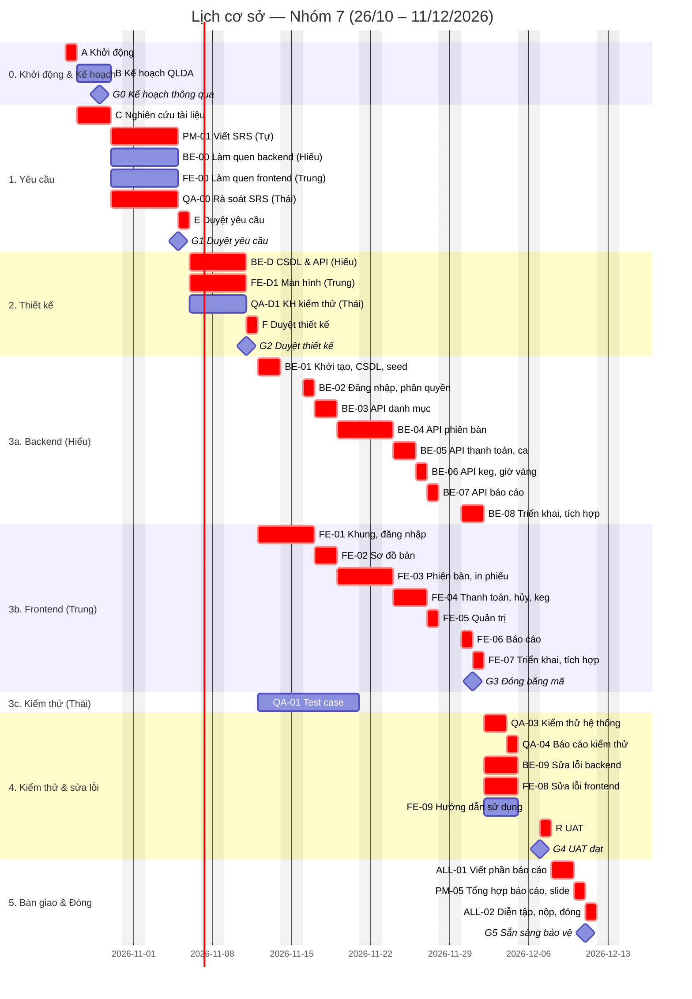

# Kế hoạch quản lý dự án: Hệ thống quản lý quầy nhà hàng bia hơi

> Nhóm 7 — môn Quản trị dự án — ĐH Bách Khoa
> Phiên bản 0.2 — 2026-10-24
> Người lập: Nguyễn Xuân Tự (Quản lý dự án)
> Tài liệu kèm theo: `srs.md` (đặc tả yêu cầu — SRS v0.2)
> Căn cứ: bài giảng Lesson 1–7 (Schwalbe, *Information Technology Project Management*, 9th ed.; PMBOK)

| Phiên bản | Ngày | Người sửa | Nội dung thay đổi |
|---|---|---|---|
| 0.1 | 24/10/2026 | Tự | Bản nháp đầu tiên, trình bày tại buổi kick-off |
| 0.2 | 24/10/2026 | Tự | Cập nhật theo phân công thống nhất tại kick-off: Hiếu lập trình backend, Trung lập trình frontend, Thái kiểm thử, Tự quản lý & duyệt PR; công nghệ Node.js/Express + React; tính lại WBS, lịch, chi phí, rủi ro; khớp với SRS v0.2 |

---

## Phần I — KHỞI TẠO (Initiating)

### 1. Hiến chương dự án (Project Charter)

| Mục | Nội dung |
|---|---|
| Tên dự án | Hệ thống quản lý quầy nhà hàng bia hơi |
| Mã dự án | QTDA-N7-2026 |
| Ngày bắt đầu – kết thúc | 24/10/2026 (kick-off) – 13/12/2026; lịch công việc 26/10 – 11/12/2026 (7 tuần) |
| Nhà tài trợ / khách hàng | Giảng viên môn Quản trị dự án (giao đề bài, nghiệm thu) |
| Quản lý dự án | Nguyễn Xuân Tự — được giao quyền lập kế hoạch, phân công, duyệt mọi thay đổi mã nguồn và phê duyệt thay đổi nhỏ |
| Ngân sách (quy đổi) | 15.750.000 đ (xem mục 12) |

**Mục đích / tình huống kinh doanh.** Nhà hàng bia hơi đông khách quản lý order và tiền bằng giấy, dẫn đến sót món, tính tiền chậm/sai, thất thoát bia hơi và hủy món không kiểm soát. Dự án xây dựng một web app giúp quầy nhập order và tính tiền nhanh, đồng thời cho chủ quán theo dõi doanh thu, hao hụt bia và nhật ký hủy món.

**Mục tiêu (SMART).**
1. Đến 01/12/2026 hoàn thành web app có phân quyền (phân hệ Quầy, Quản trị, Báo cáo), đáp ứng 100% yêu cầu mức **M** trong SRS, chạy trên đường dẫn công khai.
2. Đến 07/12/2026 đạt nghiệm thu UAT: ≥ 95% test case mức M đạt, không còn lỗi nghiêm trọng.
3. Bảo vệ cuối kỳ với bản demo và bộ hồ sơ quản lý dự án đầy đủ.
4. Tổng chi phí thực tế (giờ công quy đổi) không vượt cost baseline 15,00 triệu đ quá 10%.

**Yêu cầu mức cao.** Sơ đồ bàn theo khu; gọi món và in phiếu theo khu chế biến; chuyển/gộp bàn; hủy/giảm món có duyệt bằng PIN; in tạm tính; thanh toán tiền mặt + VietQR; theo dõi keg bia và báo cáo hao hụt; quản trị thực đơn, bàn, nhân viên, kho keg; báo cáo cho chủ quán. Mọi chức năng được phân quyền theo 3 vai trò.

**Sản phẩm bàn giao chính.** Web app đã triển khai (frontend + backend), mã nguồn trên GitHub, SRS, thiết kế CSDL & API, đặc tả màn hình, kế hoạch & bộ hồ sơ quản lý dự án, kế hoạch – test case – báo cáo kiểm thử, hướng dẫn sử dụng, báo cáo cuối kỳ + slide.

**Tiêu chí thành công.** Giảng viên nghiệm thu sản phẩm và hồ sơ; dự án đóng đúng ngày; mỗi thành viên có đóng góp được ghi nhận rõ ràng.

**Rủi ro chính** (chi tiết mục 15): các thành viên lập trình đang trong quá trình làm quen công nghệ, lệch giao tiếp giữa backend và frontend, nghẽn khâu duyệt PR, trùng lịch thi.

**Ký duyệt**

| Vai trò | Họ tên | Chữ ký | Ngày |
|---|---|---|---|
| Nhà tài trợ | Giảng viên môn học | | |
| Quản lý dự án | Nguyễn Xuân Tự | | |
| Thành viên | Phí Việt Hiếu | | |
| Thành viên | Dương Tất Trung | | |
| Thành viên | Nguyễn Chính Thái | | |

### 2. Lựa chọn dự án & phương pháp

#### 2.1 Phân tích lợi ích (minh họa — số liệu giả định)

Giả định một quán áp dụng hệ thống: chi phí ban đầu C₀ = 15,75 triệu đ (bằng ngân sách dự án); lợi ích ròng nhờ giảm thất thoát bia và sai sót tính tiền ước 8 triệu đ/năm trong 3 năm; lãi suất chiết khấu r = 10%.

| Năm | Lợi ích (triệu đ) | Hệ số chiết khấu 1/(1+r)ᵗ | Lợi ích chiết khấu | Lũy kế |
|---|---|---|---|---|
| 0 | −15,75 | 1,000 | −15,75 | −15,75 |
| 1 | 8,00 | 0,909 | 7,27 | −8,48 |
| 2 | 8,00 | 0,826 | 6,61 | −1,87 |
| 3 | 8,00 | 0,751 | 6,01 | +4,15 |

- **NPV** = Σ Cₜ/(1+r)ᵗ − C₀ = 19,90 − 15,75 = **+4,15 triệu đ** > 0 → đáng đầu tư.
- **ROI** = (19,90 − 15,75) / 15,75 ≈ **26,3%**.
- **Thời gian hoàn vốn** ≈ 2 + 1,87/6,01 ≈ **2,3 năm**.

#### 2.2 Chọn mô hình vòng đời: mô hình chấm điểm có trọng số

| Tiêu chí | Trọng số | Thác nước | Scrum (Agile) | Tăng dần (Incremental) |
|---|---|---|---|---|
| Phù hợp kinh nghiệm của nhóm | 30% | 9 | 3 | 6 |
| Dễ kiểm soát tiến độ, tài liệu, mốc nghiệm thu | 25% | 9 | 6 | 7 |
| Yêu cầu tương đối ổn định (đề bài cố định, 7 tuần) | 20% | 8 | 6 | 7 |
| Phù hợp cách đánh giá của môn học (hồ sơ theo nhóm quy trình) | 15% | 9 | 7 | 7 |
| Khả năng thích ứng thay đổi | 10% | 4 | 9 | 7 |
| **Tổng điểm** | 100% | **8,30** | 5,55 | 6,70 |

**Kết luận:** chọn mô hình **thác nước (predictive)**. Không ai trong nhóm có kinh nghiệm Agile, và thác nước cho các mốc rõ ràng để kiểm soát. Điểm yếu là thích ứng thay đổi kém và lỗi có thể lộ ra muộn. Hai điểm này được giảm thiểu bằng quy trình kiểm soát thay đổi (mục 9), hợp đồng API được duyệt ở Gate G2, và việc kiểm thử từng chức năng ngay khi có Pull Request (mục 13).

### 3. Đăng ký các bên liên quan (Stakeholder Register)

| Họ tên / nhóm | Vị trí | Trong/ngoài | Vai trò dự án | Liên hệ | Ảnh hưởng | Tác động | Chiến lược quản lý |
|---|---|---|---|---|---|---|---|
| Giảng viên môn học | Giảng viên | Ngoài | Nhà tài trợ, khách hàng, người nghiệm thu | Email / lớp học | Cao | Cao | Quản lý chặt: hỏi rõ yêu cầu hồ sơ nộp cuối kỳ ngay tuần 1, báo cáo ở các mốc |
| Nguyễn Xuân Tự (GitHub: xuan-tu-ai) | Nhóm trưởng | Trong | Quản lý dự án; duyệt mọi Pull Request (code owner) | Zalo nhóm | Cao | Cao | Ra quyết định, chủ trì họp và CCB |
| Phí Việt Hiếu (phiviethieu-cpu) | Thành viên | Trong | Lập trình backend; thiết kế CSDL & API | Zalo nhóm | Trung bình | Cao | Giao việc rõ theo bảng công việc SRS, theo dõi hằng tuần |
| Dương Tất Trung (GalaxyKnight08) | Thành viên | Trong | Lập trình frontend; đặc tả màn hình; hướng dẫn sử dụng | Zalo nhóm | Trung bình | Cao | Như trên |
| Nguyễn Chính Thái (thainguyen1165) | Thành viên | Trong | Kiểm thử; thư ký họp | Zalo nhóm | Trung bình | Cao | Như trên |
| Chủ quán bia hơi (người dùng giả định) | Người dùng nghiệp vụ | Ngoài | Đại diện qua tài liệu nghiên cứu | — | Thấp | Trung bình | Đại diện bằng nghiên cứu tài liệu và phần mềm tương tự |
| Nhân viên quầy (người dùng cuối) | Người dùng | Ngoài | Đại diện qua tài liệu nghiên cứu | — | Thấp | Trung bình | Như trên; 2 bạn ngoài nhóm đóng vai khi kiểm thử dễ dùng (NFR-03) |

### 4. Nhật ký giả định & ràng buộc (Assumption Log)

| Mã | Giả định / ràng buộc | Loại | Người nêu | Trạng thái |
|---|---|---|---|---|
| A1 | Tự dành khoảng 6 giờ/tuần; Hiếu và Trung khoảng 9 giờ/tuần; Thái khoảng 6 giờ/tuần | Giả định | Tự | Mở — xác nhận tại họp tuần 1 |
| A2 | Yêu cầu được thu thập bằng nghiên cứu tài liệu và phần mềm tương tự, không khảo sát trực tiếp tại quán | Ràng buộc | Nhóm | Đã chốt (kick-off 24/10) |
| A3 | Hạn bảo vệ cuối kỳ không sớm hơn 13/12/2026 | Giả định | Tự | Mở — hỏi giảng viên |
| A4 | Hồ sơ nộp cuối kỳ gồm báo cáo (có ảnh chụp giao diện); danh mục tài liệu chi tiết sẽ hỏi lại giảng viên | Giả định | Trung | Mở — hỏi giảng viên |
| A5 | Chỉ dùng công cụ & dịch vụ miễn phí (GitHub, Neon/Supabase Postgres, Render, Vercel, Google Meet, Zalo) | Ràng buộc | Tự | Đã chốt |
| A6 | Phạm vi là một web app có phân quyền; không làm app desktop, app di động, offline, hóa đơn điện tử | Ràng buộc | Nhóm | Đã chốt |
| A7 | Hiếu và Trung có thể bắt đầu viết code ngay sau G2 nhờ tuần làm quen công nghệ (BE-00, FE-00) trước G1 | Giả định | Tự | Mở — kiểm tra ở G1 |

### 5. Điều lệ nhóm (Team Charter)

**Giá trị chung:** đúng hẹn, minh bạch, hỏi sớm khi bị kẹt, tôn trọng ý kiến.

**Quy tắc làm việc**
1. Mọi công việc (cả tài liệu lẫn code) được giao qua GitHub Issues, ghi mã việc theo SRS mục 10 (vd `BE-04`, `FE-03`, `QA-01`). Mỗi người cập nhật trạng thái ít nhất 2 lần/tuần.
2. Ưu tiên trao đổi bằng văn bản trên nhóm Zalo để mọi người đọc lại và suy nghĩ trước khi phản hồi. Quyết định quan trọng được chép vào nhật ký quyết định.
3. Bị kẹt quá 1 ngày, hoặc thấy có nguy cơ trễ hạn, thì báo ngay lên nhóm.
4. Họp tuần 30 phút đúng giờ. Vắng phải báo trước ít nhất 12 giờ và gửi báo cáo bằng văn bản (đã làm / sẽ làm / vướng mắc).
5. Không push thẳng vào `main`/`develop`. Mọi thay đổi đi qua Pull Request; **chỉ nhóm trưởng được duyệt để merge**. PR chức năng được Thái kiểm thử trước khi nhóm trưởng duyệt.
6. Muốn đổi API thì Hiếu và Trung thống nhất và cập nhật tài liệu API trước khi code.

**Ra quyết định:** thảo luận để đạt đồng thuận. Nếu không đạt (sau 15 phút họp hoặc 24 giờ trên chat), quản lý dự án quyết định và ghi vào nhật ký quyết định.

**Giải quyết xung đột:** (1) hai bên trao đổi trực tiếp → (2) quản lý dự án hòa giải trong buổi họp tuần → (3) nếu ảnh hưởng đến phân công/điểm số, báo giảng viên.

**Ghi nhận đóng góp:** dựa trên issue đã đóng, PR đã merge, tài liệu đã viết, kết quả kiểm thử và biên bản họp. Bảng đóng góp cập nhật ở mỗi Gate và đưa vào báo cáo cuối kỳ.

---

## Phần II — LẬP KẾ HOẠCH (Planning)

### 6. Tổng quan kế hoạch quản lý dự án

| Thành phần | Nơi mô tả |
|---|---|
| Mục đích, mục tiêu, phạm vi | Mục 1, 7 |
| Giả định & ràng buộc | Mục 4 |
| Tổ chức, vai trò, trách nhiệm | Mục 8 |
| Quy trình kỹ thuật (vòng đời, phương pháp, công cụ) | Mục 2.2, 6.1, 6.2 |
| Kế hoạch phạm vi, tiến độ, chi phí | Mục 7, 11, 12 |
| Kiểm soát thay đổi, quản lý cấu hình | Mục 9, 10 |
| Chất lượng, truyền thông, rủi ro, mua sắm | Mục 13, 14, 15, 16 |
| Giám sát, báo cáo, đóng dự án | Mục 17, 18 |

Chi tiết từng công việc (mã việc, người làm, hạn, kết quả cần có) nằm ở **SRS mục 10**; kế hoạch này tổng hợp các công việc đó thành WBS, lịch và ngân sách.

#### 6.1 Vòng đời dự án: thác nước, 6 pha, mỗi pha kết thúc bằng một Gate

| Pha | Thời gian | Đầu ra chính | Gate (tiêu chí qua cổng) |
|---|---|---|---|
| 0. Khởi động & Lập kế hoạch | 24/10 – 29/10 | Hiến chương, đăng ký các bên liên quan, điều lệ nhóm, kế hoạch quản lý dự án | G0 (29/10): kế hoạch được cả nhóm thông qua |
| 1. Phân tích yêu cầu | 27/10 – 05/11 | SRS v1.0; làm quen công nghệ (BE-00, FE-00) | **G1 (05/11)**: SRS được duyệt → *scope baseline* |
| 2. Thiết kế | 06/11 – 11/11 | `schema.prisma`, thiết kế CSDL, đặc tả API, đặc tả màn hình, kế hoạch kiểm thử | **G2 (11/11)**: thiết kế được duyệt, hợp đồng API đóng băng |
| 3. Cài đặt | 12/11 – 01/12 | Backend & frontend (song song), triển khai lên Render/Vercel; test case | **G3 (01/12)**: đóng băng mã, mọi FR mức M đã cài đặt |
| 4. Kiểm thử | 02/12 – 07/12 | Báo cáo kiểm thử, lỗi đã sửa, hướng dẫn sử dụng | **G4 (07/12)**: UAT đạt (≥ 95% TC mức M, 0 lỗi nghiêm trọng) |
| 5. Bàn giao & Đóng dự án | 08/12 – 11/12 | Báo cáo cuối kỳ, slide, bài học kinh nghiệm | **G5 (11/12)**: hồ sơ hoàn tất, sẵn sàng bảo vệ |

Nguyên tắc thác nước: **không bắt đầu pha sau khi pha trước chưa qua Gate.** Riêng việc làm quen công nghệ (không tạo ra sản phẩm) được làm trong pha Yêu cầu, và các việc có độ trễ cho phép (như viết test case) chạy song song theo lịch ở mục 11. Muốn sửa sản phẩm của một pha đã qua Gate thì phải đi qua quy trình kiểm soát thay đổi (mục 9).

#### 6.2 Phương pháp, công cụ, hạ tầng

| Hạng mục | Lựa chọn |
|---|---|
| Frontend | React 18 + Vite + TypeScript, Tailwind CSS + shadcn/ui, TanStack Query, Recharts; triển khai Vercel |
| Backend | Node.js 20 + Express + TypeScript, Prisma, zod, JWT; triển khai Render |
| Cơ sở dữ liệu | PostgreSQL (gói miễn phí Neon hoặc Supabase) |
| Quản lý mã nguồn & công việc | GitHub: repo `xuan-tu-ai/bia-hoi-pos` (thư mục `frontend/`, `backend/`, `docs/`), Issues, Projects, Pull Request, CODEOWNERS |
| Giao tiếp | Nhóm Zalo (trao đổi hằng ngày); Google Meet (họp online) |
| Tài liệu | Markdown trong `docs/`; sơ đồ bằng Mermaid / draw.io |
| Lập lịch | Biểu đồ Gantt (Mermaid trong tài liệu này, có thể chuyển sang Excel/GanttProject) |
| Kiểm thử | Kiểm thử thủ công theo test case: kiểm thử từng Pull Request, kiểm thử hệ thống, UAT |

### 7. Quản lý phạm vi

#### 7.1 Kế hoạch quản lý phạm vi & yêu cầu

- **Thu thập yêu cầu:** nghiên cứu tài liệu, gồm phân tích các phần mềm quản lý nhà hàng phổ biến (KiotViet, iPOS, Sapo FnB, CukCuk) và tài liệu về vận hành quán bia hơi. Mỗi thành viên phân tích một phần mềm; Tự tổng hợp vào SRS.
- **Ghi nhận yêu cầu:** trong SRS, mỗi yêu cầu có mã `FR-xx`/`NFR-xx`, mức ưu tiên (M/S/C) và tiêu chí nghiệm thu dạng danh sách kiểm tra.
- **Truy vết:** mỗi công việc trong bảng SRS mục 10 ghi rõ các FR liên quan; mỗi issue và Pull Request ghi mã việc và mã FR; test case của Thái ghi mã FR được kiểm thử. Nhờ đó luôn lần được từ yêu cầu → công việc → mã nguồn → test case.
- **Tạo & duyệt WBS:** quản lý dự án lập theo hướng từ trên xuống, dựa trên bảng công việc của SRS. Cả nhóm rà soát; WBS được duyệt cùng SRS ở G1.
- **Nghiệm thu sản phẩm (Validate Scope):** mỗi sản phẩm bàn giao được kiểm tra theo tiêu chí nghiệm thu và ký vào *Phiếu nghiệm thu* (Phụ lục D) tại Gate tương ứng.
- **Kiểm soát phạm vi:** mọi yêu cầu thêm/bớt chức năng sau G1 phải có *Phiếu yêu cầu thay đổi* (Phụ lục C) và đi qua CCB (mục 9). Khi trễ tiến độ, ưu tiên cắt yêu cầu mức C rồi đến S, không cắt M.

#### 7.2 Tuyên bố phạm vi dự án (Project Scope Statement)

- **Mô tả phạm vi sản phẩm:** một web app có phân quyền theo 3 vai trò (Nhân viên quầy, Quản lý ca, Chủ quán), gồm phân hệ Quầy, Quản trị và Báo cáo; frontend React gọi REST API của backend Node.js/Express, dữ liệu lưu trong PostgreSQL. Có 19 yêu cầu chức năng (FR-01..FR-19) và 8 yêu cầu phi chức năng, chi tiết trong SRS.
- **Tiêu chí nghiệm thu của người dùng:** mọi FR mức M đạt tiêu chí nghiệm thu; kịch bản demo ở SRS mục 10.4 chạy trọn vẹn không lỗi trên đường dẫn công khai.
- **Sản phẩm bàn giao:**

| Sản phẩm | Pha | Người chịu trách nhiệm chính |
|---|---|---|
| Hiến chương, đăng ký các bên liên quan, điều lệ nhóm, kế hoạch quản lý dự án | 0 | Tự |
| SRS (`docs/srs.md`) | 1 | Tự |
| Thiết kế CSDL (`schema.prisma`, `docs/thiet-ke-csdl.md`), đặc tả API (`docs/api.md`) | 2 | Hiếu |
| Đặc tả màn hình (`docs/man-hinh.md`) | 2 | Trung |
| Kế hoạch kiểm thử, test case, báo cáo kiểm thử | 2–4 | Thái |
| Backend đã triển khai + mã nguồn (`backend/`) | 3 | Hiếu |
| Frontend đã triển khai + mã nguồn (`frontend/`) | 3 | Trung |
| Hướng dẫn sử dụng (`docs/huong-dan-su-dung.md`) | 4 | Trung |
| Biên bản họp (`docs/meetings/`) | Suốt dự án | Thái |
| Báo cáo tuần, sổ rủi ro, nhật ký thay đổi, báo cáo EVM | Suốt dự án | Tự |
| Báo cáo cuối kỳ, slide, bài học kinh nghiệm | 5 | Tự (cả nhóm viết phần của mình) |

- **Ngoài phạm vi:** ứng dụng desktop riêng, app di động, chạy offline, máy in nhiệt chuyên dụng, hóa đơn điện tử, tự xác nhận chuyển khoản, nhiều chi nhánh, app phục vụ, khách tự order, màn hình bếp, định lượng nguyên liệu, đặt bàn, combo, tách bill theo người (xem `tam-nhin.md`).
- **Ràng buộc & giả định:** mục 4.

#### 7.3 Cấu trúc phân chia công việc (WBS)

Mã trong ngoặc là mã việc tương ứng trong bảng công việc của SRS mục 10.

```
1.0 Hệ thống quản lý quầy bia hơi
├── 1.1 Quản lý dự án
│   ├── 1.1.1 Khởi động (kick-off, hiến chương, các bên liên quan, điều lệ nhóm)
│   ├── 1.1.2 Lập kế hoạch quản lý dự án
│   ├── 1.1.3 Họp & báo cáo (họp tuần, họp Gate, biên bản, báo cáo tuần) (PM-03)
│   ├── 1.1.4 Giám sát, kiểm soát thay đổi & duyệt PR (PM-03)
│   ├── 1.1.5 Đóng dự án (bài học kinh nghiệm, lưu trữ hồ sơ)
│   └── 1.1.6 Đào tạo & làm quen công nghệ (BE-00, FE-00)
├── 1.2 Phân tích yêu cầu
│   ├── 1.2.1 Nghiên cứu tài liệu & phần mềm tương tự
│   ├── 1.2.2 Viết SRS (PM-01)
│   └── 1.2.3 Rà soát & duyệt yêu cầu — G1 (QA-00)
├── 1.3 Thiết kế
│   ├── 1.3.1 Thiết kế CSDL (BE-D1)
│   ├── 1.3.2 Đặc tả API (BE-D2)
│   ├── 1.3.3 Đặc tả màn hình (FE-D1)
│   └── 1.3.4 Duyệt thiết kế — G2 (PM-02)
├── 1.4 Cài đặt
│   ├── 1.4.1 Backend: nền tảng & đăng nhập (BE-01, BE-02)
│   ├── 1.4.2 Backend: API nghiệp vụ (BE-03 → BE-07)
│   ├── 1.4.3 Frontend: khung ứng dụng & đăng nhập (FE-01)
│   ├── 1.4.4 Frontend: phân hệ Quầy, Quản trị, Báo cáo (FE-02 → FE-06)
│   └── 1.4.5 Triển khai, tích hợp & đóng băng mã — G3 (BE-08, FE-07)
├── 1.5 Kiểm thử
│   ├── 1.5.1 Kế hoạch kiểm thử (QA-D1)
│   ├── 1.5.2 Viết test case (QA-01)
│   ├── 1.5.3 Kiểm thử theo Pull Request (QA-02)
│   ├── 1.5.4 Kiểm thử hệ thống & sửa lỗi (QA-03, BE-09, FE-08)
│   └── 1.5.5 Báo cáo kiểm thử & UAT — G4 (QA-04, PM-04)
└── 1.6 Bàn giao
    ├── 1.6.1 Hướng dẫn sử dụng (FE-09)
    ├── 1.6.2 Báo cáo cuối kỳ & slide (ALL-01, PM-05)
    └── 1.6.3 Diễn tập demo & nộp — G5 (ALL-02)
```

#### 7.4 Từ điển WBS (WBS Dictionary)

Mỗi gói công việc có một mục theo mẫu sau. Dưới đây là các gói chính; các gói còn lại được ghi trong `docs/wbs-dictionary.md` theo cùng mẫu.

| Tên dự án | Hệ thống quản lý quầy bia hơi |
|---|---|
| **Mã WBS** | 1.4.2 |
| **Tên** | Backend: API nghiệp vụ |
| **Mô tả công việc** | Cài đặt các API trong SRS mục 7 theo thứ tự frontend cần: danh mục (BE-03), phiên bàn & gọi món (BE-04), thanh toán & ca (BE-05), keg & giờ vàng (BE-06), báo cáo (BE-07). Các thao tác ghi nhiều bảng dùng transaction; mọi API kiểm tra quyền theo vai trò |
| **Người chịu trách nhiệm** | Hiếu; Thái kiểm thử từng PR; Tự duyệt PR |
| **Đầu vào / phụ thuộc trước** | 1.3.4 Thiết kế đã duyệt; 1.4.1 Nền tảng backend |
| **Phụ thuộc sau** | 1.4.5 Triển khai & tích hợp |
| **Sản phẩm / tiêu chí hoàn thành** | Mọi API khớp `docs/api.md`; trả lỗi đúng định dạng SRS 7.1; số liệu báo cáo khớp dữ liệu mẫu; PR đã merge vào `develop` |
| **Ước lượng** | 9 ngày làm việc (17/11 – 27/11); 22 giờ công |

| Tên dự án | Hệ thống quản lý quầy bia hơi |
|---|---|
| **Mã WBS** | 1.4.4 |
| **Tên** | Frontend: phân hệ Quầy, Quản trị, Báo cáo |
| **Mô tả công việc** | Cài đặt các màn hình theo SRS mục 6 và `docs/man-hinh.md`: sơ đồ bàn (FE-02), phiên bàn & in phiếu (FE-03), chuyển/gộp – hủy có PIN – tạm tính – thanh toán – ca – vòi bia (FE-04), Quản trị (FE-05), Báo cáo (FE-06). Trong lúc chờ API dùng dữ liệu giả đúng định dạng SRS 7.3 |
| **Người chịu trách nhiệm** | Trung; Thái kiểm thử từng PR; Tự duyệt PR |
| **Đầu vào / phụ thuộc trước** | 1.3.4 Thiết kế đã duyệt; 1.4.3 Khung ứng dụng |
| **Phụ thuộc sau** | 1.4.5 Triển khai & tích hợp |
| **Sản phẩm / tiêu chí hoàn thành** | Mọi tiêu chí nghiệm thu của FR-02..FR-19 đạt khi Thái kiểm thử; màn Báo cáo hiển thị tốt trên điện thoại; PR đã merge vào `develop` |
| **Ước lượng** | 10 ngày làm việc (17/11 – 30/11); 20 giờ công |

| Tên dự án | Hệ thống quản lý quầy bia hơi |
|---|---|
| **Mã WBS** | 1.5.2 |
| **Tên** | Viết test case |
| **Mô tả công việc** | Viết test case cho mọi FR và NFR trong SRS theo kế hoạch kiểm thử: mã TC, FR liên quan, tiền điều kiện, các bước, dữ liệu (tài khoản mẫu SRS 8.3), kết quả mong đợi |
| **Người chịu trách nhiệm** | Thái; Tự rà soát độ phủ so với SRS |
| **Đầu vào / phụ thuộc trước** | 1.5.1 Kế hoạch kiểm thử; SRS đã duyệt |
| **Phụ thuộc sau** | 1.5.3 Kiểm thử theo PR, 1.5.4 Kiểm thử hệ thống |
| **Sản phẩm / tiêu chí hoàn thành** | `docs/test-cases.md`: mỗi FR có ≥ 1 TC luồng đúng và ≥ 1 TC luồng lỗi |
| **Ước lượng** | 7 ngày làm việc (12/11 – 20/11); 8 giờ công |

### 8. Tổ chức dự án & phân công

#### 8.1 Cơ cấu tổ chức

Nhóm tổ chức theo **cơ cấu dự án**: quản lý dự án có toàn quyền phân công. Công việc chia theo mảng chuyên môn; mỗi thành viên sở hữu trọn vẹn một phần sản phẩm và tài liệu đi kèm.

| Thành viên | Vai trò | Sản phẩm bàn giao sở hữu |
|---|---|---|
| Nguyễn Xuân Tự | Quản lý dự án; duyệt mọi Pull Request (code owner); chủ tịch CCB | Kế hoạch QLDA, SRS, báo cáo tuần, sổ rủi ro, báo cáo EVM, báo cáo cuối kỳ |
| Phí Việt Hiếu | Lập trình backend | `backend/`, thiết kế CSDL, đặc tả API, triển khai backend |
| Dương Tất Trung | Lập trình frontend | `frontend/`, đặc tả màn hình, hướng dẫn sử dụng, triển khai frontend |
| Nguyễn Chính Thái | Kiểm thử (tester); thư ký họp | Kế hoạch kiểm thử, test case, báo cáo kiểm thử, kết quả kiểm thử trên PR, biên bản họp |

Hiếu và Trung phối hợp trực tiếp về API (thống nhất trước, ghi vào `docs/api.md`, rồi mới code).

#### 8.2 Ma trận trách nhiệm RACI

R = thực hiện · A = chịu trách nhiệm cuối cùng (mỗi dòng đúng một A) · C = được tham vấn · I = được thông báo

| Mã WBS | Công việc | Tự | Hiếu | Trung | Thái |
|---|---|---|---|---|---|
| 1.1.1 | Khởi động | A/R | C | C | C |
| 1.1.2 | Kế hoạch quản lý dự án | A/R | C | C | C |
| 1.1.3 | Họp & báo cáo | A/R (báo cáo tuần) | R | R | R (biên bản) |
| 1.1.4 | Giám sát, kiểm soát thay đổi & duyệt PR | A/R | C | C | C |
| 1.1.5 | Đóng dự án | A/R | R | R | R |
| 1.1.6 | Đào tạo & làm quen công nghệ | A | R | R | I |
| 1.2.1 | Nghiên cứu tài liệu & phần mềm tương tự | A/R | R | R | R |
| 1.2.2 | Viết SRS | A/R | C | C | C |
| 1.2.3 | Rà soát & duyệt yêu cầu (G1) | A | C | C | R |
| 1.3.1 | Thiết kế CSDL | C | A/R | C | I |
| 1.3.2 | Đặc tả API | C | A/R | C | I |
| 1.3.3 | Đặc tả màn hình | C | C | A/R | I |
| 1.3.4 | Duyệt thiết kế (G2) | A | R | R | R |
| 1.4.1–1.4.2 | Backend | C (duyệt PR) | A/R | C | C (kiểm thử PR) |
| 1.4.3–1.4.4 | Frontend | C (duyệt PR) | C | A/R | C (kiểm thử PR) |
| 1.4.5 | Triển khai, tích hợp (G3) | A | R | R | C |
| 1.5.1 | Kế hoạch kiểm thử | C | I | I | A/R |
| 1.5.2 | Test case | C | I | I | A/R |
| 1.5.3 | Kiểm thử theo PR | C | I | I | A/R |
| 1.5.4 | Kiểm thử hệ thống & sửa lỗi | I | R (sửa lỗi BE) | R (sửa lỗi FE) | A/R |
| 1.5.5 | Báo cáo kiểm thử & UAT (G4) | A | R | R | R |
| 1.6.1 | Hướng dẫn sử dụng | C | I | A/R | C |
| 1.6.2 | Báo cáo cuối kỳ & slide | A/R | R | R | R |
| 1.6.3 | Diễn tập demo & nộp (G5) | A/R | R | R | R |

#### 8.3 Kế hoạch nhân lực

- **Thời gian cam kết:** Tự ~6 giờ/tuần; Hiếu và Trung ~9 giờ/tuần (vừa học vừa làm); Thái ~6 giờ/tuần. Tổng 210 giờ công (mục 12).
- **Tải theo pha:** Tự đều suốt dự án, cao ở tuần 1–2 (kế hoạch, SRS) và tuần 7 (báo cáo cuối kỳ). Hiếu và Trung cao điểm tuần 3–6 (thiết kế, lập trình). Thái cao ở tuần 3–4 (kế hoạch kiểm thử, test case) và tuần 6–7 (kiểm thử hệ thống, báo cáo).
- **Đào tạo:**
  - Tuần 1–2: Hiếu làm quen Node.js + Express + Prisma (BE-00), Trung làm quen React + Vite + Tailwind + shadcn/ui (FE-00), mỗi bạn dựng thử một ứng dụng nhỏ, hạn 04/11.
  - Tuần 1: Tự hướng dẫn cả nhóm 45 phút về quy trình GitHub (nhánh, Pull Request, issue) và cách đọc SRS.
- **Lịch bận:** mỗi người khai báo các tuần thi/bài tập lớn môn khác ở họp tuần 1. Quản lý dự án điều chỉnh dựa trên độ trễ cho phép ở mục 11.4.

### 9. Kiểm soát thay đổi tích hợp

- **Ban kiểm soát thay đổi (CCB):** Tự (chủ tịch) + Thái (kiểm thử) + người phụ trách phần bị ảnh hưởng. Thay đổi làm đổi mục tiêu hoặc phạm vi đã thống nhất với giảng viên thì phải xin ý kiến giảng viên.
- **Quy trình:**
  1. Người đề xuất tạo issue theo mẫu **Yêu cầu thay đổi** (Phụ lục C).
  2. Quản lý dự án phân tích tác động đến phạm vi, tiến độ, chi phí, chất lượng và rủi ro trong ≤ 2 ngày.
  3. CCB quyết định Duyệt / Từ chối / Hoãn, tại họp tuần hoặc qua chat nếu khẩn.
  4. Nếu duyệt: cập nhật SRS, WBS, lịch và baseline liên quan, tăng số phiên bản tài liệu.
  5. Thông báo cho cả nhóm và ghi vào *Nhật ký thay đổi*.
- **Thay đổi API:** sau G2, mọi thay đổi API (thêm/bớt trường, đổi đường dẫn) được coi là thay đổi nhỏ nếu Hiếu và Trung cùng đồng ý và không ảnh hưởng hạn; phải cập nhật `docs/api.md` trong cùng Pull Request.
- **Thay đổi nhỏ khác** (≤ 2 giờ công, không đổi yêu cầu mức M, không lùi mốc Gate): quản lý dự án duyệt nhanh qua chat, vẫn ghi vào nhật ký.
- **Baseline:** schedule baseline và cost baseline chốt ở G0; scope baseline (SRS + WBS + từ điển WBS) chốt ở G1. Baseline chỉ được sửa qua thay đổi đã duyệt.

### 10. Quản lý cấu hình

- **Mục cấu hình:** mã nguồn backend (`backend/`, gồm `prisma/schema.prisma` và migrations), mã nguồn frontend (`frontend/`), tài liệu (`docs/`), file mẫu biến môi trường (`.env.example`).
- **Nhánh Git:** `main` (bản ổn định, chỉ cập nhật tại Gate) ← `develop` (tích hợp, nhánh mặc định) ← nhánh công việc `feature/<mã việc>-...` cho code, `docs/...` cho tài liệu.
- **Bảo vệ nhánh:** trên cả `main` và `develop`: không push trực tiếp, không force-push, không xóa nhánh; mọi Pull Request phải được **code owner** duyệt. File `.github/CODEOWNERS` chỉ định `@xuan-tu-ai` (Tự) là code owner của toàn bộ repo, nên chỉ Tự duyệt được để merge.
- **Quyền truy cập:** Hiếu (`phiviethieu-cpu`), Trung (`GalaxyKnight08`), Thái (`thainguyen1165`) là collaborator quyền Write: đẩy nhánh, mở PR, tạo issue; không thay đổi cài đặt repo.
- **Bí mật:** file `.env` không bao giờ được commit (đã có trong `.gitignore`); chỉ commit `.env.example`.
- **Phiên bản:** gắn tag ở mỗi Gate: `v0.1-G1`, `v0.2-G2`, `v0.9-G3`, `v1.0-G4`, `v1.0.1-final`.
- **Tài liệu:** có bảng lịch sử phiên bản ở đầu file.
- **Kiểm tra cấu hình:** tại mỗi Gate, Thái đối chiếu bản triển khai với danh sách FR của SRS để đảm bảo những gì bàn giao khớp yêu cầu đã duyệt.

### 11. Quản lý tiến độ

#### 11.1 Kế hoạch quản lý tiến độ

- **Mô hình lịch:** danh sách hoạt động + sơ đồ mạng PDM + Gantt; đơn vị là **ngày làm việc** (thứ 2–6, 35 ngày từ 26/10 đến 11/12/2026). Thứ 7 và Chủ nhật là thời gian đệm; 12–13/12 là dự phòng cuối.
- **Phương pháp:** phương pháp đường găng (CPM); ước lượng ba điểm PERT cho các hoạt động có độ bất định cao. Trong pha Cài đặt, backend và frontend là **hai chuỗi song song**, mỗi chuỗi do một người thực hiện tuần tự (ràng buộc nguồn lực). Frontend dùng dữ liệu giả để không phải chờ backend, nên hai chuỗi chỉ gặp nhau ở bước triển khai & tích hợp.
- **Ngưỡng kiểm soát:** hoạt động găng trễ ≥ 1 ngày, hoặc hoạt động không găng trễ vượt độ trễ cho phép → báo ngay và đề xuất phương án (làm thêm cuối tuần / cắt yêu cầu C, S qua CCB).
- **Đo lường:** % hoàn thành theo quy tắc 0/50/100 (chưa bắt đầu / đang làm / xong), cập nhật trên GitHub Projects, tổng hợp ở báo cáo tuần.

#### 11.2 Danh sách hoạt động & ước lượng thời gian

Ước lượng PERT: tₑ = (MO + 4·ML + MP) / 6 (MO lạc quan, ML khả dĩ nhất, MP bi quan). Giá trị tₑ được làm tròn để lập lịch.

| Mã | Hoạt động (WBS) | Phụ thuộc trước | MO | ML | MP | tₑ | Dùng (ngày) | Người | Hạn |
|---|---|---|---|---|---|---|---|---|---|
| A | Khởi động (1.1.1) | — | | | | | 1 | Tự | 26/10 |
| B | Lập kế hoạch QLDA (1.1.2) | A | | | | | 3 | Tự | 29/10 |
| C | Nghiên cứu tài liệu (1.2.1) | A | | | | | 3 | Cả nhóm | 29/10 |
| D | Viết SRS — PM-01 (1.2.2) | C | 3 | 4 | 6 | 4,17 | 4 | Tự | 04/11 |
| BE-00 | Làm quen backend (1.1.6) | C | | | | | 4 | Hiếu | 04/11 |
| FE-00 | Làm quen frontend (1.1.6) | C | | | | | 4 | Trung | 04/11 |
| QA-00 | Rà soát SRS (1.2.3) | C | | | | | 4 | Thái | 04/11 |
| E | Duyệt yêu cầu — **G1** (1.2.3) | B, D, QA-00 | | | | | 1 | Cả nhóm | 05/11 |
| BE-D | Thiết kế CSDL & đặc tả API — BE-D1, BE-D2 (1.3.1, 1.3.2) | E, BE-00 | 2 | 3 | 5 | 3,17 | 3 | Hiếu | 10/11 |
| FE-D1 | Đặc tả màn hình (1.3.3) | E, FE-00 | | | | | 3 | Trung | 10/11 |
| QA-D1 | Kế hoạch kiểm thử (1.5.1) | E | | | | | 3 | Thái | 10/11 |
| F | Duyệt thiết kế — **G2** (1.3.4) | BE-D, FE-D1 | | | | | 1 | Cả nhóm | 11/11 |
| BE-01 | Khởi tạo backend, CSDL, seed (1.4.1) | F | | | | | 2 | Hiếu | 13/11 |
| BE-02 | Đăng nhập, phân quyền (1.4.1) | BE-01 | | | | | 1 | Hiếu | 16/11 |
| BE-03 | API danh mục (1.4.2) | BE-02 | | | | | 2 | Hiếu | 18/11 |
| BE-04 | API phiên bàn & gọi món (1.4.2) | BE-03 | 2 | 3 | 5 | 3,17 | 3 | Hiếu | 23/11 |
| BE-05 | API tạm tính, thanh toán, ca (1.4.2) | BE-04 | | | | | 2 | Hiếu | 25/11 |
| BE-06 | API keg, giờ vàng (1.4.2) | BE-05 | | | | | 1 | Hiếu | 26/11 |
| BE-07 | API báo cáo (1.4.2) | BE-06 | | | | | 1 | Hiếu | 27/11 |
| BE-08 | Triển khai backend, tích hợp (1.4.5) | BE-07 | | | | | 2 | Hiếu | 01/12 |
| FE-01 | Khung ứng dụng, đăng nhập (1.4.3) | F | | | | | 3 | Trung | 16/11 |
| FE-02 | Sơ đồ bàn, mở bàn (1.4.4) | FE-01 | | | | | 2 | Trung | 18/11 |
| FE-03 | Phiên bàn, gọi món, in phiếu (1.4.4) | FE-02 | 2 | 3 | 5 | 3,17 | 3 | Trung | 23/11 |
| FE-04 | Chuyển/gộp, hủy, tạm tính, thanh toán, ca, vòi bia (1.4.4) | FE-03 | 2 | 3 | 5 | 3,17 | 3 | Trung | 26/11 |
| FE-05 | Phân hệ Quản trị (1.4.4) | FE-04 | | | | | 1 | Trung | 27/11 |
| FE-06 | Phân hệ Báo cáo (1.4.4) | FE-05 | | | | | 1 | Trung | 30/11 |
| FE-07 | Triển khai frontend, tích hợp — **G3** (1.4.5) | FE-06, BE-07 | | | | | 1 | Trung | 01/12 |
| QA-01 | Viết test case (1.5.2) | F, QA-D1 | | | | | 7 | Thái | 20/11 |
| QA-03 | Kiểm thử hệ thống (1.5.4) | BE-08, FE-07, QA-01 | 1 | 2 | 4 | 2,17 | 2 | Thái | 03/12 |
| BE-09 | Sửa lỗi backend (1.5.4) | BE-08 | | | | | 3 | Hiếu | 04/12 |
| FE-08 | Sửa lỗi frontend (1.5.4) | FE-07 | | | | | 3 | Trung | 04/12 |
| QA-04 | Báo cáo kiểm thử (1.5.5) | QA-03 | | | | | 1 | Thái | 04/12 |
| FE-09 | Hướng dẫn sử dụng (1.6.1) | FE-07 | | | | | 3 | Trung | 04/12 |
| R | UAT — **G4** (1.5.5, PM-04) | QA-04, BE-09, FE-08 | | | | | 1 | Cả nhóm | 07/12 |
| ALL-01 | Viết phần báo cáo của từng người (1.6.2) | R, FE-09 | | | | | 2 | Cả nhóm | 09/12 |
| PM-05 | Tổng hợp báo cáo & slide (1.6.2) | ALL-01 | | | | | 1 | Tự | 10/12 |
| ALL-02 | Diễn tập, nộp, đóng dự án — **G5** (1.6.3, 1.1.5) | PM-05 | | | | | 1 | Cả nhóm | 11/12 |

Hoạt động *Họp & báo cáo* (1.1.3), *Giám sát & duyệt PR* (1.1.4) và *Kiểm thử theo PR* (1.5.3, QA-02) diễn ra liên tục, không nằm trên sơ đồ mạng. Buổi kick-off (24/10) diễn ra trước ngày làm việc đầu tiên và được tính vào A. Riêng FE-09 làm song song với FE-08 trong cùng 3 ngày (làm song song có chủ đích — fast-tracking), Trung chia thời gian giữa hai việc.

**Danh sách mốc (milestone) — SMART**

| Mốc | Ngày | Tiêu chí đo được | Người ký |
|---|---|---|---|
| G0 — Kế hoạch được thông qua | 29/10/2026 | 4 thành viên ký hiến chương & điều lệ nhóm | Cả nhóm |
| G1 — Yêu cầu được duyệt | 05/11/2026 | SRS v1.0 được cả nhóm thống nhất; Hiếu, Trung đã chạy được ứng dụng thử | Tự |
| G2 — Thiết kế được duyệt | 11/11/2026 | Có `schema.prisma`, `thiet-ke-csdl.md`, `api.md`, `man-hinh.md`, `ke-hoach-kiem-thu.md` | Tự |
| G3 — Đóng băng mã | 01/12/2026 | Mọi FR mức M chạy trên đường dẫn công khai (Vercel + Render); tag `v0.9-G3` | Tự, Thái |
| G4 — UAT đạt | 07/12/2026 | ≥ 95% TC mức M đạt, 0 lỗi nghiêm trọng; kịch bản demo SRS 10.4 chạy trọn vẹn | Thái, Tự |
| G5 — Sẵn sàng bảo vệ | 11/12/2026 | Báo cáo, slide, đường dẫn demo, video demo dự phòng đã nộp | Tự |

#### 11.3 Sơ đồ mạng (PDM, quan hệ Kết thúc–Bắt đầu)

```mermaid
flowchart LR
  A[A Khởi động 1] --> B[B Kế hoạch 3]
  A --> C[C Nghiên cứu 3]
  C --> D[D SRS 4]
  C --> BE00[BE-00 Làm quen BE 4]
  C --> FE00[FE-00 Làm quen FE 4]
  C --> QA00[QA-00 Rà soát SRS 4]
  B --> E[E G1 1]
  D --> E
  QA00 --> E
  E --> BED[BE-D CSDL & API 3]
  BE00 --> BED
  E --> FED[FE-D1 Màn hình 3]
  FE00 --> FED
  E --> QAD[QA-D1 KH kiểm thử 3]
  BED --> F[F G2 1]
  FED --> F
  F --> BE01[BE-01 2] --> BE02[BE-02 1] --> BE03[BE-03 2] --> BE04[BE-04 3] --> BE05[BE-05 2] --> BE06[BE-06 1] --> BE07[BE-07 1] --> BE08[BE-08 2]
  F --> FE01[FE-01 3] --> FE02[FE-02 2] --> FE03[FE-03 3] --> FE04[FE-04 3] --> FE05[FE-05 1] --> FE06[FE-06 1] --> FE07[FE-07 G3 1]
  BE07 --> FE07
  QAD --> QA01[QA-01 Test case 7]
  F --> QA01
  BE08 --> QA03[QA-03 Kiểm thử 2]
  FE07 --> QA03
  QA01 --> QA03
  QA03 --> QA04[QA-04 Báo cáo KT 1]
  BE08 --> BE09[BE-09 Sửa lỗi 3]
  FE07 --> FE08[FE-08 Sửa lỗi 3]
  FE07 --> FE09[FE-09 HDSD 3]
  QA04 --> R[R UAT G4 1]
  BE09 --> R
  FE08 --> R
  R --> ALL01[ALL-01 Báo cáo 2]
  FE09 --> ALL01
  ALL01 --> PM05[PM-05 Tổng hợp 1] --> ALL02[ALL-02 Nộp G5 1]
  classDef crit fill:#fde2e2,stroke:#c0392b,color:#000;
  class A,C,D,QA00,E,BED,FED,F,BE01,BE02,BE03,BE04,BE05,BE06,BE07,BE08,FE01,FE02,FE03,FE04,FE05,FE06,FE07,QA03,QA04,BE09,FE08,R,ALL01,PM05,ALL02 crit;
```



#### 11.4 Phân tích đường găng (CPM)

Lượt thuận tính ES/EF (bắt đầu/kết thúc sớm nhất), lượt ngược tính LS/LF (muộn nhất). Đơn vị: ngày làm việc tính từ 0 (ngày 0 = 26/10/2026).

| Hoạt động | Thời gian | ES | EF | LS | LF | Dự trữ toàn phần | Găng? |
|---|---|---|---|---|---|---|---|
| A | 1 | 0 | 1 | 0 | 1 | 0 | ✔ |
| B | 3 | 1 | 4 | 5 | 8 | 4 | |
| C | 3 | 1 | 4 | 1 | 4 | 0 | ✔ |
| D | 4 | 4 | 8 | 4 | 8 | 0 | ✔ |
| BE-00 | 4 | 4 | 8 | 5 | 9 | 1 | |
| FE-00 | 4 | 4 | 8 | 5 | 9 | 1 | |
| QA-00 | 4 | 4 | 8 | 4 | 8 | 0 | ✔ |
| E | 1 | 8 | 9 | 8 | 9 | 0 | ✔ |
| BE-D | 3 | 9 | 12 | 9 | 12 | 0 | ✔ |
| FE-D1 | 3 | 9 | 12 | 9 | 12 | 0 | ✔ |
| QA-D1 | 3 | 9 | 12 | 10 | 13 | 1 | |
| F | 1 | 12 | 13 | 12 | 13 | 0 | ✔ |
| BE-01 | 2 | 13 | 15 | 13 | 15 | 0 | ✔ |
| BE-02 | 1 | 15 | 16 | 15 | 16 | 0 | ✔ |
| BE-03 | 2 | 16 | 18 | 16 | 18 | 0 | ✔ |
| BE-04 | 3 | 18 | 21 | 18 | 21 | 0 | ✔ |
| BE-05 | 2 | 21 | 23 | 21 | 23 | 0 | ✔ |
| BE-06 | 1 | 23 | 24 | 23 | 24 | 0 | ✔ |
| BE-07 | 1 | 24 | 25 | 24 | 25 | 0 | ✔ |
| BE-08 | 2 | 25 | 27 | 25 | 27 | 0 | ✔ |
| FE-01 | 3 | 13 | 16 | 13 | 16 | 0 | ✔ |
| FE-02 | 2 | 16 | 18 | 16 | 18 | 0 | ✔ |
| FE-03 | 3 | 18 | 21 | 18 | 21 | 0 | ✔ |
| FE-04 | 3 | 21 | 24 | 21 | 24 | 0 | ✔ |
| FE-05 | 1 | 24 | 25 | 24 | 25 | 0 | ✔ |
| FE-06 | 1 | 25 | 26 | 25 | 26 | 0 | ✔ |
| FE-07 | 1 | 26 | 27 | 26 | 27 | 0 | ✔ |
| QA-01 | 7 | 13 | 20 | 20 | 27 | 7 | |
| QA-03 | 2 | 27 | 29 | 27 | 29 | 0 | ✔ |
| QA-04 | 1 | 29 | 30 | 29 | 30 | 0 | ✔ |
| BE-09 | 3 | 27 | 30 | 27 | 30 | 0 | ✔ |
| FE-08 | 3 | 27 | 30 | 27 | 30 | 0 | ✔ |
| FE-09 | 3 | 27 | 30 | 28 | 31 | 1 | |
| R | 1 | 30 | 31 | 30 | 31 | 0 | ✔ |
| ALL-01 | 2 | 31 | 33 | 31 | 33 | 0 | ✔ |
| PM-05 | 1 | 33 | 34 | 33 | 34 | 0 | ✔ |
| ALL-02 | 1 | 34 | 35 | 34 | 35 | 0 | ✔ |

**Đường găng** dài 35 ngày. Các nhánh găng chính (cùng độ dài):
- A → C → D/QA-00 → E → BE-D → F → **chuỗi backend BE-01 → BE-08** → QA-03 → QA-04 → R → ALL-01 → PM-05 → ALL-02
- A → C → D/QA-00 → E → FE-D1 → F → **chuỗi frontend FE-01 → FE-07** → QA-03 → QA-04 → R → ALL-01 → PM-05 → ALL-02
- Nhánh sửa lỗi: … → BE-08 → BE-09 → R và … → FE-07 → FE-08 → R

Nhận xét:
- **Có nhiều đường găng song song** là đặc điểm của lịch này: pha Cài đặt có hai chuỗi găng (backend và frontend) dài bằng nhau, mỗi chuỗi do một người làm và không có dự trữ. Bất kỳ việc nào trong hai chuỗi trễ đều làm lùi mốc G3.
- **Không thể bổ sung người (crashing)** hiệu quả vì mỗi chuỗi gắn với một người. Phương án khi trễ: (1) dùng thứ 7, Chủ nhật làm đệm; (2) cắt yêu cầu mức S/C qua CCB (FR-09, FR-15, FR-19 giúp rút 1–2 ngày mỗi chuỗi).
- **Frontend dùng dữ liệu giả** là chủ ý để hai chuỗi không phụ thuộc nhau cho tới FE-07. Nếu không làm vậy, FE-03/FE-04 phải chờ BE-04/BE-05 và lịch sẽ dài thêm.
- QA-01 (test case) có 7 ngày dự trữ; BE-00, FE-00, QA-D1, FE-09 có 1 ngày; kế hoạch QLDA (B) có 4 ngày.

#### 11.5 Biểu đồ Gantt (lịch cơ sở — schedule baseline)



| Tuần | Ngày | Trọng tâm |
|---|---|---|
| 0 | 24/10 | Kick-off, thống nhất phân công |
| 1 | 26/10 – 01/11 | Kế hoạch (**G0** 29/10); nghiên cứu tài liệu; bắt đầu SRS; Hiếu, Trung làm quen công nghệ |
| 2 | 02/11 – 08/11 | Hoàn thiện SRS (**G1** 05/11); bắt đầu thiết kế |
| 3 | 09/11 – 15/11 | Thiết kế CSDL, API, màn hình, kế hoạch kiểm thử (**G2** 11/11); khởi tạo backend & frontend |
| 4 | 16/11 – 22/11 | Đăng nhập, danh mục, sơ đồ bàn, gọi món; test case (hạn 20/11) |
| 5 | 23/11 – 29/11 | Phiên bàn, thanh toán, keg, giờ vàng, quản trị |
| 6 | 30/11 – 06/12 | Báo cáo, triển khai, tích hợp (**G3** 01/12); kiểm thử hệ thống, sửa lỗi, hướng dẫn sử dụng |
| 7 | 07/12 – 13/12 | UAT (**G4** 07/12); báo cáo cuối kỳ & slide; **G5** 11/12; dự phòng 12–13/12 |

### 12. Quản lý chi phí

#### 12.1 Kế hoạch quản lý chi phí

- **Đơn vị:** đồng Việt Nam, làm tròn đến 10.000 đ. Công lao động quy đổi theo giờ công.
- **Đơn giá giả định:** quản lý dự án 80.000 đ/giờ; thành viên 60.000 đ/giờ (tham chiếu mức thực tập sinh phần mềm).
- **Phương pháp ước lượng:** từ dưới lên (bottom-up) theo gói WBS, kết hợp PERT ở mục 11.2. Đây là ước lượng mức ngân sách, độ chính xác mục tiêu −10% đến +25%.
- **Ghi nhận chi phí thực tế:** mỗi thành viên ghi số giờ làm vào issue GitHub tương ứng (dòng "Giờ thực tế"); Tự tổng hợp hằng tuần.
- **Ngưỡng kiểm soát:** CPI hoặc SPI < 0,9 → cảnh báo vàng, đề xuất hành động ở họp tuần; < 0,8 → cảnh báo đỏ, đưa ra CCB.

#### 12.2 Ước lượng chi phí theo WBS

| Mã WBS | Gói công việc | Tự (giờ) | Hiếu | Trung | Thái | Tổng giờ | Chi phí lao động (đ) | Chi phí khác (đ) | Tổng (đ) |
|---|---|---|---|---|---|---|---|---|---|
| 1.1 | Quản lý dự án (gồm họp, đào tạo) | 22 | 14 | 14 | 14 | 64 | 4.280.000 | — | 4.280.000 |
| 1.2 | Phân tích yêu cầu | 10 | 3 | 3 | 5 | 21 | 1.460.000 | — | 1.460.000 |
| 1.3 | Thiết kế | 2 | 8 | 8 | 0 | 18 | 1.120.000 | — | 1.120.000 |
| 1.4 | Cài đặt | 4 | 30 | 28 | 0 | 62 | 3.800.000 | — | 3.800.000 |
| 1.5 | Kiểm thử | 1 | 4 | 4 | 20 | 29 | 1.760.000 | — | 1.760.000 |
| 1.6 | Bàn giao | 3 | 4 | 6 | 3 | 16 | 1.020.000 | 200.000 (in ấn báo cáo) | 1.220.000 |
| | **Cộng** | **42** | **63** | **63** | **42** | **210** | **13.440.000** | **200.000** | **13.640.000** |

Ghi chú: giờ của Tự ở 1.4 là thời gian duyệt Pull Request; giờ của Thái ở 1.5 gồm cả kế hoạch kiểm thử (QA-D1), test case, kiểm thử theo PR và kiểm thử hệ thống. Chi phí phần mềm & hạ tầng = 0 đ (GitHub, Neon/Supabase, Render, Vercel, Google Meet, Zalo đều dùng gói miễn phí). Chi phí gián tiếp (điện, Internet, máy tính cá nhân) không tính.

#### 12.3 Ngân sách & cost baseline

| Thành phần | Số tiền (đ) |
|---|---|
| Tổng ước lượng các gói công việc (BAC) | 13.640.000 |
| Dự phòng rủi ro (contingency reserve, 10%) — cho rủi ro đã nhận diện ở mục 15 | 1.360.000 |
| **Cost baseline** | **15.000.000** |
| Dự phòng quản lý (management reserve, 5%) — cho rủi ro chưa biết, ngoài baseline | 750.000 |
| **Tổng ngân sách dự án** | **15.750.000** |

**Giá trị kế hoạch lũy kế (PV) theo tuần** — dùng để vẽ đường cong chữ S và tính EVM:

| Tuần | 1 | 2 | 3 | 4 | 5 | 6 | 7 |
|---|---|---|---|---|---|---|---|
| PV lũy kế (triệu đ) | 1,90 | 3,60 | 5,40 | 7,40 | 9,40 | 11,90 | 13,64 |

#### 12.4 Kiểm soát chi phí: quản lý giá trị thu được (EVM)

Mỗi tối Chủ nhật, Tự tính các chỉ số sau và đưa vào báo cáo tuần:

| Chỉ số | Công thức | Ý nghĩa |
|---|---|---|
| EV | Σ PV của phần việc đã hoàn thành (quy tắc 0/50/100) | Giá trị thu được |
| CV / SV | EV − AC / EV − PV | Chênh lệch chi phí / tiến độ |
| CPI / SPI | EV / AC / EV / PV | < 1: vượt chi / chậm tiến độ |
| EAC | BAC / CPI | Dự báo tổng chi phí khi hoàn thành |
| ETC | EAC − AC | Chi phí còn lại cần thêm |
| TCPI | (BAC − EV) / (BAC − AC) | Hiệu suất cần đạt cho phần còn lại |

*Ví dụ minh họa (cuối tuần 4):* PV = 7,40; EV = 6,70; AC = 7,10 (triệu đ).
→ CV = −0,40; SV = −0,70; CPI ≈ 0,94; SPI ≈ 0,91; EAC = 13,64/0,94 ≈ 14,45 (vẫn trong cost baseline 15,00); TCPI = (13,64 − 6,70)/(13,64 − 7,10) ≈ 1,06.
→ SPI gần ngưỡng vàng: họp tuần xem xét cắt FR-19 (mức S) và dùng cuối tuần làm đệm để giữ mốc G3.

### 13. Quản lý chất lượng

| Hạng mục | Quy định |
|---|---|
| Tiêu chuẩn chất lượng sản phẩm | Đạt tiêu chí nghiệm thu của các FR trong SRS; NFR-01..08; quy ước code ở SRS mục 9.1 |
| Định nghĩa "Hoàn thành" — chức năng | PR ghi mã việc & mã FR, mô tả cách kiểm tra → Thái kiểm thử theo tiêu chí nghiệm thu và ghi kết quả vào PR → Tự duyệt (code owner) → merge vào `develop` |
| Định nghĩa "Hoàn thành" — tài liệu | Viết đúng mẫu → Tự duyệt PR → merge vào `develop` |
| Duyệt mã | Tự duyệt mọi PR trong 24 giờ. PR nhỏ (≤ 400 dòng), mỗi PR một việc. Kiểm tra: đúng phạm vi việc, không lộ bí mật, API khớp `docs/api.md`, quyền được kiểm tra ở backend |
| Kiểm thử | Kiểm thử theo PR (suốt pha Cài đặt) → kiểm thử hệ thống sau G3 → kiểm thử chấp nhận (UAT, G4) theo kịch bản demo SRS 10.4 |
| Mức độ lỗi | Nghiêm trọng (sai tiền, mất dữ liệu, lộ quyền, sập), Cao (chức năng M không dùng được), Trung bình, Thấp |
| Chỉ số chất lượng | Số lỗi / FR; tỉ lệ TC đạt; số PR bị trả lại; thời gian trung bình sửa lỗi nghiêm trọng (mục tiêu ≤ 1 ngày) |
| Cải tiến | Mỗi Gate có mục "Điều gì làm tốt / cần cải thiện" trong biên bản, ghi vào sổ bài học kinh nghiệm |

### 14. Quản lý truyền thông

#### 14.1 Ma trận truyền thông

| Thông tin | Người gửi | Người nhận | Kênh | Tần suất | Lưu trữ |
|---|---|---|---|---|---|
| Họp tiến độ tuần (30 phút) | Tự chủ trì | Cả nhóm | Google Meet | Tối Chủ nhật 20:30–21:00 hằng tuần | Biên bản `docs/meetings/` |
| Họp duyệt Gate (≤ 60 phút) | Tự | Cả nhóm (+ giảng viên nếu cần) | Google Meet / trực tiếp | Cuối mỗi pha (6 lần) | Biên bản + Phiếu nghiệm thu |
| Báo cáo tiến độ tuần (EVM, rủi ro, việc tuần tới) | Tự | Cả nhóm; giảng viên khi được yêu cầu | `docs/reports/` + link vào Zalo | Chủ nhật hằng tuần | `docs/reports/` |
| Trao đổi, góp ý, báo vướng mắc | Mọi người | Cả nhóm | Nhóm Zalo | Hằng ngày khi cần | Quyết định quan trọng chép vào nhật ký quyết định |
| Phối hợp API backend – frontend | Hiếu ↔ Trung | Hai bạn (Tự, Thái được thông báo) | Trao đổi trực tiếp + `docs/api.md` | Khi cần | `docs/api.md` |
| Giao việc, trạng thái công việc | Tự / người phụ trách | Cả nhóm | GitHub Issues + Projects | Liên tục | GitHub |
| Kết quả kiểm thử PR | Thái | Người mở PR, Tự | Bình luận trên PR | Mỗi PR chức năng | GitHub |
| Duyệt PR | Người mở PR → Tự | Tự | GitHub Pull Request | Mỗi PR | GitHub |
| Yêu cầu thay đổi | Bất kỳ ai | CCB | GitHub issue mẫu "Yêu cầu thay đổi" | Khi phát sinh | Nhật ký thay đổi |
| Báo cáo cuối kỳ & demo | Cả nhóm | Giảng viên | Nộp theo quy định lớp | Cuối kỳ | Repo + bản nộp |

#### 14.2 Quy định họp

- **Nguyên tắc:** họp ngắn; việc gì trao đổi được bằng văn bản thì làm trên Zalo/GitHub trước. Buổi họp dùng để chốt quyết định và xử lý vướng mắc.
- **Chuẩn bị:** Tự gửi chương trình họp lên Zalo trước 24 giờ. Mỗi người cập nhật trạng thái issue và gửi báo cáo ngắn (đã làm / sẽ làm / vướng mắc) lên Zalo trước giờ họp.
- **Chương trình họp tuần (30 phút):**
  1. Xem lại các việc cần làm từ biên bản trước (5 phút).
  2. Tiến độ so với bảng công việc và EVM (5 phút).
  3. Vướng mắc, rủi ro mới, yêu cầu thay đổi, thống nhất API (15 phút).
  4. Chốt quyết định & phân công (5 phút).
- **Biên bản:** Thái ghi theo mẫu Phụ lục A, đăng lên repo trong 24 giờ. Mỗi việc cần làm có người phụ trách và hạn chót. Thành viên xác nhận bằng cách thả 👍 vào link trên Zalo.
- **Họp duyệt Gate:** trình bày sản phẩm của pha, đối chiếu tiêu chí Gate, ký Phiếu nghiệm thu, cập nhật sổ bài học kinh nghiệm. Kết quả là *Qua* / *Qua có điều kiện* (kèm việc phải xong trước ngày X) / *Không qua*.

### 15. Quản lý rủi ro

**Phương pháp:** xác suất (P) và tác động (I) chấm thang 1–5; điểm = P × I. Mức Cao ≥ 12, Trung bình 6–11, Thấp ≤ 5. Sổ rủi ro được rà soát ở mọi buổi họp tuần.

| Mã | Rủi ro | P | I | Điểm | Chiến lược | Biện pháp ứng phó | Dấu hiệu cảnh báo | Người theo dõi |
|---|---|---|---|---|---|---|---|---|
| R01 | Hiếu, Trung đang làm quen công nghệ nên cài đặt chậm hoặc sai, làm lùi G3 | 4 | 4 | 16 | Giảm thiểu | Tuần làm quen BE-00/FE-00 trước G1; SRS viết chi tiết (API mẫu, schema, cấu trúc thư mục, quy ước); việc chia nhỏ có hạn rõ; PR nhỏ để duyệt sớm | Việc trong chuỗi BE/FE trễ > 1 ngày | Tự |
| R02 | Lệch giao tiếp giữa backend và frontend, phát hiện muộn khi tích hợp | 3 | 4 | 12 | Giảm thiểu | Hợp đồng API (SRS mục 7, `docs/api.md`) duyệt ở G2; frontend dùng dữ liệu giả đúng định dạng; Hiếu cung cấp `requests.http`; đổi API phải cập nhật tài liệu trước | Frontend gọi API thật lỗi định dạng | Tự |
| R03 | Nghẽn khâu duyệt PR vì chỉ nhóm trưởng được duyệt | 3 | 4 | 12 | Giảm thiểu | Cam kết duyệt trong 24 giờ; khung giờ duyệt cố định mỗi tối; PR nhỏ; Thái kiểm thử trước để giảm việc cho người duyệt | PR chờ duyệt > 48 giờ | Tự |
| R04 | Trùng lịch thi giữa kỳ / bài tập lớn môn khác | 3 | 4 | 12 | Chấp nhận chủ động | Khai báo lịch bận tuần 1; dùng dự trữ; thứ 7–CN làm đệm | Thành viên báo bận | Tự |
| R05 | Thành viên không tham gia đầy đủ (vắng họp, không phản hồi) | 3 | 4 | 12 | Giảm thiểu | Ưu tiên trao đổi bất đồng bộ; báo cáo bằng văn bản khi vắng; phân công lại sau 3 ngày không phản hồi; ghi nhận đóng góp minh bạch | Không cập nhật issue trong 3 ngày | Tự |
| R06 | Chất lượng mã thấp, khó sửa lỗi ở pha Kiểm thử | 3 | 3 | 9 | Giảm thiểu | Quy ước code SRS 9.1; cấu trúc thư mục cố định; kiểm thử theo từng PR | Nhiều PR bị trả lại | Tự |
| R07 | Lộ khóa bí mật (chuỗi kết nối CSDL, JWT secret) trên repo công khai | 2 | 4 | 8 | Phòng tránh | `.env` trong `.gitignore`; chỉ commit `.env.example`; kiểm tra khi duyệt PR; nếu lộ thì đổi khóa ngay | Thấy chuỗi kết nối trong diff | Tự |
| R08 | Yêu cầu chưa sát thực tế do không khảo sát trực tiếp | 2 | 3 | 6 | Giảm thiểu | Phân tích ≥ 4 phần mềm tương tự; rà soát SRS (QA-00) | Phát hiện thiếu chức năng cơ bản ở G2 | Tự |
| R09 | Mở rộng phạm vi (scope creep) | 3 | 3 | 9 | Phòng tránh | Quy trình CCB; ưu tiên M/S/C; ý tưởng mới đưa vào tài liệu tầm nhìn | Yêu cầu không có mã FR | Tự |
| R10 | Ước lượng sai do thiếu kinh nghiệm | 3 | 3 | 9 | Giảm thiểu | PERT; dự phòng 10%; EVM hằng tuần; ước lượng lại ở G2 | SPI < 0,9 | Tự |
| R11 | Hồ sơ nộp cuối kỳ không đúng yêu cầu của giảng viên | 2 | 4 | 8 | Phòng tránh | Hỏi rõ giảng viên danh mục tài liệu cần nộp ngay tuần 1 (A4) | Chưa có câu trả lời trước G1 | Trung |
| R12 | Demo lỗi vào ngày bảo vệ (mạng, dịch vụ miễn phí "ngủ") | 2 | 4 | 8 | Giảm thiểu | Mở backend trước vài phút; diễn tập (ALL-02); quay video demo dự phòng | Lỗi trong buổi diễn tập | Hiếu |
| R13 | Mất tài liệu hoặc mã nguồn | 1 | 5 | 5 | Phòng tránh | Mọi thứ trên GitHub; bảo vệ nhánh | — | Tự |

### 16. Quản lý mua sắm

| Hạng mục | Hình thức | Thời điểm | Chi phí | Người phụ trách |
|---|---|---|---|---|
| PostgreSQL (Neon hoặc Supabase) | Gói miễn phí | Tuần 3 (BE-01) | 0 đ | Hiếu |
| Render (triển khai backend) | Gói miễn phí | Tuần 6 (BE-08) | 0 đ | Hiếu |
| Vercel (triển khai frontend) | Gói miễn phí | Tuần 6 (FE-07) | 0 đ | Trung |
| In ấn báo cáo | Mua dịch vụ | Tuần 7 | ≤ 200.000 đ | Thái |

Không có hợp đồng với bên thứ ba. Giới hạn của gói miễn phí (dung lượng, backend "ngủ" khi lâu không dùng) được ghi nhận trong rủi ro R12.

---

## Phần III — THỰC HIỆN, GIÁM SÁT & KIỂM SOÁT

### 17. Giám sát và báo cáo

- **Hằng ngày:** cập nhật GitHub Projects; trao đổi, báo vướng mắc qua Zalo.
- **Hằng tuần (Chủ nhật):** báo cáo tiến độ theo mẫu Phụ lục B, gồm tiến độ theo bảng công việc SRS, EVM, rủi ro, thay đổi, việc tuần tới. Họp tuần dựa trên báo cáo này.
- **Mỗi Gate:** tag phiên bản, phiếu nghiệm thu, bảng đóng góp, bài học kinh nghiệm.
- **Quản lý tri thức:**
  - *Tri thức hiện:* tài liệu trong `docs/` (SRS là tài liệu chính), README hướng dẫn cài đặt, `requests.http` mô tả cách gọi API.
  - *Tri thức ẩn:* chia sẻ qua buổi hướng dẫn tuần 1, trao đổi trực tiếp Hiếu – Trung, nhận xét trong Pull Request, và *sổ bài học kinh nghiệm* cập nhật ở mỗi Gate.

---

## Phần IV — ĐÓNG DỰ ÁN

### 18. Kế hoạch đóng dự án

| Việc | Hạn | Người phụ trách |
|---|---|---|
| Nghiệm thu UAT, ký phiếu nghiệm thu cuối | 07/12 | Thái, Tự |
| Gộp `develop` vào `main`, gắn tag `v1.0.1-final`, lưu trữ repo & tài liệu | 11/12 | Tự |
| Báo cáo cuối kỳ (gồm so sánh kế hoạch vs. thực tế về phạm vi, tiến độ, chi phí) | 10/12 | Tự (cả nhóm viết phần của mình trước 09/12) |
| Họp tổng kết bài học kinh nghiệm | 11/12 | Cả nhóm |
| Bảng đóng góp cuối cùng | 11/12 | Tự |
| Bảo vệ cuối kỳ | Theo lịch lớp | Cả nhóm |

---

## Phụ lục

### Phụ lục A — Mẫu biên bản họp

```
BIÊN BẢN HỌP — Nhóm 7 — Số: BB-<tuần>-<số thứ tự>
Loại họp: Họp tuần / Họp duyệt Gate G_ / Họp đột xuất
Thời gian: __/__/2026, __:__ – __:__     Hình thức: Trực tiếp / Google Meet
Chủ trì: Nguyễn Xuân Tự                  Thư ký: Nguyễn Chính Thái
Có mặt: ...                               Vắng (lý do, đã gửi báo cáo?): ...

1. Rà soát việc cần làm từ biên bản trước
| # | Việc | Người phụ trách | Hạn | Trạng thái |

2. Tiến độ & chi phí (PV, EV, AC, SPI, CPI)

3. Vướng mắc, rủi ro & yêu cầu thay đổi phát sinh

4. Quyết định
| # | Quyết định | Lý do | Người quyết định |

5. Việc cần làm mới
| # | Việc | Người phụ trách | Hạn | Issue GitHub |

Buổi họp tiếp theo: __/__/2026 __:__
```

### Phụ lục B — Mẫu báo cáo tiến độ tuần

```
BÁO CÁO TIẾN ĐỘ TUẦN <n> (__/__ – __/__/2026)
1. Tóm tắt: Xanh / Vàng / Đỏ — một câu nhận định
2. Việc đã hoàn thành trong tuần (mã việc, issue, PR)
3. Việc chưa hoàn thành & lý do
4. Chỉ số: PV __ | EV __ | AC __ | SV __ | CV __ | SPI __ | CPI __ | EAC __
5. Rủi ro: mới / thay đổi điểm / đã đóng
6. Yêu cầu thay đổi: số lượng mới / đã duyệt / từ chối
7. Kế hoạch tuần tới
8. Cần hỗ trợ / quyết định
```

### Phụ lục C — Phiếu yêu cầu thay đổi

```
PHIẾU YÊU CẦU THAY ĐỔI — CR-<số>
Người đề xuất: ________     Ngày: __/__/2026
Loại: Phạm vi / Tiến độ / Chi phí / Chất lượng / Tài liệu
Mô tả thay đổi:
Lý do:
Yêu cầu / việc bị ảnh hưởng (mã FR, mã việc, mã WBS):
Phân tích tác động (do QLDA điền):
  - Phạm vi:        - Tiến độ (ngày):     - Chi phí (giờ công / đ):
  - Chất lượng:     - Rủi ro:
Quyết định CCB: Duyệt / Từ chối / Hoãn      Ngày: __/__/2026
Chữ ký CCB: ________
Tài liệu đã cập nhật (SRS/WBS/lịch): ________
```

### Phụ lục D — Phiếu nghiệm thu sản phẩm bàn giao

```
PHIẾU NGHIỆM THU — Gate G_
Sản phẩm bàn giao: ________   Phiên bản / tag: ________
Tiêu chí nghiệm thu                       | Đạt | Không đạt | Ghi chú
...
Kết luận: Chấp nhận / Chấp nhận có điều kiện (việc phải xong trước __/__) / Không chấp nhận
Người bàn giao: ________   Người nghiệm thu: ________   Ngày: __/__/2026
```

### Phụ lục E — Mẫu sổ bài học kinh nghiệm

| Mã | Pha / Gate | Tình huống | Điều làm tốt / chưa tốt | Nguyên nhân | Khuyến nghị cho lần sau | Người ghi |
|---|---|---|---|---|---|---|
| LL-01 | | | | | | |
