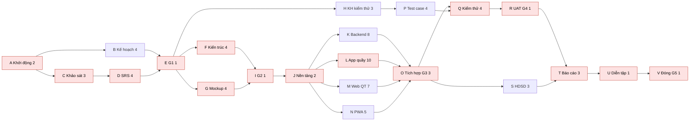
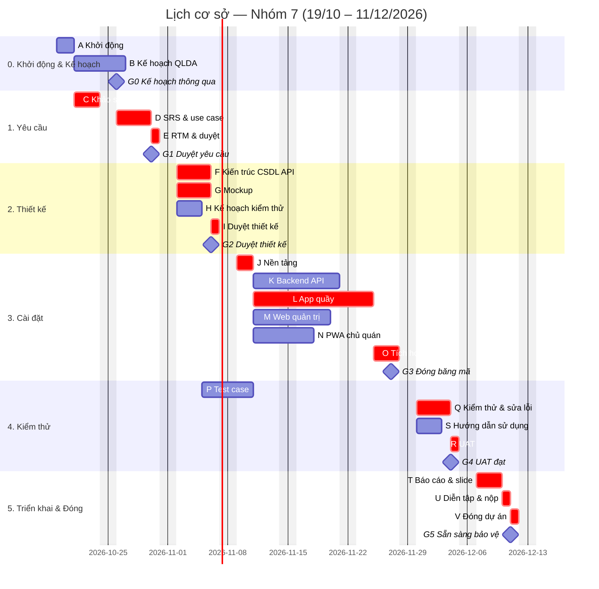

# Kế hoạch quản lý dự án: Hệ thống quản lý quầy nhà hàng bia hơi

> Nhóm 7 — môn Quản trị dự án — ĐH Bách Khoa
> Phiên bản 0.1 (bản nháp, duyệt ở buổi kick-off) — 2026-10-20
> Người lập: Nguyễn Xuân Tự (Quản lý dự án)
> Tài liệu kèm theo: `bia-hoi-quay-spec.md` (đặc tả yêu cầu — SRS)
> Căn cứ: bài giảng Lesson 1–7 (Schwalbe, *Information Technology Project Management*, 9th ed.; PMBOK)

| Phiên bản | Ngày | Người sửa | Nội dung thay đổi |
|---|---|---|---|
| 0.1 | 20/10/2026 | Tự | Bản nháp đầu tiên |

---

## Phần I — KHỞI TẠO (Initiating)

### 1. Hiến chương dự án (Project Charter)

| Mục | Nội dung |
|---|---|
| Tên dự án | Hệ thống quản lý quầy nhà hàng bia hơi |
| Mã dự án | QTDA-N7-2026 |
| Ngày bắt đầu – kết thúc | 19/10/2026 – 13/12/2026 (8 tuần) |
| Nhà tài trợ / khách hàng | Giảng viên môn Quản trị dự án (giao đề bài, nghiệm thu) |
| Quản lý dự án | Nguyễn Xuân Tự — được giao toàn quyền lập kế hoạch, phân công, phê duyệt thay đổi nhỏ |
| Ngân sách (quy đổi) | 30.030.000 đ (xem mục 12) |

**Mục đích / tình huống kinh doanh.** Nhà hàng bia hơi đông khách quản lý order và tiền bằng giấy, dẫn đến sót món, tính tiền chậm/sai, thất thoát bia hơi và hủy món không kiểm soát. Dự án xây dựng phần mềm giúp quầy nhập order và tính tiền nhanh, đồng thời cho chủ quán theo dõi doanh thu, hao hụt bia và nhật ký hủy món từ điện thoại.

**Mục tiêu (SMART).**
1. Đến 27/11/2026 hoàn thành App quầy (Windows), Web quản trị và PWA chủ quán đáp ứng 100% yêu cầu mức **M** trong SRS.
2. Đến 04/12/2026 đạt nghiệm thu UAT: ≥ 95% test case mức M đạt, không còn lỗi nghiêm trọng.
3. Bảo vệ cuối kỳ với bản demo chạy trên 3 máy (2 máy quầy + 1 điện thoại) và bộ hồ sơ quản lý dự án đầy đủ.
4. Tổng chi phí thực tế (giờ công quy đổi) không vượt quá cost baseline 28,6 triệu đ quá 10%.

**Yêu cầu mức cao.** Sơ đồ bàn theo khu; nhập order và in phiếu theo trạm; chuyển/gộp bàn; hủy/giảm món có duyệt bằng PIN quản lý; in tạm tính; thanh toán tiền mặt + VietQR; theo dõi keg bia và báo cáo hao hụt; quản trị thực đơn/bàn/nhân viên/kho keg; báo cáo cho chủ quán trên PWA.

**Sản phẩm bàn giao chính.** Bộ cài App quầy (.exe), Web quản trị + PWA, mã nguồn trên GitHub, tài liệu SRS, tài liệu thiết kế, kế hoạch & bộ hồ sơ quản lý dự án, kế hoạch & báo cáo kiểm thử, hướng dẫn sử dụng, báo cáo cuối kỳ + slide.

**Tiêu chí thành công.** Giảng viên nghiệm thu sản phẩm và hồ sơ; dự án đóng đúng ngày 13/12/2026; mỗi thành viên có đóng góp được ghi nhận rõ ràng.

**Rủi ro chính** (chi tiết mục 15): thành viên chưa quen công nghệ, quản lý dự án quá tải, trùng lịch thi, phát hiện lỗi tích hợp muộn (đặc thù mô hình thác nước).

**Ký duyệt**

| Vai trò | Họ tên | Chữ ký | Ngày |
|---|---|---|---|
| Nhà tài trợ | Giảng viên môn học | | |
| Quản lý dự án | Nguyễn Xuân Tự | | |
| Thành viên | Phí Việt Hiếu | | |
| Thành viên | Dương Tất Trung | | |
| Thành viên | Nguyễn Chính Thái | | |

### 2. Lựa chọn dự án & phương pháp

#### 2.1 Phân tích lợi ích (minh họa — số liệu giả định)

Giả định một quán áp dụng hệ thống: chi phí ban đầu C₀ = 30 triệu đ (bằng ngân sách dự án); lợi ích ròng nhờ giảm thất thoát bia và sai sót tính tiền ước 15 triệu đ/năm trong 3 năm; lãi suất chiết khấu r = 10%.

| Năm | Lợi ích | Hệ số chiết khấu 1/(1+r)ᵗ | Lợi ích chiết khấu | Lũy kế |
|---|---|---|---|---|
| 0 | −30,00 | 1,000 | −30,00 | −30,00 |
| 1 | 15,00 | 0,909 | 13,64 | −16,36 |
| 2 | 15,00 | 0,826 | 12,40 | −3,97 |
| 3 | 15,00 | 0,751 | 11,27 | +7,30 |

- **NPV** = Σ Cₜ/(1+r)ᵗ − C₀ = 37,30 − 30,00 = **+7,30 triệu đ** > 0 → đáng đầu tư.
- **ROI** = (37,30 − 30,00) / 30,00 = **24,3%**.
- **Thời gian hoàn vốn** ≈ 2 + 3,97/11,27 ≈ **2,35 năm**.

#### 2.2 Chọn mô hình vòng đời: mô hình chấm điểm có trọng số

| Tiêu chí | Trọng số | Thác nước | Scrum (Agile) | Tăng dần (Incremental) |
|---|---|---|---|---|
| Phù hợp kinh nghiệm của nhóm | 30% | 9 | 3 | 6 |
| Dễ kiểm soát tiến độ, tài liệu, mốc nghiệm thu | 25% | 9 | 6 | 7 |
| Yêu cầu tương đối ổn định (đề bài cố định, 8 tuần) | 20% | 8 | 6 | 7 |
| Phù hợp cách đánh giá của môn học (hồ sơ theo nhóm quy trình) | 15% | 9 | 7 | 7 |
| Khả năng thích ứng thay đổi | 10% | 4 | 9 | 7 |
| **Tổng điểm** | 100% | **8,30** | 5,55 | 6,70 |

**Kết luận:** chọn mô hình **thác nước (predictive)**. Không ai trong nhóm có kinh nghiệm Agile, và thác nước cho các mốc rõ ràng để kiểm soát. Điểm yếu là thích ứng thay đổi kém và lỗi tích hợp có thể lộ ra muộn. Hai điểm này được giảm thiểu bằng quy trình kiểm soát thay đổi (mục 9), hợp đồng API được duyệt ở Gate G2, và tích hợp từng phần ngay trong pha Cài đặt (mục 15, rủi ro R03).

### 3. Đăng ký các bên liên quan (Stakeholder Register)

| Họ tên / nhóm | Vị trí | Trong/ngoài | Vai trò dự án | Liên hệ | Ảnh hưởng | Tác động | Chiến lược quản lý |
|---|---|---|---|---|---|---|---|
| Giảng viên môn học | Giảng viên | Ngoài | Nhà tài trợ, khách hàng, người nghiệm thu | Email/lớp học | Cao | Cao | Quản lý chặt: gửi báo cáo ở các mốc, xin ý kiến về phạm vi tại G1 |
| Nguyễn Xuân Tự | Nhóm trưởng | Trong | Quản lý dự án, trưởng kỹ thuật, phụ trách backend | Zalo nhóm | Cao | Cao | Ra quyết định, chủ trì họp và CCB |
| Phí Việt Hiếu | Thành viên | Trong | Phát triển App quầy (gọi món, sơ đồ bàn, keg); quản lý cấu hình | Zalo nhóm | Trung bình | Cao | Giao việc rõ, theo dõi hằng tuần |
| Dương Tất Trung | Thành viên | Trong | Phát triển App quầy (thanh toán, chuyển/gộp, hủy); trưởng kiểm thử | Zalo nhóm | Trung bình | Cao | Giao việc rõ, theo dõi hằng tuần |
| Nguyễn Chính Thái | Thành viên | Trong | Phát triển Web quản trị & PWA; thư ký nhóm | Zalo nhóm | Trung bình | Cao | Giao việc rõ, theo dõi hằng tuần |
| Chủ quán bia hơi (đối tượng khảo sát) | Người dùng nghiệp vụ | Ngoài | Cung cấp yêu cầu, góp ý UAT | Gặp trực tiếp | Trung bình | Thấp | Giữ hài lòng: phỏng vấn ở pha Yêu cầu, mời xem demo |
| Nhân viên quầy (người dùng cuối) | Người dùng | Ngoài | Cung cấp quy trình thực tế | Gặp trực tiếp | Thấp | Thấp | Thông báo, quan sát khi khảo sát |
| Sinh viên nhóm khác | Bạn học | Ngoài | Người thử nghiệm độc lập (NFR-03) | Lớp học | Thấp | Thấp | Mời thử ở tuần 7 |

### 4. Nhật ký giả định & ràng buộc (Assumption Log)

| Mã | Giả định / ràng buộc | Loại | Người nêu | Trạng thái |
|---|---|---|---|---|
| A1 | Mỗi thành viên dành trung bình 11–14 giờ/tuần cho dự án | Giả định | Tự | Mở — xác nhận ở kick-off |
| A2 | Có ít nhất một quán bia hơi đồng ý cho phỏng vấn/quan sát; nếu không có, giảng viên hoặc người quen đóng vai chủ quán | Giả định | Tự | Mở |
| A3 | Mượn hoặc mua được 1 máy in nhiệt 80 mm; nếu không, in ra PDF | Giả định | Hiếu | Mở |
| A4 | Hạn bảo vệ cuối kỳ không sớm hơn 13/12/2026 | Ràng buộc | Giảng viên | Mở — xác nhận với giảng viên |
| A5 | Chỉ dùng công cụ miễn phí (GitHub, Google Meet/Discord, Zalo, dịch vụ hosting miễn phí) | Ràng buộc | Tự | Đã chốt |
| A6 | Phạm vi giới hạn ở App quầy, Web quản trị/PWA và backend chung; không làm offline, hóa đơn điện tử, multi-tenant | Ràng buộc | Tự | Đã chốt |

### 5. Điều lệ nhóm (Team Charter)

**Giá trị chung:** đúng hẹn, minh bạch, hỏi sớm khi bị kẹt, tôn trọng ý kiến.

**Quy tắc làm việc**
1. Mỗi người cập nhật trạng thái công việc trên GitHub Projects ít nhất 2 lần/tuần.
2. Bị kẹt quá 1 ngày thì báo ngay lên nhóm Zalo; không để đến buổi họp.
3. Họp đúng giờ; vắng phải báo trước ít nhất 12 giờ và gửi báo cáo bằng văn bản.
4. Mọi mã nguồn vào nhánh chính qua Pull Request và được nhóm trưởng duyệt.
5. Tài liệu viết trong repo (`docs/`), không gửi file rời qua chat.

**Ra quyết định:** thảo luận để đạt đồng thuận; nếu không đạt sau 15 phút, quản lý dự án quyết định và ghi vào nhật ký quyết định.

**Giải quyết xung đột:** (1) hai bên trao đổi trực tiếp → (2) quản lý dự án hòa giải trong buổi họp tuần → (3) nếu ảnh hưởng đến phân công/điểm số, báo giảng viên.

**Ghi nhận đóng góp:** dựa trên issue đã đóng, PR được merge, tài liệu đã viết và biên bản họp. Bảng đóng góp cập nhật ở mỗi Gate và đưa vào báo cáo cuối kỳ.

---

## Phần II — LẬP KẾ HOẠCH (Planning)

### 6. Tổng quan kế hoạch quản lý dự án

| Thành phần | Nơi mô tả |
|---|---|
| Mục đích, mục tiêu, phạm vi | Mục 1, 7 |
| Giả định & ràng buộc | Mục 4 |
| Tổ chức, vai trò, trách nhiệm | Mục 8 |
| Quy trình kỹ thuật (vòng đời, phương pháp, công cụ) | Mục 2.2, 6.1, 6.2 |
| Kế hoạch phạm vi, tiến độ, chi phí | Mục 7, 11, 12 |
| Kiểm soát thay đổi, quản lý cấu hình | Mục 9, 10 |
| Chất lượng, truyền thông, rủi ro, mua sắm | Mục 13, 14, 15, 16 |
| Giám sát, báo cáo, đóng dự án | Mục 17, 18 |

#### 6.1 Vòng đời dự án: thác nước, 6 pha, mỗi pha kết thúc bằng một Gate

| Pha | Thời gian | Đầu ra chính | Gate (tiêu chí qua cổng) |
|---|---|---|---|
| 0. Khởi động & Lập kế hoạch | 19/10 – 26/10 | Hiến chương, đăng ký các bên liên quan, điều lệ nhóm, kế hoạch quản lý dự án | G0 (26/10): kế hoạch được cả nhóm thông qua |
| 1. Phân tích yêu cầu | 21/10 – 30/10 | SRS, danh sách use case, RTM, tuyên bố phạm vi | **G1 (30/10)**: SRS được duyệt → *scope baseline* |
| 2. Thiết kế | 02/11 – 06/11 | Kiến trúc, ERD, đặc tả API (OpenAPI), mockup giao diện, kế hoạch kiểm thử | **G2 (06/11)**: thiết kế được duyệt, hợp đồng API đóng băng |
| 3. Cài đặt (lập trình) | 09/11 – 27/11 | Mã nguồn backend, App quầy, Web quản trị, PWA; tích hợp | **G3 (27/11)**: đóng băng mã (code freeze), mọi FR mức M đã cài đặt |
| 4. Kiểm thử | 30/11 – 04/12 | Test case, báo cáo kiểm thử, lỗi đã sửa, hướng dẫn sử dụng | **G4 (04/12)**: UAT đạt (≥ 95% TC mức M, 0 lỗi nghiêm trọng) |
| 5. Triển khai & Đóng dự án | 07/12 – 11/12 | Bộ cài, báo cáo cuối kỳ, slide, bài học kinh nghiệm | **G5 (11/12)**: hồ sơ hoàn tất, sẵn sàng bảo vệ |

Nguyên tắc thác nước: **không bắt đầu pha sau khi pha trước chưa qua Gate.** Riêng các công việc có độ trễ cho phép (ví dụ viết kế hoạch kiểm thử) được chạy song song theo lịch ở mục 11. Muốn sửa sản phẩm của một pha đã qua Gate thì phải đi qua quy trình kiểm soát thay đổi (mục 9).

#### 6.2 Phương pháp, công cụ, hạ tầng

| Hạng mục | Lựa chọn |
|---|---|
| Ngôn ngữ / framework | TypeScript; React + Vite; Electron (App quầy); Node.js + Fastify + Prisma; PostgreSQL |
| Quản lý mã nguồn & công việc | GitHub (repo, Issues, Projects dạng bảng Kanban theo pha, Pull Request) |
| Giao tiếp | Nhóm Zalo/Messenger (hằng ngày); Google Meet/Discord (họp online) |
| Tài liệu | Markdown trong thư mục `docs/` của repo; sơ đồ bằng draw.io / Mermaid |
| Lập lịch | Biểu đồ Gantt (Mermaid trong tài liệu này, có thể chuyển sang GanttProject/Excel) |
| Kiểm thử | Vitest (đơn vị), kiểm thử thủ công theo test case, k6 (tải) |

### 7. Quản lý phạm vi

#### 7.1 Kế hoạch quản lý phạm vi & yêu cầu

- **Thu thập yêu cầu:** phỏng vấn chủ quán và nhân viên quầy, quan sát quầy giờ cao điểm, bản mẫu giao diện (mockup) để xác nhận. Người phụ trách: Tự (chính), cả nhóm tham gia.
- **Ghi nhận yêu cầu:** trong SRS, mỗi yêu cầu có mã `FR-xx`/`NFR-xx`, mức ưu tiên MoSCoW và tiêu chí nghiệm thu.
- **Truy vết:** ma trận truy vết yêu cầu (RTM, mục 7 trong SRS) nối yêu cầu với nguồn, gói WBS, người phụ trách, test case và trạng thái. RTM được cập nhật ở mỗi Gate.
- **Tạo & duyệt WBS:** quản lý dự án lập bản nháp theo hướng từ trên xuống. Cả nhóm rà soát ở buổi họp kick-off. WBS được duyệt cùng SRS ở G1.
- **Nghiệm thu sản phẩm (Validate Scope):** mỗi sản phẩm bàn giao được kiểm tra theo tiêu chí nghiệm thu và ký vào *Phiếu nghiệm thu* (Phụ lục D) tại Gate tương ứng.
- **Kiểm soát phạm vi:** mọi yêu cầu thêm/bớt chức năng sau G1 phải có *Phiếu yêu cầu thay đổi* (Phụ lục C) và đi qua CCB (mục 9). Khi trễ tiến độ, ưu tiên cắt yêu cầu mức C rồi đến S, không cắt M.

#### 7.2 Tuyên bố phạm vi dự án (Project Scope Statement)

- **Mô tả phạm vi sản phẩm:** hệ thống gồm App quầy (Windows), Web quản trị, PWA chủ quán, dùng chung backend API + CSDL PostgreSQL. Có 21 yêu cầu chức năng (FR-01..FR-21) và 9 yêu cầu phi chức năng, chi tiết trong SRS.
- **Tiêu chí nghiệm thu của người dùng:** mọi FR mức M đạt tiêu chí nghiệm thu; demo kịch bản trọn vẹn (mở bàn → gọi món → in phiếu → hủy có duyệt → tạm tính → thanh toán QR → báo cáo trên PWA) chạy không lỗi trên 3 thiết bị.
- **Sản phẩm bàn giao:**

| Sản phẩm | Pha | Người chịu trách nhiệm chính |
|---|---|---|
| Hiến chương, đăng ký các bên liên quan, điều lệ nhóm, kế hoạch quản lý dự án | 0 | Tự |
| SRS + RTM | 1 | Tự |
| Tài liệu thiết kế (kiến trúc, ERD, OpenAPI, mockup) | 2 | Tự |
| Kế hoạch kiểm thử + bộ test case | 2–4 | Trung |
| Mã nguồn + bộ cài App quầy, Web quản trị/PWA đã triển khai | 3 | Tự |
| Báo cáo kiểm thử | 4 | Trung |
| Hướng dẫn sử dụng | 4 | Thái |
| Biên bản họp, báo cáo tuần, nhật ký thay đổi, sổ rủi ro | Suốt dự án | Thái (thư ký) / Tự |
| Báo cáo cuối kỳ, slide, video demo dự phòng, bài học kinh nghiệm | 5 | Tự |

- **Ngoài phạm vi:** chạy offline, hóa đơn điện tử, tự xác nhận chuyển khoản qua ngân hàng, nhiều chi nhánh, app phục vụ, khách tự order, màn hình bếp, định lượng nguyên liệu, đặt bàn, combo, tách bill theo người (xem `bia-hoi-counter-pos-vision.md`).
- **Ràng buộc & giả định:** mục 4.

#### 7.3 Cấu trúc phân chia công việc (WBS)

```
1.0 Hệ thống quản lý quầy bia hơi
├── 1.1 Quản lý dự án
│   ├── 1.1.1 Khởi động (hiến chương, các bên liên quan, điều lệ nhóm)
│   ├── 1.1.2 Lập kế hoạch quản lý dự án
│   ├── 1.1.3 Họp & báo cáo (họp tuần, review Gate, báo cáo tuần)
│   ├── 1.1.4 Giám sát & kiểm soát thay đổi
│   └── 1.1.5 Đóng dự án (bài học kinh nghiệm, lưu trữ hồ sơ)
├── 1.2 Phân tích yêu cầu
│   ├── 1.2.1 Khảo sát (phỏng vấn, quan sát quán)
│   ├── 1.2.2 Viết SRS & use case
│   └── 1.2.3 Lập RTM & duyệt yêu cầu (G1)
├── 1.3 Thiết kế
│   ├── 1.3.1 Thiết kế kiến trúc, CSDL, API
│   ├── 1.3.2 Mockup giao diện
│   └── 1.3.3 Duyệt thiết kế (G2)
├── 1.4 Cài đặt
│   ├── 1.4.1 Nền tảng (repo, CI, xác thực, migration, dữ liệu mẫu)
│   ├── 1.4.2 Backend API
│   ├── 1.4.3 App quầy
│   ├── 1.4.4 Web quản trị
│   ├── 1.4.5 PWA chủ quán
│   └── 1.4.6 Tích hợp & đóng băng mã (G3)
├── 1.5 Kiểm thử
│   ├── 1.5.1 Kế hoạch kiểm thử
│   ├── 1.5.2 Viết test case
│   ├── 1.5.3 Kiểm thử hệ thống & sửa lỗi
│   └── 1.5.4 Kiểm thử chấp nhận UAT (G4)
└── 1.6 Triển khai & bàn giao
    ├── 1.6.1 Hướng dẫn sử dụng
    ├── 1.6.2 Báo cáo cuối kỳ & slide
    └── 1.6.3 Diễn tập demo & nộp (G5)
```

#### 7.4 Từ điển WBS (WBS Dictionary)

Mỗi gói công việc có một mục theo mẫu sau. Dưới đây là các gói chính; các gói còn lại được ghi trong `docs/wbs-dictionary.md` theo cùng mẫu.

| Tên dự án | Hệ thống quản lý quầy bia hơi |
|---|---|
| **Mã WBS** | 1.4.3 |
| **Tên** | App quầy |
| **Mô tả công việc** | Xây dựng ứng dụng Electron + React cho FR-01..FR-10: màn khóa PIN, sơ đồ bàn, panel gọi món, in phiếu theo trạm, chuyển/gộp bàn, hủy/giảm có duyệt, tạm tính, thanh toán VietQR, ca, thay keg. Đóng gói bộ cài .exe |
| **Người chịu trách nhiệm** | Hiếu (FR-01..04, 10), Trung (FR-05..09); Tự duyệt PR |
| **Đầu vào / phụ thuộc trước** | 1.3.3 Thiết kế đã duyệt (mockup, OpenAPI); 1.4.1 Nền tảng |
| **Phụ thuộc sau** | 1.4.6 Tích hợp |
| **Sản phẩm / tiêu chí hoàn thành** | Mọi tiêu chí nghiệm thu của FR-01..FR-10 trong SRS đạt khi tự kiểm tra; PR đã merge; bộ cài chạy trên Windows 10/11 |
| **Ước lượng** | 10 ngày làm việc; 70 giờ công |

| Tên dự án | Hệ thống quản lý quầy bia hơi |
|---|---|
| **Mã WBS** | 1.4.2 |
| **Tên** | Backend API |
| **Mô tả công việc** | Cài đặt các API trong SRS mục 6.3, WebSocket phát sự kiện bàn, sinh chuỗi VietQR, tính hao hụt keg, các truy vấn báo cáo; kiểm thử đơn vị cho phần tính tiền |
| **Người chịu trách nhiệm** | Tự |
| **Đầu vào / phụ thuộc trước** | 1.3.1 Thiết kế CSDL & OpenAPI; 1.4.1 |
| **Phụ thuộc sau** | 1.4.6 |
| **Sản phẩm / tiêu chí hoàn thành** | Mọi endpoint khớp OpenAPI đã duyệt; test đơn vị phần tính tiền đạt 100%; triển khai được bằng Docker Compose |
| **Ước lượng** | 8 ngày làm việc; 22 giờ công |

| Tên dự án | Hệ thống quản lý quầy bia hơi |
|---|---|
| **Mã WBS** | 1.2.2 |
| **Tên** | Viết SRS & use case |
| **Mô tả công việc** | Hoàn thiện SRS từ kết quả khảo sát: use case, yêu cầu chức năng/phi chức năng, tiêu chí nghiệm thu, mô hình dữ liệu sơ bộ |
| **Người chịu trách nhiệm** | Tự (chính); Hiếu, Trung, Thái mỗi người viết đặc tả use case cho phần mình phụ trách |
| **Đầu vào / phụ thuộc trước** | 1.2.1 Khảo sát |
| **Phụ thuộc sau** | 1.2.3 RTM & duyệt |
| **Sản phẩm / tiêu chí hoàn thành** | SRS đủ các mục, mọi FR có tiêu chí nghiệm thu đo được; được cả nhóm rà soát |
| **Ước lượng** | 4 ngày làm việc; 18 giờ công |

### 8. Tổ chức dự án & phân công

#### 8.1 Cơ cấu tổ chức

Nhóm tổ chức theo **cơ cấu dự án**: quản lý dự án có toàn quyền phân công. Ngoài vai trò phát triển, mỗi thành viên kiêm một vai trò quản lý để mọi mảng của kế hoạch đều có người chịu trách nhiệm.

| Thành viên | Vai trò quản lý | Vai trò kỹ thuật |
|---|---|---|
| Nguyễn Xuân Tự | Quản lý dự án; chủ tịch CCB | Trưởng kỹ thuật; kiến trúc; Backend API; duyệt mọi Pull Request |
| Phí Việt Hiếu | Quản lý cấu hình (nhánh, phiên bản, bộ cài) | App quầy: đăng nhập, sơ đồ bàn, gọi món & in, thay keg |
| Dương Tất Trung | Trưởng đảm bảo chất lượng / kiểm thử | App quầy: chuyển/gộp, hủy/giảm, tạm tính, thanh toán, ca |
| Nguyễn Chính Thái | Thư ký nhóm (biên bản, nhật ký quyết định); phụ trách truyền thông | Web quản trị & PWA chủ quán |

#### 8.2 Ma trận trách nhiệm RACI

R = thực hiện · A = chịu trách nhiệm cuối cùng (mỗi dòng đúng một A) · C = được tham vấn · I = được thông báo

| Mã WBS | Công việc | Tự | Hiếu | Trung | Thái |
|---|---|---|---|---|---|
| 1.1.1 | Khởi động | A/R | C | C | C |
| 1.1.2 | Kế hoạch quản lý dự án | A/R | C | C | C |
| 1.1.3 | Họp & báo cáo | A | R | R | R (biên bản) |
| 1.1.4 | Giám sát & kiểm soát thay đổi | A/R | C | C | I |
| 1.1.5 | Đóng dự án | A/R | R | R | R |
| 1.2.1 | Khảo sát | A/R | R | R | R |
| 1.2.2 | SRS & use case | A/R | R | R | R |
| 1.2.3 | RTM & duyệt yêu cầu | A | I | R | I |
| 1.3.1 | Kiến trúc, CSDL, API | A/R | C | C | C |
| 1.3.2 | Mockup giao diện | A | R (App quầy) | C | R (Web/PWA) |
| 1.4.1 | Nền tảng | A/R | R (cấu hình repo) | I | I |
| 1.4.2 | Backend API | A/R | C | C | C |
| 1.4.3 | App quầy | A | R | R | I |
| 1.4.4 | Web quản trị | A | I | I | R |
| 1.4.5 | PWA chủ quán | A | I | I | R |
| 1.4.6 | Tích hợp | A/R | R | R | R |
| 1.5.1 | Kế hoạch kiểm thử | C | C | A/R | C |
| 1.5.2 | Test case | C | R | A/R | R |
| 1.5.3 | Kiểm thử hệ thống & sửa lỗi | R | R | A/R | R |
| 1.5.4 | UAT | A | R | R | R |
| 1.6.1 | Hướng dẫn sử dụng | C | R | R | A/R |
| 1.6.2 | Báo cáo cuối kỳ & slide | A/R | R | R | R |
| 1.6.3 | Diễn tập demo & nộp | A/R | R | R | R |

#### 8.3 Kế hoạch nhân lực

- **Thời gian cam kết:** Tự ~14 giờ/tuần; các thành viên khác ~11 giờ/tuần (tổng 380 giờ công, mục 12).
- **Đào tạo (tuần 3–4):** quản lý dự án tổ chức 2 buổi hướng dẫn kỹ thuật, mỗi buổi 1,5 giờ: (1) Git/GitHub flow & quy trình Pull Request; (2) cấu trúc dự án React/Electron + cách gọi API. Mỗi người nhận một issue "khởi động" nhỏ để làm quen trước khi vào chức năng chính.
- **Lịch bận:** tại kick-off, mỗi người khai báo các tuần thi/bài tập lớn môn khác. Quản lý dự án điều chỉnh phân công dựa trên độ trễ cho phép (slack) ở mục 11.4.

### 9. Kiểm soát thay đổi tích hợp

- **Ban kiểm soát thay đổi (CCB):** Tự (chủ tịch) + Trung (QA) + người phụ trách gói công việc bị ảnh hưởng. Thay đổi làm đổi mục tiêu hoặc phạm vi đã thống nhất với giảng viên thì phải xin ý kiến giảng viên.
- **Quy trình:**
  1. Người đề xuất tạo issue nhãn `change-request` theo mẫu Phụ lục C.
  2. Quản lý dự án phân tích tác động đến phạm vi, tiến độ, chi phí, chất lượng và rủi ro trong ≤ 2 ngày.
  3. CCB quyết định Duyệt / Từ chối / Hoãn, tại họp tuần hoặc qua chat nếu khẩn.
  4. Nếu duyệt: cập nhật SRS, RTM, WBS, lịch và baseline liên quan, tăng số phiên bản tài liệu.
  5. Thông báo cho cả nhóm và ghi vào *Nhật ký thay đổi*.
- **Thay đổi nhỏ** (≤ 4 giờ công, không đổi yêu cầu mức M, không lùi mốc Gate): quản lý dự án duyệt nhanh qua chat, vẫn ghi vào nhật ký.
- **Baseline:** scope baseline (SRS + WBS + từ điển WBS) chốt ở G1; schedule baseline và cost baseline chốt ở G0. Baseline chỉ được sửa qua thay đổi đã duyệt.

### 10. Quản lý cấu hình

- **Mục cấu hình:** mã nguồn, tài liệu `docs/`, file cấu hình môi trường mẫu, bộ cài.
- **Nhánh Git:** `main` (bản ổn định, chỉ merge tại Gate) ← `develop` (tích hợp) ← `feature/FR-xx-ten-ngan`. Branch protection: không push trực tiếp vào `main`/`develop`, PR cần 1 duyệt (Tự).
- **Phiên bản:** gắn tag ở mỗi Gate: `v0.1-G1`, `v0.2-G2`, `v0.9-G3`, `v1.0-G4`, `v1.0.1-final`.
- **Tài liệu:** có bảng lịch sử phiên bản ở đầu file, như tài liệu này.
- **Kiểm tra cấu hình:** tại mỗi Gate, Hiếu đối chiếu tag/bộ cài với RTM để đảm bảo những gì bàn giao khớp yêu cầu đã duyệt.

### 11. Quản lý tiến độ

#### 11.1 Kế hoạch quản lý tiến độ

- **Mô hình lịch:** danh sách hoạt động + sơ đồ mạng PDM + Gantt; đơn vị là **ngày làm việc** (thứ 2–6, 40 ngày từ 19/10 đến 11/12/2026). Thứ 7 và Chủ nhật là thời gian đệm.
- **Phương pháp:** phương pháp đường găng (CPM); ước lượng ba điểm PERT cho các hoạt động có độ bất định cao.
- **Ngưỡng kiểm soát:** hoạt động găng trễ ≥ 1 ngày, hoặc hoạt động không găng trễ vượt độ trễ cho phép → báo ngay và đề xuất phương án (làm song song / bổ sung người / cắt yêu cầu C, S qua CCB).
- **Đo lường:** % hoàn thành theo quy tắc 0/50/100 (chưa bắt đầu / đang làm / xong), cập nhật trên GitHub Projects, tổng hợp ở báo cáo tuần.

#### 11.2 Danh sách hoạt động & ước lượng thời gian

Ước lượng PERT: tₑ = (MO + 4·ML + MP) / 6 (MO lạc quan, ML khả dĩ nhất, MP bi quan). Giá trị tₑ được làm tròn để lập lịch.

| Mã | Hoạt động (WBS) | Phụ thuộc trước | MO | ML | MP | tₑ | Dùng (ngày) | Người phụ trách |
|---|---|---|---|---|---|---|---|---|
| A | Khởi động (1.1.1) | — | | | | | 2 | Tự |
| B | Lập kế hoạch quản lý dự án (1.1.2) | A | | | | | 4 | Tự |
| C | Khảo sát yêu cầu (1.2.1) | A | | | | | 3 | Cả nhóm |
| D | Viết SRS & use case (1.2.2) | C | 3 | 4 | 6 | 4,17 | 4 | Tự |
| E | RTM & duyệt yêu cầu — **G1** (1.2.3) | B, D | | | | | 1 | Tự, Trung |
| F | Kiến trúc, CSDL, API (1.3.1) | E | 3 | 4 | 6 | 4,17 | 4 | Tự |
| G | Mockup giao diện (1.3.2) | E | | | | | 4 | Hiếu, Thái |
| H | Kế hoạch kiểm thử (1.5.1) | E | | | | | 3 | Trung |
| I | Duyệt thiết kế — **G2** (1.3.3) | F, G | | | | | 1 | Cả nhóm |
| J | Nền tảng (1.4.1) | I | | | | | 2 | Tự, Hiếu |
| K | Backend API (1.4.2) | J | 6 | 8 | 11 | 8,17 | 8 | Tự |
| L | App quầy (1.4.3) | J | 8 | 10 | 14 | 10,33 | 10 | Hiếu, Trung |
| M | Web quản trị (1.4.4) | J | 5 | 7 | 10 | 7,17 | 7 | Thái |
| N | PWA chủ quán (1.4.5) | J | 4 | 5 | 7 | 5,17 | 5 | Thái |
| O | Tích hợp & đóng băng mã — **G3** (1.4.6) | K, L, M, N | | | | | 3 | Cả nhóm |
| P | Viết test case (1.5.2) | H | | | | | 4 | Trung |
| Q | Kiểm thử hệ thống & sửa lỗi (1.5.3) | O, P | 3 | 4 | 7 | 4,33 | 4 | Trung + cả nhóm |
| R | UAT — **G4** (1.5.4) | Q | | | | | 1 | Cả nhóm |
| S | Hướng dẫn sử dụng (1.6.1) | O | | | | | 3 | Thái |
| T | Báo cáo cuối kỳ & slide (1.6.2) | R, S | | | | | 3 | Tự + cả nhóm |
| U | Diễn tập demo & nộp (1.6.3) | T | | | | | 1 | Cả nhóm |
| V | Đóng dự án — **G5** (1.1.5) | U | | | | | 1 | Tự |

Hoạt động *Họp & báo cáo* (1.1.3) và *Giám sát & kiểm soát* (1.1.4) diễn ra liên tục suốt dự án, không nằm trên sơ đồ mạng.

**Danh sách mốc (milestone) — SMART**

| Mốc | Ngày | Tiêu chí đo được | Người ký |
|---|---|---|---|
| G0 — Kế hoạch được thông qua | 26/10/2026 | 4 thành viên ký hiến chương & điều lệ nhóm | Cả nhóm |
| G1 — Yêu cầu được duyệt | 30/10/2026 | SRS v1.0 + RTM, mọi FR có tiêu chí nghiệm thu | Tự, (giảng viên góp ý) |
| G2 — Thiết kế được duyệt | 06/11/2026 | ERD, OpenAPI, mockup đủ màn hình trong SRS 6.4 | Tự, Trung |
| G3 — Đóng băng mã | 27/11/2026 | Mọi FR mức M ở trạng thái "Đã cài đặt" trong RTM; tag `v0.9-G3` | Tự, Hiếu |
| G4 — UAT đạt | 04/12/2026 | ≥ 95% TC mức M đạt, 0 lỗi nghiêm trọng | Trung, Tự |
| G5 — Sẵn sàng bảo vệ | 11/12/2026 | Báo cáo, slide, bộ cài, video demo đã nộp | Tự |

#### 11.3 Sơ đồ mạng (PDM, quan hệ Kết thúc–Bắt đầu)



#### 11.4 Phân tích đường găng (CPM)

Lượt thuận tính ES/EF (bắt đầu/kết thúc sớm nhất), lượt ngược tính LS/LF (muộn nhất). Đơn vị: ngày làm việc tính từ 0.

| Hoạt động | Thời gian | ES | EF | LS | LF | Dự trữ toàn phần | Găng? |
|---|---|---|---|---|---|---|---|
| A | 2 | 0 | 2 | 0 | 2 | 0 | ✔ |
| B | 4 | 2 | 6 | 5 | 9 | 3 | |
| C | 3 | 2 | 5 | 2 | 5 | 0 | ✔ |
| D | 4 | 5 | 9 | 5 | 9 | 0 | ✔ |
| E | 1 | 9 | 10 | 9 | 10 | 0 | ✔ |
| F | 4 | 10 | 14 | 10 | 14 | 0 | ✔ |
| G | 4 | 10 | 14 | 10 | 14 | 0 | ✔ |
| H | 3 | 10 | 13 | 23 | 26 | 13 | |
| I | 1 | 14 | 15 | 14 | 15 | 0 | ✔ |
| J | 2 | 15 | 17 | 15 | 17 | 0 | ✔ |
| K | 8 | 17 | 25 | 19 | 27 | 2 | |
| L | 10 | 17 | 27 | 17 | 27 | 0 | ✔ |
| M | 7 | 17 | 24 | 20 | 27 | 3 | |
| N | 5 | 17 | 22 | 22 | 27 | 5 | |
| O | 3 | 27 | 30 | 27 | 30 | 0 | ✔ |
| P | 4 | 13 | 17 | 26 | 30 | 13 | |
| Q | 4 | 30 | 34 | 30 | 34 | 0 | ✔ |
| R | 1 | 34 | 35 | 34 | 35 | 0 | ✔ |
| S | 3 | 30 | 33 | 32 | 35 | 2 | |
| T | 3 | 35 | 38 | 35 | 38 | 0 | ✔ |
| U | 1 | 38 | 39 | 38 | 39 | 0 | ✔ |
| V | 1 | 39 | 40 | 39 | 40 | 0 | ✔ |

**Đường găng** (40 ngày), có hai nhánh song song cùng độ dài:
- A → C → D → E → **F** → I → J → L → O → Q → R → T → U → V
- A → C → D → E → **G** → I → J → L → O → Q → R → T → U → V

Nhận xét:
- **App quầy (L)** là hoạt động găng dài nhất và rủi ro nhất. Ưu tiên hỗ trợ: Tự review PR của L trước, và nếu cần thì rút người từ N (dự trữ 5 ngày) sang hỗ trợ.
- Backend (K) chỉ có 2 ngày dự trữ. Vì frontend phụ thuộc API, Tự cài đặt theo thứ tự các endpoint mà App quầy cần trước. Trong lúc chờ, frontend dùng mock server sinh từ OpenAPI.
- Kế hoạch kiểm thử và test case (H, P) có 13 ngày dự trữ. Đây là chỗ đệm cho Trung trong tuần thi giữa kỳ nếu có.
- **Phương án nén lịch** nếu trễ: *làm song song (fast-tracking)* viết hướng dẫn sử dụng (S) song song với kiểm thử; *bổ sung người (crashing)* bằng cách Tự và Thái hỗ trợ L sau khi xong K, N. Phương án cuối cùng là cắt yêu cầu S/C qua CCB.

#### 11.5 Biểu đồ Gantt (lịch cơ sở — schedule baseline)



| Tuần | Ngày | Trọng tâm |
|---|---|---|
| 1 | 19/10 – 25/10 | Kick-off, hiến chương, kế hoạch, khảo sát quán |
| 2 | 26/10 – 01/11 | G0; SRS, RTM; **G1** |
| 3 | 02/11 – 08/11 | Thiết kế, mockup, kế hoạch kiểm thử; **G2** |
| 4 | 09/11 – 15/11 | Nền tảng; đào tạo kỹ thuật; bắt đầu lập trình |
| 5 | 16/11 – 22/11 | Lập trình (backend, App quầy, Web, PWA) |
| 6 | 23/11 – 29/11 | Hoàn thiện App quầy, tích hợp; **G3** |
| 7 | 30/11 – 06/12 | Kiểm thử hệ thống, HDSD, UAT; **G4** |
| 8 | 07/12 – 13/12 | Báo cáo, slide, diễn tập; **G5**; dự phòng 12–13/12 |

### 12. Quản lý chi phí

#### 12.1 Kế hoạch quản lý chi phí

- **Đơn vị:** đồng Việt Nam, làm tròn đến 10.000 đ. Công lao động quy đổi theo giờ công.
- **Đơn giá giả định:** quản lý dự án/trưởng kỹ thuật 80.000 đ/giờ; thành viên 60.000 đ/giờ (tham chiếu mức thực tập sinh phần mềm).
- **Phương pháp ước lượng:** từ dưới lên (bottom-up) theo gói WBS, kết hợp PERT ở mục 11.2. Đây là ước lượng mức ngân sách, độ chính xác mục tiêu −10% đến +25%.
- **Ghi nhận chi phí thực tế:** mỗi thành viên ghi số giờ làm vào issue GitHub (trường "Giờ thực tế"); Tự tổng hợp hằng tuần.
- **Ngưỡng kiểm soát:** CPI hoặc SPI < 0,9 → cảnh báo vàng, đề xuất hành động ở họp tuần; < 0,8 → cảnh báo đỏ, đưa ra CCB.
- **Đối chiếu:** có thể tính thêm chi phí theo phương pháp điểm use case (UCP) của QĐ 671/QĐ-BTTTT từ danh sách tác nhân & use case trong SRS, để so sánh với ước lượng từ dưới lên.

#### 12.2 Ước lượng chi phí theo WBS

| Mã WBS | Gói công việc | Tự (giờ) | Hiếu | Trung | Thái | Tổng giờ | Chi phí lao động (đ) | Chi phí khác (đ) | Tổng (đ) |
|---|---|---|---|---|---|---|---|---|---|
| 1.1 | Quản lý dự án (gồm họp) | 40 | 20 | 20 | 20 | 100 | 6.800.000 | — | 6.800.000 |
| 1.2 | Phân tích yêu cầu | 14 | 6 | 6 | 6 | 32 | 2.200.000 | — | 2.200.000 |
| 1.3 | Thiết kế | 16 | 8 | 6 | 10 | 40 | 2.720.000 | — | 2.720.000 |
| 1.4 | Cài đặt | 30 | 40 | 30 | 40 | 140 | 9.000.000 | 800.000 (máy in nhiệt 80 mm) | 9.800.000 |
| 1.5 | Kiểm thử | 4 | 8 | 18 | 8 | 38 | 2.360.000 | — | 2.360.000 |
| 1.6 | Triển khai & bàn giao | 6 | 8 | 10 | 6 | 30 | 1.920.000 | 200.000 (in ấn báo cáo) | 2.120.000 |
| | **Cộng** | **110** | **90** | **90** | **90** | **380** | **25.000.000** | **1.000.000** | **26.000.000** |

Chi phí phần mềm/hạ tầng = 0 đ (GitHub, Google Meet/Discord, Zalo, hosting miễn phí). Đây là chi phí hữu hình, trực tiếp. Chi phí gián tiếp (điện, Internet, máy tính cá nhân) không tính.

#### 12.3 Ngân sách & cost baseline

| Thành phần | Số tiền (đ) |
|---|---|
| Tổng ước lượng các gói công việc (BAC) | 26.000.000 |
| Dự phòng rủi ro (contingency reserve, 10%) — cho rủi ro đã nhận diện ở mục 15 | 2.600.000 |
| **Cost baseline** | **28.600.000** |
| Dự phòng quản lý (management reserve, 5%) — cho rủi ro chưa biết, ngoài baseline | 1.430.000 |
| **Tổng ngân sách dự án** | **30.030.000** |

**Giá trị kế hoạch lũy kế (PV) theo tuần** — dùng để vẽ đường cong chữ S và tính EVM:

| Tuần | 1 | 2 | 3 | 4 | 5 | 6 | 7 | 8 |
|---|---|---|---|---|---|---|---|---|
| PV lũy kế (triệu đ) | 2,9 | 5,6 | 8,0 | 11,6 | 16,0 | 20,9 | 23,6 | 26,0 |

#### 12.4 Kiểm soát chi phí: quản lý giá trị thu được (EVM)

Mỗi tối Chủ nhật, Tự tính các chỉ số sau và đưa vào báo cáo tuần:

| Chỉ số | Công thức | Ý nghĩa |
|---|---|---|
| EV | Σ PV của phần việc đã hoàn thành (quy tắc 0/50/100) | Giá trị thu được |
| CV / SV | EV − AC / EV − PV | Chênh lệch chi phí / tiến độ |
| CPI / SPI | EV / AC / EV / PV | < 1: vượt chi / chậm tiến độ |
| EAC | BAC / CPI | Dự báo tổng chi phí khi hoàn thành |
| ETC | EAC − AC | Chi phí còn lại cần thêm |
| TCPI | (BAC − EV) / (BAC − AC) | Hiệu suất cần đạt cho phần còn lại |

*Ví dụ minh họa (cuối tuần 5):* PV = 16,0; EV = 14,4; AC = 15,2 (triệu đ).
→ CV = −0,8; SV = −1,6; CPI = 0,95; SPI = 0,90; EAC = 26,0/0,95 ≈ 27,4 (vẫn trong cost baseline 28,6); TCPI = (26,0 − 14,4)/(26,0 − 15,2) ≈ 1,07.
→ SPI = 0,90 chạm ngưỡng vàng: họp tuần quyết định Tự hỗ trợ App quầy sau khi xong backend.

### 13. Quản lý chất lượng

| Hạng mục | Quy định |
|---|---|
| Tiêu chuẩn chất lượng sản phẩm | Đạt tiêu chí nghiệm thu trong SRS; NFR-01..09 |
| Định nghĩa "Hoàn thành" cho một issue | Code đã merge vào `develop` qua PR được duyệt; tự kiểm tra đủ tiêu chí nghiệm thu; không lỗi lint; cập nhật RTM |
| Duyệt mã | Tự duyệt **mọi** PR trong 24 giờ. PR ≤ 400 dòng thay đổi, mô tả ghi mã FR và cách kiểm tra. PR không đạt → trả lại kèm nhận xét |
| Duyệt tài liệu | Tài liệu bàn giao ở mỗi Gate được ít nhất 1 người khác người viết rà soát |
| Kiểm thử | Đơn vị (phần tính tiền, hao hụt keg) → tích hợp (G3) → hệ thống → chấp nhận (UAT, G4) |
| Mức độ lỗi | Nghiêm trọng (sai tiền, mất dữ liệu, sập), Cao (chức năng M không dùng được), Trung bình, Thấp |
| Chỉ số chất lượng | Số lỗi / use case; tỉ lệ TC đạt; số PR bị trả lại; thời gian trung bình sửa lỗi nghiêm trọng (mục tiêu ≤ 1 ngày) |
| Cải tiến | Mỗi Gate có mục "Điều gì làm tốt / cần cải thiện" trong biên bản, ghi vào sổ bài học kinh nghiệm |

### 14. Quản lý truyền thông

#### 14.1 Ma trận truyền thông

| Thông tin | Người gửi | Người nhận | Kênh | Tần suất | Lưu trữ |
|---|---|---|---|---|---|
| Họp tiến độ tuần | Tự chủ trì | Cả nhóm | Google Meet/Discord | Chủ nhật 20:00–21:00 hằng tuần | Biên bản `docs/meetings/` |
| Họp duyệt Gate (phase review) | Tự | Cả nhóm (+ giảng viên nếu cần) | Gặp trực tiếp sau giờ học / Meet | Cuối mỗi pha (6 lần) | Biên bản + Phiếu nghiệm thu |
| Báo cáo tiến độ tuần (EVM, rủi ro, việc tuần tới) | Tự | Cả nhóm; giảng viên khi được yêu cầu | GitHub (`docs/reports/`) + link vào Zalo | Chủ nhật hằng tuần | `docs/reports/` |
| Trao đổi nhanh, báo vướng mắc | Mọi người | Cả nhóm | Nhóm Zalo/Messenger | Hằng ngày khi cần | — (quyết định quan trọng phải chép vào nhật ký quyết định) |
| Giao việc, trạng thái công việc | Tự / người phụ trách | Cả nhóm | GitHub Issues + Projects | Liên tục | GitHub |
| Duyệt mã | Người viết → Tự | Tự | GitHub Pull Request | Mỗi PR | GitHub |
| Yêu cầu thay đổi | Bất kỳ ai | CCB | GitHub issue `change-request` | Khi phát sinh | Nhật ký thay đổi |
| Báo cáo cuối kỳ & demo | Cả nhóm | Giảng viên | Nộp theo quy định lớp | Cuối kỳ | Repo + bản nộp |

#### 14.2 Quy định họp

- **Chuẩn bị:** Tự gửi chương trình họp lên Zalo trước 24 giờ. Mỗi người cập nhật trạng thái issue trước giờ họp.
- **Chương trình họp tuần (≤ 60 phút):**
  1. Điểm danh, xem lại các việc cần làm từ biên bản trước (5 phút).
  2. Mỗi người báo cáo: đã làm, sẽ làm, vướng mắc (4 × 5 phút).
  3. Tự trình bày tiến độ so với lịch cơ sở và EVM (10 phút).
  4. Rủi ro mới, yêu cầu thay đổi (10 phút).
  5. Chốt quyết định & phân công (10 phút).
- **Biên bản:** Thái ghi theo mẫu Phụ lục A, đăng lên repo trong 24 giờ. Mỗi việc cần làm có người phụ trách và hạn chót. Các thành viên xác nhận bằng cách thả 👍 vào link trên Zalo.
- **Họp duyệt Gate:** trình bày sản phẩm của pha, đối chiếu tiêu chí Gate, ký Phiếu nghiệm thu, cập nhật sổ bài học kinh nghiệm. Kết quả là *Qua* / *Qua có điều kiện* (kèm việc phải xong trước ngày X) / *Không qua*.

### 15. Quản lý rủi ro

**Phương pháp:** xác suất (P) và tác động (I) chấm thang 1–5; điểm = P × I. Mức Cao ≥ 12, Trung bình 6–11, Thấp ≤ 5. Sổ rủi ro được rà soát ở mọi buổi họp tuần.

| Mã | Rủi ro | P | I | Điểm | Chiến lược | Biện pháp ứng phó | Dấu hiệu cảnh báo | Người theo dõi |
|---|---|---|---|---|---|---|---|---|
| R01 | Thành viên chưa quen React/Electron/Node làm chậm pha Cài đặt | 4 | 4 | 16 | Giảm thiểu | 2 buổi đào tạo tuần 3–4; dựng sẵn khung dự án & mẫu code; issue nhỏ, mô tả rõ, có tiêu chí nghiệm thu | Issue trễ hạn > 2 ngày | Tự |
| R02 | Quản lý dự án quá tải (vừa quản lý, vừa backend, vừa duyệt mã) | 4 | 4 | 16 | Giảm thiểu | Giao thư ký, QA, quản lý cấu hình cho thành viên; giới hạn PR ≤ 400 dòng; khung giờ review cố định mỗi tối | PR chờ duyệt > 48 giờ | Tự |
| R03 | Phát hiện lỗi tích hợp muộn (đặc thù thác nước) | 3 | 4 | 12 | Giảm thiểu | Đóng băng OpenAPI ở G2; mock server; tích hợp từng phần ngay khi một endpoint xong | Lệch giữa API và frontend khi demo nội bộ | Tự |
| R04 | Trùng lịch thi giữa kỳ / bài tập lớn môn khác | 3 | 4 | 12 | Chấp nhận chủ động | Khai báo lịch bận ở kick-off; dùng dự trữ của H, P, N; thứ 7–CN làm đệm | Thành viên báo bận | Tự |
| R05 | Thành viên không hoàn thành phần việc / mất liên lạc | 2 | 5 | 10 | Giảm thiểu | Điều lệ nhóm; theo dõi tuần; phân công lại phần việc sau 3 ngày không phản hồi; ghi nhận đóng góp minh bạch | Không cập nhật issue trong 3 ngày | Tự |
| R06 | Demo lỗi vào ngày bảo vệ (mạng, máy) | 2 | 5 | 10 | Giảm thiểu | Chạy toàn bộ trên LAN/localhost; diễn tập (U); quay video demo dự phòng | Lỗi trong buổi diễn tập | Hiếu |
| R07 | Mở rộng phạm vi (scope creep) | 3 | 3 | 9 | Phòng tránh | Quy trình CCB; MoSCoW; mọi ý tưởng mới đưa vào tài liệu tầm nhìn | Yêu cầu không có mã FR | Tự |
| R08 | Ước lượng sai do thiếu kinh nghiệm | 3 | 3 | 9 | Giảm thiểu | PERT; dự phòng 10%; EVM hằng tuần; ước lượng lại ở G2 | SPI < 0,9 | Tự |
| R09 | Không khảo sát được quán thực tế | 3 | 2 | 6 | Chấp nhận | Phỏng vấn người quen làm nhà hàng; giảng viên/bạn đóng vai chủ quán | Chưa hẹn được quán trước 23/10 | Thái |
| R10 | Không có máy in nhiệt / lỗi driver | 3 | 2 | 6 | Giảm thiểu | Chế độ in ra PDF (NFR-08) | Chưa có máy in ở G2 | Hiếu |
| R11 | Mất mã nguồn hoặc tài liệu | 1 | 5 | 5 | Phòng tránh | Mọi thứ trên GitHub; branch protection | — | Hiếu |

### 16. Quản lý mua sắm

| Hạng mục | Hình thức | Thời điểm | Chi phí | Người phụ trách |
|---|---|---|---|---|
| Máy in nhiệt 80 mm (USB) | Mượn; nếu không mượn được thì mua | Trước G2 (06/11) | ≤ 800.000 đ | Hiếu |
| Giấy in nhiệt | Mua | Tuần 4 | Đã tính trong 1.4 | Hiếu |
| Hosting demo (API + CSDL) | Gói miễn phí | Tuần 6 | 0 đ | Tự |
| In ấn báo cáo | Mua dịch vụ | Tuần 8 | ≤ 200.000 đ | Thái |

Không có hợp đồng với bên thứ ba.

---

## Phần III — THỰC HIỆN, GIÁM SÁT & KIỂM SOÁT

### 17. Giám sát và báo cáo

- **Hằng ngày:** cập nhật GitHub Projects; báo vướng mắc qua Zalo.
- **Hằng tuần (Chủ nhật):** báo cáo tiến độ theo mẫu Phụ lục B, gồm % hoàn thành theo WBS, EVM, rủi ro, thay đổi, việc tuần tới. Họp tuần dựa trên báo cáo này.
- **Mỗi Gate:** cập nhật RTM, tag phiên bản, phiếu nghiệm thu, bảng đóng góp, bài học kinh nghiệm.
- **Quản lý tri thức:**
  - *Tri thức hiện:* tài liệu trong `docs/`, README hướng dẫn cài đặt, wiki "Cách làm" (cách chạy dự án, quy ước code).
  - *Tri thức ẩn:* chia sẻ qua buổi đào tạo, review PR có nhận xét giải thích, và *sổ bài học kinh nghiệm* cập nhật ở mỗi Gate.

---

## Phần IV — ĐÓNG DỰ ÁN

### 18. Kế hoạch đóng dự án

| Việc | Hạn | Người phụ trách |
|---|---|---|
| Nghiệm thu UAT, ký phiếu nghiệm thu cuối | 04/12 | Trung, Tự |
| Gắn tag `v1.0.1-final`, đóng gói bộ cài, lưu trữ repo | 10/12 | Hiếu |
| Báo cáo cuối kỳ (gồm so sánh kế hoạch vs. thực tế về phạm vi, tiến độ, chi phí) | 09/12 | Tự |
| Họp tổng kết bài học kinh nghiệm | 11/12 | Cả nhóm |
| Bảng đóng góp cuối cùng | 11/12 | Tự |
| Bảo vệ cuối kỳ | Theo lịch lớp | Cả nhóm |

---

## Phụ lục

### Phụ lục A — Mẫu biên bản họp

```
BIÊN BẢN HỌP — Nhóm 7 — Số: BB-<tuần>-<số thứ tự>
Loại họp: Họp tuần / Họp duyệt Gate G_ / Họp đột xuất
Thời gian: __/__/2026, __:__ – __:__     Hình thức: Trực tiếp / Google Meet / Discord
Chủ trì: Nguyễn Xuân Tự                  Thư ký: Nguyễn Chính Thái
Có mặt: ...                               Vắng (lý do): ...

1. Rà soát việc cần làm từ biên bản trước
| # | Việc | Người phụ trách | Hạn | Trạng thái |

2. Báo cáo của từng thành viên (đã làm / sẽ làm / vướng mắc)

3. Tiến độ & chi phí (PV, EV, AC, SPI, CPI)

4. Rủi ro & yêu cầu thay đổi phát sinh

5. Quyết định
| # | Quyết định | Lý do | Người quyết định |

6. Việc cần làm mới
| # | Việc | Người phụ trách | Hạn | Issue GitHub |

Buổi họp tiếp theo: __/__/2026 __:__
```

### Phụ lục B — Mẫu báo cáo tiến độ tuần

```
BÁO CÁO TIẾN ĐỘ TUẦN <n> (__/__ – __/__/2026)
1. Tóm tắt: Xanh / Vàng / Đỏ — một câu nhận định
2. Việc đã hoàn thành trong tuần (mã WBS, issue)
3. Việc chưa hoàn thành & lý do
4. Chỉ số: PV __ | EV __ | AC __ | SV __ | CV __ | SPI __ | CPI __ | EAC __
5. Rủi ro: mới / thay đổi điểm / đã đóng
6. Yêu cầu thay đổi: số lượng mới / đã duyệt / từ chối
7. Kế hoạch tuần tới
8. Cần hỗ trợ / quyết định
```

### Phụ lục C — Phiếu yêu cầu thay đổi

```
PHIẾU YÊU CẦU THAY ĐỔI — CR-<số>
Người đề xuất: ________     Ngày: __/__/2026
Loại: Phạm vi / Tiến độ / Chi phí / Chất lượng / Tài liệu
Mô tả thay đổi:
Lý do:
Yêu cầu / gói WBS bị ảnh hưởng (mã FR, mã WBS):
Phân tích tác động (do QLDA điền):
  - Phạm vi:        - Tiến độ (ngày):     - Chi phí (giờ công / đ):
  - Chất lượng:     - Rủi ro:
Quyết định CCB: Duyệt / Từ chối / Hoãn      Ngày: __/__/2026
Chữ ký CCB: ________
Tài liệu đã cập nhật (SRS/RTM/WBS/lịch): ________
```

### Phụ lục D — Phiếu nghiệm thu sản phẩm bàn giao

```
PHIẾU NGHIỆM THU — Gate G_
Sản phẩm bàn giao: ________   Phiên bản / tag: ________
Tiêu chí nghiệm thu                       | Đạt | Không đạt | Ghi chú
...
Kết luận: Chấp nhận / Chấp nhận có điều kiện (việc phải xong trước __/__) / Không chấp nhận
Người bàn giao: ________   Người nghiệm thu: ________   Ngày: __/__/2026
```

### Phụ lục E — Mẫu sổ bài học kinh nghiệm

| Mã | Pha / Gate | Tình huống | Điều làm tốt / chưa tốt | Nguyên nhân | Khuyến nghị cho lần sau | Người ghi |
|---|---|---|---|---|---|---|
| LL-01 | | | | | | |
