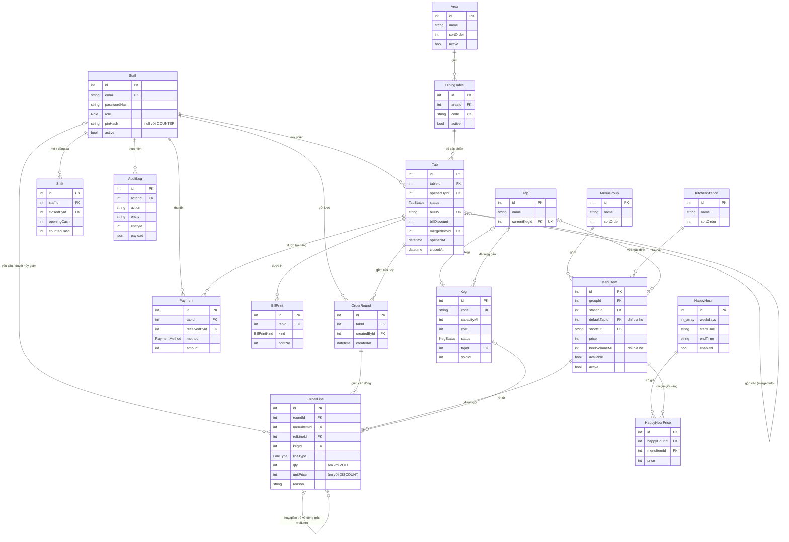

# Thiết kế cơ sở dữ liệu

> Việc BE-D1 (WBS 1.3.1), hạn 10/11/2026. Người soạn: Phí Việt Hiếu (backend).
> Nguồn: SRS v0.2 mục 8 và file [`backend/prisma/schema.prisma`](../backend/prisma/schema.prisma). Nếu tài liệu này và schema lệch nhau thì **schema là bản đúng**, cần sửa lại tài liệu.
> Đặc tả API dùng các bảng này: [`api.md`](api.md).

## 1. Tổng quan

- **Hệ quản trị:** PostgreSQL (Neon hoặc Supabase, gói miễn phí). Truy cập qua Prisma ORM.
- **17 bảng, 6 kiểu enum**, chia thành 5 nhóm:

| Nhóm | Bảng | Phục vụ FR |
|---|---|---|
| Người dùng | `Staff`, `AuditLog` | 01, 13, mọi thao tác ghi |
| Sơ đồ quán | `Area`, `DiningTable` | 02, 12 |
| Thực đơn | `MenuGroup`, `MenuItem`, `KitchenStation`, `HappyHour`, `HappyHourPrice` | 04, 11, 15 |
| Bán hàng | `Tab`, `OrderRound`, `OrderLine`, `Payment`, `BillPrint`, `Shift` | 03 – 09, 16, 18, 19 |
| Bia hơi | `Tap`, `Keg` | 10, 14, 17 |

- **Quy ước chung:**
  - Khóa chính `id` kiểu số nguyên tự tăng.
  - Tiền là **số nguyên VND** (`Int`), không dùng số thực.
  - Thời gian là `timestamp` lưu theo UTC. Các phép tính theo ngày (hôm nay, giờ vàng, doanh thu theo giờ) quy đổi sang giờ Việt Nam (UTC+7) ở backend.
  - Thể tích bia tính bằng **ml** (`Int`).

## 2. Sơ đồ ERD

Bản vẽ chính: [`erd.drawio`](erd.drawio), đủ mọi cột và quan hệ, các bảng tô màu theo 5 nhóm ở mục 1. Mở bằng [app.diagrams.net](https://app.diagrams.net) hoặc extension *Draw.io Integration* của VS Code. Khi đưa vào báo cáo, xuất ra PNG/PDF bằng **File → Export as**.

Bản rút gọn bên dưới (Mermaid) hiện trực tiếp trên GitHub:



Đọc ký hiệu: `||--o{` là một – nhiều; `|o--o{` là khóa ngoại có thể null; `|o--o|` là một – một (có thể null). Sơ đồ chỉ ghi các cột chính, đủ cột ở mục 4.

## 3. Kiểu liệt kê (enum)

| Enum | Giá trị | Ý nghĩa |
|---|---|---|
| `Role` | `COUNTER` · `SHIFT_MANAGER` · `OWNER` | Nhân viên quầy · Quản lý ca · Chủ quán (SRS 2.1) |
| `TabStatus` | `OPEN` · `PAID` · `MERGED` | Đang mở · Đã thanh toán · Đã gộp sang phiên khác |
| `LineType` | `NORMAL` · `VOID` · `DISCOUNT` | Dòng gọi món · Dòng hủy (qty âm) · Dòng giảm giá (đơn giá âm) |
| `PaymentMethod` | `CASH` · `TRANSFER` | Tiền mặt · Chuyển khoản (VietQR) |
| `BillPrintKind` | `PROVISIONAL` · `FINAL` | In tạm tính · Hóa đơn cuối |
| `KegStatus` | `IN_STOCK` · `TAPPED` · `EMPTY` | Trong kho · Đang dùng (gắn trên vòi) · Đã hết |

Mã lý do hủy/giảm (`OrderLine.reason`, `Tab.billDiscountReason`) lưu dạng chuỗi, giá trị cố định: `CUSTOMER_CHANGED_MIND`, `OUT_OF_STOCK`, `WRONG_ENTRY`, `DEFECTIVE`, `OTHER`. Backend kiểm tra giá trị này, CSDL không ràng buộc.

## 4. Từ điển dữ liệu

Ký hiệu cột **Ràng buộc**: PK khóa chính, FK khóa ngoại, UK duy nhất, NN bắt buộc (không null), DF giá trị mặc định.

### 4.1 `Staff` — nhân viên

| Cột | Kiểu | Ràng buộc | Ý nghĩa |
|---|---|---|---|
| `id` | Int | PK | |
| `fullName` | String | NN | Họ tên hiển thị trên phiếu, hóa đơn, nhật ký |
| `email` | String | NN, UK | Tên đăng nhập, lưu chữ thường |
| `passwordHash` | String | NN | Mật khẩu đã băm bcrypt (NFR-05) |
| `role` | Role | NN | Vai trò |
| `pinHash` | String? | | PIN duyệt hủy/giảm đã băm. Chỉ `SHIFT_MANAGER`, `OWNER` có; `COUNTER` luôn null |
| `active` | Boolean | DF `true` | `false` = đã khóa, không đăng nhập được |
| `createdAt` | DateTime | DF now | |

Không xóa nhân viên, chỉ khóa (`active = false`), vì tên họ còn gắn với hóa đơn và nhật ký.

### 4.2 `Area` — khu

| Cột | Kiểu | Ràng buộc | Ý nghĩa |
|---|---|---|---|
| `id` | Int | PK | |
| `name` | String | NN | Vd "Trong nhà", "Sân sau" — mỗi khu là một tab trên sơ đồ bàn |
| `sortOrder` | Int | DF 0 | Thứ tự tab |
| `active` | Boolean | DF `true` | Khu đã ẩn (từng có bàn có lịch sử) |

### 4.3 `DiningTable` — bàn

| Cột | Kiểu | Ràng buộc | Ý nghĩa |
|---|---|---|---|
| `id` | Int | PK | |
| `areaId` | Int | FK → `Area`, NN | Bàn thuộc khu nào |
| `code` | String | NN, UK | Số bàn in trên phiếu (vd "13") |
| `sortOrder` | Int | DF 0 | Thứ tự trong lưới |
| `active` | Boolean | DF `true` | `false` = đã ẩn |

Tên bảng là `DiningTable` (không phải `Table`) để tránh trùng từ khóa SQL. Khi ẩn một bàn đã có lịch sử, backend đổi `code` thành `<code>#<id>` để số bàn được dùng lại cho bàn mới.

### 4.4 `KitchenStation` — khu chế biến

| Cột | Kiểu | Ràng buộc | Ý nghĩa |
|---|---|---|---|
| `id` | Int | PK | |
| `name` | String | NN | Vd "Quầy rót bia", "Bếp nướng" — mỗi khu nhận một phiếu riêng |
| `sortOrder` | Int | DF 0 | Thứ tự in phiếu |

### 4.5 `MenuGroup` — nhóm món

| Cột | Kiểu | Ràng buộc | Ý nghĩa |
|---|---|---|---|
| `id` | Int | PK | |
| `name` | String | NN | Bia, Đồ nướng, Đồ chiên, Đồ nhắm |
| `sortOrder` | Int | DF 0 | Thứ tự trên màn gọi món |

### 4.6 `MenuItem` — món

| Cột | Kiểu | Ràng buộc | Ý nghĩa |
|---|---|---|---|
| `id` | Int | PK | |
| `groupId` | Int | FK → `MenuGroup`, NN | |
| `name` | String | NN | |
| `shortcut` | String | NN, UK | Mã tắt để tìm nhanh, chỉ chữ thường không dấu và số |
| `price` | Int | NN | Giá thường hiện hành. **Không** dùng để tính lại các lượt đã gửi |
| `unit` | String | NN | Đơn vị: cốc, ca, tháp, đĩa… |
| `stationId` | Int | FK → `KitchenStation`, NN | Món được in ra phiếu của khu nào |
| `beerVolumeMl` | Int? | | Thể tích một đơn vị bia hơi (500, 1500, 3000). Null = không phải bia hơi |
| `defaultTapId` | Int? | FK → `Tap` | Vòi rót mặc định. Bắt buộc khi có `beerVolumeMl` (kiểm tra ở backend) |
| `available` | Boolean | DF `true` | `false` = "Hết món", mờ trên màn gọi món |
| `active` | Boolean | DF `true` | `false` = đã ẩn khỏi thực đơn |
| `sortOrder` | Int | DF 0 | |

### 4.7 `HappyHour` — khung giờ vàng

| Cột | Kiểu | Ràng buộc | Ý nghĩa |
|---|---|---|---|
| `id` | Int | PK | |
| `name` | String | NN | |
| `weekdays` | Int[] | NN | Các thứ áp dụng: 1 = Thứ 2 … 7 = Chủ nhật |
| `startTime`, `endTime` | String | NN | Dạng `HH:mm`, giờ Việt Nam. `startTime > endTime` nghĩa là qua nửa đêm |
| `enabled` | Boolean | DF `true` | Bật/tắt |

### 4.8 `HappyHourPrice` — giá giờ vàng của từng món

| Cột | Kiểu | Ràng buộc | Ý nghĩa |
|---|---|---|---|
| `id` | Int | PK | |
| `happyHourId` | Int | FK → `HappyHour`, xóa theo (cascade) | |
| `menuItemId` | Int | FK → `MenuItem` | |
| `price` | Int | NN | Giá ưu đãi |

UK (`happyHourId`, `menuItemId`): một món chỉ có một giá trong mỗi khung. Nếu nhiều khung cùng hiệu lực thì lấy giá thấp nhất.

### 4.9 `Tab` — phiên bàn (hóa đơn)

Một phiên bắt đầu khi mở bàn và kết thúc khi thanh toán hoặc bị gộp sang bàn khác.

| Cột | Kiểu | Ràng buộc | Ý nghĩa |
|---|---|---|---|
| `id` | Int | PK | |
| `tableId` | Int | FK → `DiningTable`, NN | Bàn hiện tại (đổi khi chuyển bàn) |
| `guestCount` | Int? | | Số khách, không bắt buộc. Cộng dồn khi gộp |
| `status` | TabStatus | DF `OPEN` | |
| `openedAt` | DateTime | DF now | |
| `openedById` | Int | FK → `Staff`, NN | |
| `closedAt` | DateTime? | | Lúc thanh toán hoặc lúc bị gộp |
| `billNo` | String? | UK | Số hóa đơn `HD-<yyyyMMdd ngày mở>-<id 4 số>`, ghi khi thanh toán |
| `billDiscount` | Int | DF 0 | Tiền giảm cả hóa đơn (số dương) |
| `billDiscountReason`, `billDiscountNote` | String? | | Lý do giảm hóa đơn, cho nhật ký FR-18 |
| `billDiscountById` | Int? | FK → `Staff` | Người yêu cầu giảm |
| `billDiscountApprovedById` | Int? | FK → `Staff` | Người duyệt bằng PIN |
| `mergedIntoId` | Int? | FK → `Tab` | Phiên đích khi bị gộp |

Chỉ mục: `status`, (`tableId`, `status`) để tìm nhanh phiên đang mở của một bàn, `closedAt` cho báo cáo doanh thu.

### 4.10 `OrderRound` — lượt gọi

Mỗi lần bấm **Gửi** tạo một lượt. Phiếu in cho từng khu chế biến được tách từ các dòng của lượt.

| Cột | Kiểu | Ràng buộc | Ý nghĩa |
|---|---|---|---|
| `id` | Int | PK | |
| `tabId` | Int | FK → `Tab`, NN | Đổi sang phiên đích khi gộp bàn |
| `createdAt` | DateTime | DF now | |
| `createdById` | Int | FK → `Staff`, NN | Người gửi |

### 4.11 `OrderLine` — dòng món

Bảng quan trọng nhất. **Chỉ thêm, không sửa, không xóa.**

| Cột | Kiểu | Ràng buộc | Ý nghĩa |
|---|---|---|---|
| `id` | Int | PK | |
| `roundId` | Int | FK → `OrderRound`, NN | |
| `menuItemId` | Int | FK → `MenuItem`, NN | |
| `qty` | Int | NN | Số lượng. **Âm** với dòng `VOID` |
| `unitPrice` | Int | NN | Đơn giá **chốt lúc gửi** (đã tính giờ vàng). **Âm** với dòng `DISCOUNT` |
| `note` | String? | | Ghi chú cho bếp (vd "ít cay") hoặc ghi chú lý do "Khác" |
| `lineType` | LineType | DF `NORMAL` | |
| `refLineId` | Int? | FK → `OrderLine` | Dòng gốc mà dòng `VOID`/`DISCOUNT` trỏ về |
| `reason` | String? | | Mã lý do hủy/giảm |
| `requestedById` | Int? | FK → `Staff` | Người yêu cầu hủy/giảm |
| `approvedById` | Int? | FK → `Staff` | Người duyệt (chính họ nếu là Quản lý ca/Chủ quán) |
| `tapId` | Int? | | Vòi rót lúc gửi (chỉ món bia hơi) |
| `kegId` | Int? | FK → `Keg` | Keg đang gắn trên vòi lúc gửi. Dòng `VOID` chép lại `kegId` của dòng gốc |
| `createdAt` | DateTime | DF now | |

Chỉ mục: `roundId`, `refLineId`, `kegId` (tính ml đã bán), (`lineType`, `createdAt`) cho nhật ký hủy/giảm.

### 4.12 `Payment` — khoản thanh toán

Một hóa đơn có thể có nhiều khoản (một phần tiền mặt, một phần chuyển khoản). Chỉ thêm, không sửa, không xóa.

| Cột | Kiểu | Ràng buộc | Ý nghĩa |
|---|---|---|---|
| `id` | Int | PK | |
| `tabId` | Int | FK → `Tab`, NN | |
| `method` | PaymentMethod | NN | |
| `amount` | Int | NN | **Số thực thu**: tiền mặt đã trừ tiền thừa trả khách |
| `receivedById` | Int | FK → `Staff`, NN | Thu ngân |
| `createdAt` | DateTime | DF now | Dùng để tính doanh thu theo ca, theo giờ |

### 4.13 `BillPrint` — lần in hóa đơn

| Cột | Kiểu | Ràng buộc | Ý nghĩa |
|---|---|---|---|
| `id` | Int | PK | |
| `tabId` | Int | FK → `Tab`, NN | |
| `kind` | BillPrintKind | NN | |
| `printNo` | Int | NN | Lần in thứ mấy, tăng dần ("Tạm tính — lần in N") |
| `printedAt` | DateTime | DF now | |

Phiên có ít nhất một dòng `PROVISIONAL` thì hiện màu vàng trên sơ đồ bàn.

### 4.14 `Shift` — ca làm việc

| Cột | Kiểu | Ràng buộc | Ý nghĩa |
|---|---|---|---|
| `id` | Int | PK | |
| `staffId` | Int | FK → `Staff`, NN | Người mở ca |
| `openedAt` | DateTime | DF now | |
| `openingCash` | Int | NN | Tiền đầu ca trong két |
| `closedAt` | DateTime? | | Null = ca đang mở |
| `closedById` | Int? | FK → `Staff` | Chỉ Quản lý ca/Chủ quán |
| `countedCash` | Int? | | Tiền mặt đếm được khi đóng ca |
| `cashSales`, `transferSales` | Int? | | Chốt tổng `Payment` theo phương thức trong khoảng [`openedAt`, `closedAt`) |

Chênh lệch = `countedCash − (openingCash + cashSales)`, không lưu mà tính khi đọc.

### 4.15 `Tap` — vòi bia

| Cột | Kiểu | Ràng buộc | Ý nghĩa |
|---|---|---|---|
| `id` | Int | PK | |
| `name` | String | NN | Vd "Vòi 1" |
| `sortOrder` | Int | DF 0 | |
| `currentKegId` | Int? | FK → `Keg`, UK | Keg đang gắn. UK bảo đảm một keg chỉ gắn trên một vòi |

### 4.16 `Keg` — thùng bia

| Cột | Kiểu | Ràng buộc | Ý nghĩa |
|---|---|---|---|
| `id` | Int | PK | |
| `code` | String | NN, UK | Mã `KEG-xxxx`, sinh tự động |
| `beerName` | String | NN | Loại bia |
| `capacityMl` | Int | NN | 30.000 hoặc 50.000 |
| `cost` | Int | NN | Giá nhập, dùng quy đổi hao hụt ra tiền |
| `receivedAt` | DateTime | NN | Ngày nhập |
| `status` | KegStatus | DF `IN_STOCK` | |
| `tapId` | Int? | FK → `Tap` | Vòi đã/đang gắn |
| `tappedAt`, `emptiedAt` | DateTime? | | Lúc gắn lên vòi, lúc tháo ra |
| `soldMl` | Int? | | Số ml đã bán, **chốt** khi keg chuyển sang `EMPTY` |

### 4.17 `AuditLog` — nhật ký thao tác

| Cột | Kiểu | Ràng buộc | Ý nghĩa |
|---|---|---|---|
| `id` | Int | PK | |
| `actorId` | Int | FK → `Staff`, NN | Ai làm |
| `action` | String | NN | Làm gì (bảng dưới) |
| `entity`, `entityId` | String, Int | NN | Trên đối tượng nào |
| `payload` | Json? | | Chi tiết: bàn nguồn/đích, số tiền, giá trị cũ/mới… |
| `createdAt` | DateTime | DF now | |

Các `action` đang dùng:

| Nhóm | Action |
|---|---|
| Phiên bàn | `TAB_OPENED`, `ROUND_SENT`, `TAB_MOVED`, `TAB_MERGED`, `LINE_VOIDED`, `LINE_DISCOUNTED`, `PROVISIONAL_PRINTED`, `TAB_PAID` |
| Ca, keg | `SHIFT_OPENED`, `SHIFT_CLOSED`, `KEG_CHANGED`, `KEGS_RECEIVED` |
| Danh mục | `AREA_CREATED/UPDATED/DELETED`, `TABLE_CREATED/UPDATED/DELETED`, `MENU_GROUP_CREATED/UPDATED`, `STATION_CREATED/UPDATED`, `MENU_ITEM_CREATED/UPDATED`, `HAPPY_HOUR_CREATED/UPDATED/DELETED`, `STAFF_CREATED/UPDATED` |

Nhật ký không bao giờ ghi mật khẩu hay PIN.

## 5. Quy tắc nghiệp vụ trên dữ liệu

### 5.1 Chỉ thêm, không sửa (NFR-04)

`OrderLine`, `Payment`, `AuditLog` chỉ có thao tác `INSERT`. Hủy hoặc giảm giá món tạo **dòng âm** trỏ về dòng gốc:

| Thao tác | Dòng mới | `qty` | `unitPrice` |
|---|---|---|---|
| Gọi 4 cốc bia, 15.000 ₫ | `NORMAL` | 4 | 15.000 |
| Hủy 1 cốc | `VOID`, `refLineId` = dòng gốc | −1 | 15.000 |
| Giảm 10.000 ₫ cho món | `DISCOUNT`, `refLineId` = dòng gốc | 1 | −10.000 |

Dòng âm nằm cùng lượt với dòng gốc. Backend chặn hủy quá số lượng còn lại và giảm quá số tiền còn lại của món.

### 5.2 Tính tiền phiên bàn

```
Tạm tính = Σ (qty × unitPrice) của mọi dòng thuộc các lượt của phiên
Tổng     = Tạm tính − billDiscount
```

Không cần phân biệt loại dòng vì dòng âm đã mang dấu âm. Phiên đã thanh toán thì `Σ Payment.amount = Tổng`.

### 5.3 Chốt giá lúc gửi

Khi gửi lượt, `unitPrice` = giá giờ vàng (nếu có khung đang hiệu lực, lấy giá thấp nhất) hoặc `MenuItem.price`. Đổi giá món sau đó không ảnh hưởng dòng đã gửi. Cùng món nhưng hai đơn giá thì hóa đơn tách thành hai dòng (gộp theo `menuItemId` + `unitPrice`).

### 5.4 Một bàn tối đa một phiên đang mở

Trước khi mở, chuyển, gộp, backend khóa dòng `DiningTable` và `Tab` liên quan bằng `SELECT … FOR UPDATE` trong cùng transaction, khóa theo thứ tự `id` tăng dần để tránh deadlock. Máy mở sau nhận lỗi `TABLE_ALREADY_OPEN` kèm `tabId`.

### 5.5 Chuyển và gộp bàn

- **Chuyển:** chỉ đổi `Tab.tableId`.
- **Gộp:** chuyển mọi `OrderRound` của phiên nguồn sang phiên đích; phiên nguồn → `status = MERGED`, `mergedIntoId` = phiên đích, `closedAt` = lúc gộp. Số khách cộng dồn. Không sao chép dòng món nên tổng phiên đích = tổng hai phiên trước khi gộp.

### 5.6 Theo dõi keg và hao hụt

- Khi gửi món bia hơi, dòng món lưu `tapId` = vòi mặc định của món và `kegId` = keg đang gắn trên vòi đó.
- **Số ml đã bán của keg** = Σ (`qty × MenuItem.beerVolumeMl`) của các dòng `NORMAL` và `VOID` có `kegId` = keg đó (dòng `VOID` có qty âm nên tự trừ). Dòng `DISCOUNT` không tính vì không đổi lượng bia.
- **Thay keg:** keg cũ → `EMPTY`, ghi `emptiedAt`, chốt `soldMl`; keg mới (phải `IN_STOCK`) → `TAPPED`, ghi `tapId`, `tappedAt`; `Tap.currentKegId` trỏ sang keg mới.
- **Hao hụt** = `capacityMl − soldMl`; tiền hao hụt = hao hụt × `cost / capacityMl`.

### 5.7 Không xóa dữ liệu đã có lịch sử

| Đối tượng | Chưa có lịch sử | Đã có lịch sử |
|---|---|---|
| Bàn | Xóa hẳn | Ẩn (`active = false`), giải phóng số bàn |
| Khu | Xóa hẳn | Ẩn. Không xóa được khu còn bàn đang hoạt động |
| Món | — | Chỉ ẩn (`active = false`) |
| Nhân viên | — | Chỉ khóa (`active = false`) |
| Khung giờ vàng | Xóa được (giá đã chốt vào dòng món) | |

## 6. Thay đổi so với bản khởi đầu (SRS 8.2)

Các chỗ bổ sung được đánh dấu `(bổ sung)` trong `schema.prisma`:

| Bảng | Bổ sung | Lý do |
|---|---|---|
| `TabStatus` | Giá trị `MERGED` | Phân biệt phiên đã gộp với phiên đã thanh toán, để báo cáo doanh thu không đếm trùng |
| `Area` | `active` | Ẩn khu đã từng có bàn mà không mất lịch sử |
| `KitchenStation`, `MenuItem`, `Tap` | `sortOrder` | Sắp xếp trên giao diện và thứ tự phiếu in |
| `Tab` | `billDiscountReason`, `billDiscountNote`, `billDiscountById`, `billDiscountApprovedById` | Giảm giá cả hóa đơn phải hiện trong nhật ký hủy/giảm (FR-18) với đủ người yêu cầu, người duyệt |
| `Shift` | `cashSales`, `transferSales` | Chốt số liệu lúc đóng ca, không tính lại khi có khoản thanh toán đến muộn |

## 7. Tạo CSDL và dữ liệu mẫu

```bash
cd backend
npx prisma migrate dev      # tạo bảng theo prisma/migrations
npx prisma db seed          # nạp dữ liệu mẫu (prisma/seed.ts)
npx prisma studio           # xem dữ liệu trên trình duyệt
```

Dữ liệu mẫu (theo SRS 8.3):

| Dữ liệu | Nội dung |
|---|---|
| Nhân viên | `lan@`, `minh@` (Nhân viên quầy), `hung@` (Quản lý ca, PIN `1234`), `hoa@` (Chủ quán, PIN `9999`), `khoa@` (đã khóa) — đuôi `@biahoi.vn` |
| Khu & bàn | Trong nhà (1–30), Sân (31–60), Tầng 2 (61–80) |
| Thực đơn | 4 nhóm, 3 khu chế biến (Quầy rót bia, Bếp nướng, Bếp chiên), 2 món đang "Hết món" |
| Giờ vàng | Bia hơi cốc 12.000 ₫, Ca bia 36.000 ₫, 16:00–18:00 thứ 2 → thứ 6 |
| Vòi & keg | 2 vòi; 5 keg đã hết trong 7 ngày qua (hao hụt 2% – 10%), keg đang gắn hôm nay, 4 keg trong kho |
| Hóa đơn | Hóa đơn đã thanh toán 7 ngày gần nhất; hôm nay có khoảng 20 bàn đang có khách; một số hóa đơn có hủy/giảm món |
| Ca | 3 ca đã đóng của 3 ngày gần nhất |

Keg thứ 3 (`KEG-0003`, 50 L, bán 92 cốc 0,5 L, hao hụt 4 L = 8%) dùng để nghiệm thu FR-17.

Đổi schema: sửa `schema.prisma` → `npx prisma migrate dev --name <ten-thay-doi>` → cập nhật tài liệu này trong cùng Pull Request.
